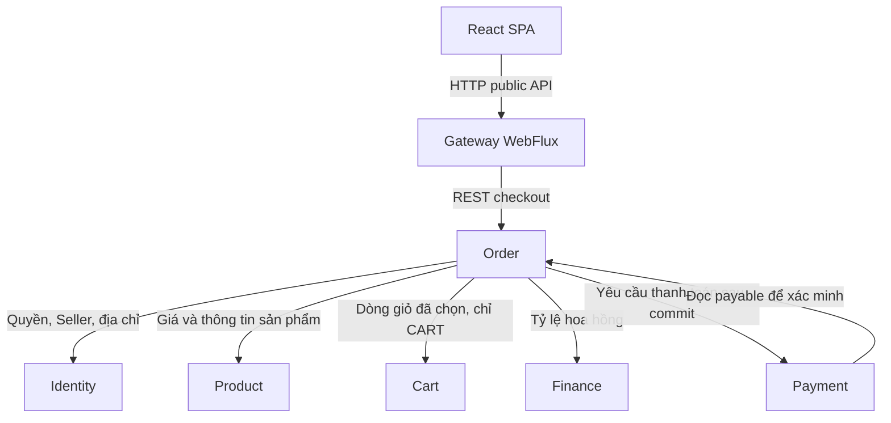
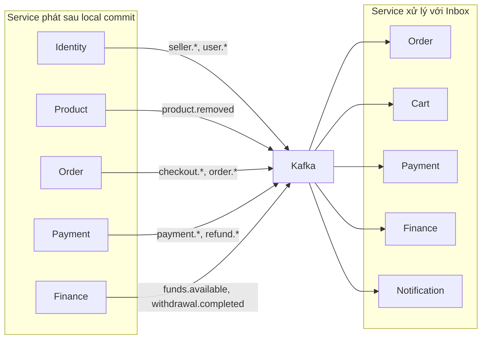
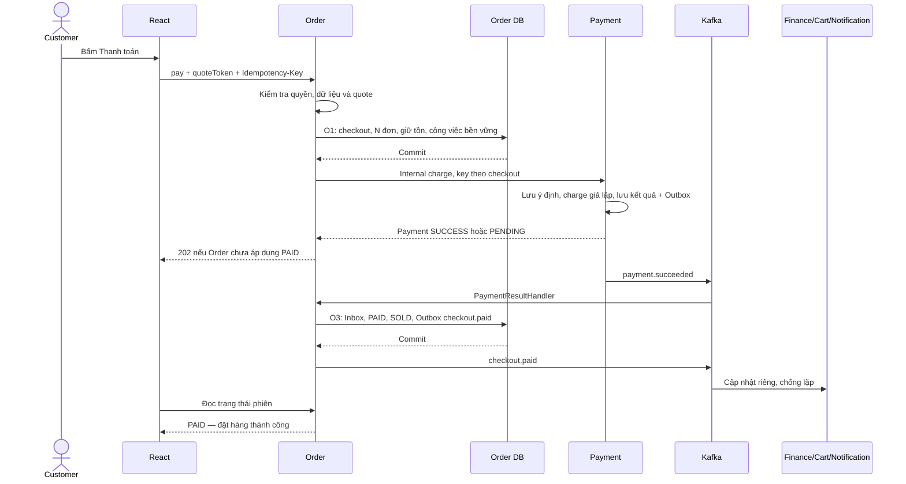

# TÀI LIỆU KIẾN TRÚC PHẦN MỀM

E-commerce đa người bán — MVP

| Thuộc tính | Nội dung |
|---|---|
| Mã tài liệu | SAD-ECOM-01 |
| Phiên bản | 1.1 — bản thiết kế để review |
| Ngày cập nhật | 10/11/2026 |
| Góc nhìn | TO-BE: cách phần mềm cần được tổ chức và hoạt động |
| Phạm vi | 7 service nghiệp vụ, API Gateway, Discovery và một React SPA |
| Nguồn chính | chốt.txt, FRD, API, Database, System Architecture và các quyết định đã xác nhận |
| Trạng thái | Nghiệp vụ đã chốt; chi tiết kỹ thuật đề xuất được đánh dấu riêng; không phải xác nhận triển khai hoàn tất |

## Hướng dẫn sử dụng tài liệu

Tài liệu đi theo ba câu hỏi: **phần mềm gồm những gì**, **các phần phối hợp ra sao**, và **những quy tắc nào phải được giữ khi triển khai**. Phần chính trình bày cấu trúc và hành vi; phụ lục chứa ghi chú triển khai, kiểm thử và vận hành để không ngắt mạch đọc kiến trúc.

Nếu đọc lần đầu, đọc mục 1–2, sau đó mục 4–5. Khi phát triển một service, đọc hồ sơ tương ứng trong mục 3 rồi lần theo các liên kết đến luồng nghiệp vụ và quy tắc chung. Không cần đọc tuần tự toàn bộ phụ lục để hiểu hệ thống.

| Bạn cần làm gì? | Nơi bắt đầu | Đọc tiếp khi cần |
|---|---|---|
| Nắm tổng thể hệ thống phần mềm | Mục 1 và 2 | Mục 4: REST và Kafka |
| Phát triển một service | Mục 3: hồ sơ service | Mục 5: luồng liên quan; phụ lục A: chi tiết kỹ thuật |
| Phát triển frontend | Mục 2.3 | Mục 5.1–5.2 và 6.1–6.3 |
| Biết service nào gọi service nào | Mục 4.2: REST | Mục 4.3: sự kiện Kafka |
| Hiểu đặt hàng, hủy/hoàn, quyết toán | Mục 5 | Mục 6: quy tắc bảo vệ dữ liệu |
| Review quyết định hoặc điểm còn mở | Mục 7 | Phụ lục D: nguồn và lịch sử |
| Viết test, xử lý lỗi hoặc triển khai | Mục 8 | Phụ lục B và C |

### Cách hiểu mức độ ràng buộc

- **Đã chốt:** quyết định từ hồ sơ nguồn hoặc câu trả lời được xác nhận; không thay đổi trong lần tổ chức lại này.
- **Đề xuất kỹ thuật:** phương án thực hiện để đáp ứng quyết định đã chốt; tên lớp, job, bảng kỹ thuật hoặc endpoint mới cần review trước khi đưa vào contract chính thức.
- **TBD/cấu hình:** giá trị chưa chốt. Không lấy ví dụ dev hoặc giá trị đang có trong code làm mặc định nghiệp vụ.

Markdown là bản nguồn để quản lý thay đổi; Word là bản xuất dùng đọc, comment và chia sẻ. Hai bản của phiên bản 1.1 được đối chiếu nội dung; chúng không tự đồng bộ khi người dùng sửa thủ công một file.

## Mục lục

1. [Bối cảnh và phạm vi kiến trúc](#section-1)
2. [Cấu trúc phần mềm và tổ chức mã nguồn](#section-2)
3. [Thiết kế bên trong từng service](#section-3)
4. [Giao tiếp giữa các thành phần](#section-4)
5. [Các luồng nghiệp vụ xuyên service](#section-5)
6. [Các quy tắc thiết kế dùng chung](#section-6)
7. [Quyết định kiến trúc và nội dung cần chốt](#section-7)
8. [Kiểm chứng kiến trúc và điều kiện nghiệm thu](#section-8)

- [Phụ lục A — Ghi chú thiết kế chi tiết để triển khai](#appendix-a)
- [Phụ lục B — Danh mục kiểm thử và truy vết](#appendix-b)
- [Phụ lục C — Hiện trạng, triển khai và vận hành](#appendix-c)
- [Phụ lục D — Nguồn, thuật ngữ và lịch sử](#appendix-d)

<a id="section-1"></a>

## 1. Bối cảnh và phạm vi kiến trúc

### 1.1. Mục đích và quan hệ với hồ sơ dự án

Hệ thống là nền tảng E-commerce nhiều người bán. Một lần mua có thể chứa hàng của nhiều Seller, được tách thành nhiều Order nhưng thanh toán bằng một Payment chung. Order từng Seller được xử lý, hủy/hoàn và quyết toán độc lập sau thanh toán.

Software Architecture mô tả cách tổ chức phần mềm bên trong hệ thống đã chọn: trách nhiệm module, hướng phụ thuộc, ranh giới transaction và cách phối hợp các service. Người triển khai phải tìm được nơi đặt nghiệp vụ và hiểu tác động khi một bước thất bại.

| Tài liệu | Trả lời câu hỏi | Vai trò so với SAD |
|---|---|---|
| FRD | Người dùng và hệ thống cần làm gì? | Nguồn use case và quy tắc nghiệp vụ |
| System Architecture | Có những khối hệ thống và định hướng công nghệ/hạ tầng nào? | Khung kiến trúc đã chọn |
| Software Architecture — tài liệu này | Tổ chức module thế nào; ai thực hiện nghiệp vụ; phối hợp và bảo vệ tính đúng đắn ra sao? | Căn cứ thiết kế/triển khai phần mềm |
| API Specification | Endpoint, DTO, lỗi, quyền và event contract là gì? | Hợp đồng giao tiếp chi tiết; SAD dẫn chiếu và ghi delta cần bổ sung |
| Database Design | Entity, cột, quan hệ và bất biến dữ liệu là gì? | Hợp đồng lưu trữ; SAD giải thích quyền ghi và transaction |

Không sao chép toàn bộ DTO/data dictionary vào SAD. Các phần bổ sung chưa có trong API/Database được gom tại mục 7.2 để review, không sửa ngầm hồ sơ nguồn. Danh mục nguồn, quy tắc ưu tiên và giới hạn đọc tại phụ lục D.1.

### 1.2. Phạm vi phiên bản MVP

Bao gồm tài khoản LOCAL, đăng nhập/đăng xuất, đổi/đặt lại mật khẩu, hồ sơ và địa chỉ; đăng ký/duyệt Seller, cấm/gỡ cấm theo phạm vi; xem/tìm Product và Seller; quản lý sản phẩm và tồn kho; giỏ, Mua ngay, checkout, thanh toán giả lập; xử lý/hủy/từ chối/xác nhận đơn; hoàn tiền và đối soát; quyết toán, ví và rút tiền giả lập; email demo và các tác vụ nền bắt buộc.

Theo S6, phần D04/E02 được giới hạn ở tra cứu vận hành: danh sách và chi tiết đơn, Payment/Refund, Settlement, Wallet, WalletTransaction, Withdrawal và đối soát tiền. Không đưa biểu đồ doanh thu, top sản phẩm, export phân tích hay Reporting Service vào MVP.

Should/Could chỉ có ranh giới mở rộng: Google login; Review; quản lý danh mục qua giao diện Admin; in-app Notification; gợi ý sản phẩm; phần can thiệp Admin ngoài xử lý hoàn tiền lỗi. Danh mục nền cho sản phẩm vẫn phải được seed/migration có kiểm soát; việc chưa xây CRUD Admin không làm mất dữ liệu danh mục cần cho luồng Must.

### 1.3. Ràng buộc và nền tảng đã chốt

| Quyết định đã chốt | Cách áp dụng |
|---|---|
| 7 service nghiệp vụ + Gateway + Discovery | Identity, Product, Cart, Order, Payment, Finance, Notification; không tách Search/Inventory/Seller/Reporting |
| Java 21, Spring Boot, Maven | Mỗi service có module build và Dockerfile riêng |
| Package by Layer | Controller → Service → Repository; package phụ trợ theo vai trò kỹ thuật |
| Spring Cloud Gateway WebFlux | Gateway không dùng starter Gateway MVC; không thực hiện nghiệp vụ hoặc JDBC/OpenFeign blocking trên event loop |
| Một React SPA | TypeScript, Vite, Tailwind CSS; các vùng Customer/Seller/Admin dùng chung phiên |
| PostgreSQL 16, dữ liệu thuộc từng service | Không đọc/ghi bảng service khác; không join xuyên quyền sở hữu |
| REST/OpenFeign và Kafka | Đồng bộ cho thông tin cần ngay; sự kiện cho hệ quả sau commit |
| Local transaction, Outbox/Inbox | Không 2PC, transaction xuyên service hay framework Saga riêng |
| AWS | Hạ tầng cụ thể thuộc phương án triển khai, không được coi là đã chạy |
| SIMULATOR | Không COD, nhập thẻ, tài khoản ngân hàng hoặc chuyển tiền thật |

Trong service nghiệp vụ dùng mô hình Spring MVC + JPA/JDBC thông thường. Chỉ Gateway cần reactive. Không áp dụng CQRS toàn hệ thống, Event Sourcing, service mesh, Kubernetes, Redis hoặc abstraction repository tổng quát khi chưa có yêu cầu chứng minh cần thiết. Kafka và Outbox/Inbox được giữ vì là quyết định đã chốt và phục vụ phục hồi giao dịch.

### 1.4. Các yêu cầu chi phối thiết kế

Bốn yêu cầu dẫn dắt thiết kế: không bán vượt tồn; không thu/hoàn/ghi ví trùng; kiểm tra quyền hiện hành và ownership; tiếp tục được công việc đã nhận sau lỗi. Chúng quan trọng hơn việc tối ưu số lần gọi mạng hoặc thêm thành phần công nghệ.

| Tình huống | Yêu cầu kiến trúc |
|---|---|
| Hai khách mua lượng tồn cuối | Order giữ/cập nhật tồn trong transaction cục bộ, có khóa/điều kiện và constraint |
| Request hoặc event bị gửi lại | Khóa nghiệp vụ và idempotency bảo vệ hiệu ứng, không chỉ nhận diện message |
| Payment đã thu nhưng Order chưa cập nhật | Hiển thị đang xác nhận; có sự kiện và đối soát để hội tụ; không thu lần hai |
| Service dừng sau khi commit | Ý định và event đã lưu bền vững; worker tiếp tục sau restart |
| Người dùng đổi ID tài nguyên hoặc bị cấm | Service kiểm tra permission, trạng thái và ownership tại backend |
| Notification hoặc Kafka tạm lỗi | Không mất giao dịch đã commit; giữ việc chờ, retry có kiểm soát |

Chi tiết cơ chế ở mục 5–6; tiêu chí kiểm chứng ở mục 8 và phụ lục B.

<a id="section-2"></a>

## 2. Cấu trúc phần mềm và tổ chức mã nguồn

Mục này xác định ranh giới thành phần và hướng phụ thuộc trong code. Các kết nối REST/Kafka được trình bày riêng ở mục 4; không suy ra giao thức chỉ từ việc hai service cùng xuất hiện trong một nhóm nghiệp vụ.

### 2.1. Bản đồ trách nhiệm và dữ liệu

| Thành phần | Trách nhiệm chính | Dữ liệu nghiệp vụ sở hữu |
|---|---|---|
| React SPA | Giao diện Customer/Seller/Admin, gọi API, thể hiện trạng thái do server xác nhận | Không sở hữu dữ liệu nghiệp vụ chính thức |
| Gateway | Điểm vào public, định tuyến, kiểm tra JWT ở biên, CORS/rate limit | Không có DB nghiệp vụ |
| Identity | Tài khoản, phiên, RBAC, hồ sơ và xét duyệt Seller, địa chỉ/địa giới | User, Customer, Seller, RBAC, CustomerAddress, session/reset/audit |
| Product | Sản phẩm, danh mục và tìm kiếm; Review khi triển khai Should | Product, Category; Review ở phạm vi mở rộng |
| Cart | Giỏ hàng của Customer và áp dụng lượng hàng đã mua | Cart, CartItem |
| Order | Checkout, đơn, điều phối thanh toán, fulfillment và tồn kho | CheckoutSession, Order, OrderItem, Inventory, Reservation, StockMovement |
| Payment | Kết quả thu/hoàn giả lập và đối soát giao dịch | Payment, Refund, dữ liệu simulator |
| Finance | Quyền hưởng tiền theo Order, ví, bút toán và rút tiền giả lập | Settlement, Wallet, WalletTransaction, Withdrawal |
| Notification | Tạo và gửi email demo từ sự kiện đã xảy ra | Notification/delivery records |
| Discovery | Đăng ký và tra cứu instance Eureka | Không có DB nghiệp vụ |

Mỗi service chỉ ghi dữ liệu do mình sở hữu. Ví dụ Product có thể yêu cầu tạo Inventory nhưng Order mới là nơi ghi Inventory; Payment có thể thông báo thu thành công nhưng Order mới cập nhật Order PAID. Đây là ranh giới nghiệp vụ, không phụ thuộc việc dev đang dùng một hay nhiều PostgreSQL instance.

### 2.2. Cấu trúc backend và hướng phụ thuộc

```text
src/main/java/com/example/<service>/
  controller/       # Public và internal REST controllers
  service/          # Use case, state transition, điều phối và transaction
  repository/       # JPA repository, JDBC/SQL có điều kiện
  entity/           # Entity và enum cục bộ
  dto/              # Request, response, internal DTO, event payload
  client/           # OpenFeign client; adapter HTTP
  messaging/        # Kafka listener, Outbox relay, event serialization
  job/              # Scheduler gọi service; không giữ nghiệp vụ riêng
  security/         # JWT, service credential, authorization và ownership helpers
  config/           # Properties, Clock, client và framework configuration
  exception/        # Business exception, error mapping
src/main/resources/
  db/migration/     # SQL có version do service sở hữu
  application*.properties
src/test/           # Test theo use case và rủi ro
```

Chỉ tạo package khi có thành phần cần dùng. Không bắt buộc mỗi lớp Service có một interface và một Impl. Interface dùng tại biên có khả năng thay thế thực tế: PaymentGateway, EmailAdapter và client/adapter kiểm thử. Entity không trả trực tiếp qua REST; DTO không chứa JPA proxy. Không chia sẻ entity, repository hoặc business service giữa các service.

Controller nhận request và gọi Service. Service thực thi use case, điều kiện chuyển trạng thái và transaction. Repository chỉ đọc/ghi DB cục bộ. Client gọi REST ngoài service; Listener và Job chuyển đầu vào tới cùng nghiệp vụ Service, không tạo một bản logic khác cho mỗi cách kích hoạt.

Hướng chính: Controller/Listener/Job → Service → Repository. Service cũng có thể gọi Client hoặc ghi Outbox theo luồng đã thiết kế. Repository không gọi HTTP; Controller không trực tiếp cập nhật nhiều bảng để thực thi một use case. Entity không trả trực tiếp qua REST; DTO không chứa JPA proxy.

Chỉ tạo interface ở biên cần thay thế thực tế, như PaymentGateway hoặc EmailAdapter. Không bắt buộc Service/ServiceImpl cho mọi lớp; không dùng chung entity/repository giữa các service. Tên lớp trong mục 3 và phụ lục A là đề xuất, không phải yêu cầu refactor toàn bộ code hiện tại ngay lập tức.

Các thao tác gọi mạng và transaction được tách rõ; ví dụ Order chuẩn bị dữ liệu qua REST trước, commit checkout/giữ tồn, rồi mới gọi Payment. Ghi chú Spring @Transactional và cấu trúc bean tại phụ lục A.2.

### 2.3. Cấu trúc React SPA

```text
src/
  app/           # Router, providers, bootstrap
  api/           # HTTP client, envelope, refresh coordination
  auth/          # Access token memory, user profile, route guards
  features/      # catalog, cart, checkout, orders, seller, wallet, admin
  components/    # Thành phần giao diện dùng lại
  layouts/       # Customer, Seller, Admin
```

Một SPA dùng routes `/`, `/seller/*`, `/admin/*`. State toàn cục tối thiểu là phiên và hồ sơ quyền; giỏ/đơn/ví lấy từ server, state form giữ tại feature. Không nhân bản state machine tài chính trong frontend. Route guard và allowedActions chỉ hỗ trợ giao diện; backend kiểm tra lại mọi thao tác.

Auth/route guard hỗ trợ trải nghiệm; backend vẫn quyết định quyền. Access token giữ trong memory, refresh token là cookie do Identity quản lý (mục 6.3). UI checkout phải phân biệt đã PAID, đang xác nhận và CLOSED; không suy thất bại từ timeout HTTP (mục 5.2).

Không cần WebSocket để hoàn thành MVP; polling trạng thái là đủ. Chu kỳ và giới hạn chờ là cấu hình/TBD. Sổ cấu hình ở mục 7.3.

### 2.4. Gateway, Discovery và biên mở rộng

Gateway dùng Spring Cloud Gateway WebFlux, định tuyến public theo API Specification. Các service nghiệp vụ dùng Spring MVC/JPA/JDBC thông thường; không chuyển toàn bộ backend sang reactive. Gateway không chạy checkout, không ghi DB nghiệp vụ và không dùng OpenFeign blocking trên event loop. Nếu gọi Identity từ Gateway, dùng HTTP client reactive phù hợp.

Discovery chỉ cung cấp instance, không là nguồn quyền hay bộ điều phối. Không mặc định có cân bằng tải đúng chỉ vì đã thêm Eureka/OpenFeign dependency; cần cấu hình và kiểm chứng khi triển khai.

Các chức năng Should/Could giữ trong service đã sở hữu miền tương ứng: Google trong Identity, Review và gợi ý trong Product, in-app trong Notification. Chúng không làm xuất hiện thêm service và không chặn hoàn thành Must. Ranh giới mở rộng chi tiết tại phụ lục A.7.

<a id="section-3"></a>

## 3. Thiết kế bên trong từng service

Mỗi hồ sơ dưới đây có cùng cấu trúc: trách nhiệm, module ứng dụng, kết nối và ranh giới nhất quán. Đây là bản đồ để đặt code; tên module là trách nhiệm logic, không bắt buộc một module phải thành Maven module hoặc một lớp riêng.

### 3.1. Identity — tài khoản, hồ sơ và quyền

**Trách nhiệm.** Identity là nguồn danh tính và quyền duy nhất. Một User có thể đồng thời có Customer/Seller và nhiều vai trò; không có ba hệ đăng nhập riêng.

| Module ứng dụng | Trách nhiệm |
|---|---|
| Xác thực và phiên | Đăng ký LOCAL, login, refresh rotation, logout, đổi/đặt lại mật khẩu. |
| RBAC và authorization context | Cấp/thu hồi role; trả trạng thái User, hồ sơ, session và quyền hiện hành cho service. |
| Hồ sơ và xét duyệt Seller | Đăng ký/nộp lại/approve/reject; cấm theo scope USER/CUSTOMER/SELLER; ghi audit. |
| Địa chỉ và RegionCatalog | Quản lý địa chỉ Customer; cung cấp dataset địa giới hai cấp nội bộ có version. |

**Kết nối.** Nhận API tài khoản/hồ sơ và internal authorization/status/contact. Gọi Order qua REST khi đánh giá Customer có đơn đã trả tiền lúc cấm. Phát seller.* và user.* sau commit; không dùng event thay việc kiểm tra quyền hiện hành.

**Ranh giới nhất quán.** Tạo User/Customer/role hoặc approve Seller/role/authzVersion/audit/Outbox trong transaction Identity. Hồ sơ Customer/Seller dùng shared PK User; role và trạng thái hồ sơ đều phải được kiểm tra. Cấm Seller không đồng nghĩa disable User.

**Tra cứu tiếp.** Mục 6.1–6.3; địa chỉ/địa giới ở mục 6.7; chi tiết đăng ký, token và khóa quyền ở phụ lục A.3.

### 3.2. Product — sản phẩm và tìm kiếm

**Trách nhiệm.** Product sở hữu nội dung sản phẩm, danh mục và khả năng hiển thị bán. Inventory chính thức thuộc Order.

| Module ứng dụng | Trách nhiệm |
|---|---|
| Sản phẩm | Tạo/sửa/ẩn/bật bán, ownership Seller, gỡ/khôi phục của Admin. |
| Danh mục và tìm kiếm | Đọc danh mục nền; tìm Product không dấu/không phân biệt hoa thường bằng PostgreSQL unaccent. |
| Khởi tạo tồn | Lưu việc yêu cầu Order tạo Inventory và giữ Product HIDDEN đến khi xác nhận. |
| Media | Ký upload URL, kiểm tra object trước khi gắn; Review là điểm mở rộng Should. |

**Kết nối.** Nhận API Product public/Seller/Admin. Gọi Identity kiểm tra Seller và Order tạo/đọc tồn qua REST. Cung cấp batch Product cho Cart/Order. Phát product.removed cho thông báo theo hợp đồng.

**Ranh giới nhất quán.** Transaction chỉ ghi Product/Category và việc phải tiếp tục. Không rollback giả định Inventory ở DB khác. Retry cùng productId; chỉ bật bán khi tồn đã sẵn sàng và policy vẫn hợp lệ.

**Tra cứu tiếp.** Luồng tạo sản phẩm ở mục 5.7; tìm kiếm/media ở mục 6.7; chi tiết ở phụ lục A.6.

### 3.3. Cart — giỏ hàng

**Trách nhiệm.** Cart lưu ý định mua của Customer. Giỏ không khóa giá, không giữ tồn và không là nguồn tổng tiền chính thức của checkout.

| Module ứng dụng | Trách nhiệm |
|---|---|
| Giỏ hàng | Một Cart/Customer, thêm/sửa/xóa các CartItem của owner. |
| Đọc giỏ hiện hành | Ghép dữ liệu Product, Seller và tồn qua API; không join DB khác. |
| Snapshot cho checkout | Trả các dòng Customer chọn, cartItemId/productId/quantity/version cho Order. |
| Áp dụng hàng đã mua | Nhận checkout.paid, giảm đúng lượng snapshot trên đúng dòng; chống lặp. |

**Kết nối.** Gọi Product/Identity/Order qua REST để hiển thị dữ liệu hiện hành. Order đọc snapshot Cart qua internal API đề xuất. Cart nhận checkout.paid bằng Kafka; BUY_NOW không gọi hoặc cập nhật Cart.

**Ranh giới nhất quán.** Cart mutation và dấu Inbox nằm trong DB Cart. Xóa rồi thêm lại tạo dòng mới để không giảm nhầm. Giữ lượng khách thêm sau snapshot; event lặp không giảm lần hai.

**Tra cứu tiếp.** Mục 5.1 và 6.5; chi tiết snapshot/dedupe ở phụ lục A.5.

### 3.4. Order — checkout, đơn hàng và tồn kho

**Trách nhiệm.** Order điều phối đặt hàng và sở hữu toàn bộ thay đổi CheckoutSession/Order/Inventory. Giữ Inventory cùng Order giúp tạo đơn và giữ hàng nguyên tử trong một DB.

| Module ứng dụng | Trách nhiệm |
|---|---|
| Checkout | Preview/quote, lấy dữ liệu đầu vào, tạo CheckoutSession và N Order theo Seller. |
| Điều phối thanh toán | Gọi Payment sau commit; theo dõi kết quả; tiếp tục ý định đã lưu sau lỗi. |
| Quản lý đơn | Hủy, PACKING, DELIVERED, CONFIRMED, lý do và quyền thao tác. |
| Tồn kho và tác vụ quá hạn | Giữ/trừ/nhả/hoàn tồn; J1/J3/J4; áp dụng kết quả Payment bằng cùng handler. |

**Kết nối.** Gọi Identity, Product, Cart, Finance và Payment bằng REST khi cần dữ liệu/kết quả trực tiếp. Nhận payment.succeeded/failed và sự kiện policy liên quan. Phát checkout.* và order.* sau commit cho các service khác.

**Ranh giới nhất quán.** Tạo checkout/N Order/Reservation cùng giữ tồn trong một transaction. Áp dụng Payment hợp lệ cập nhật toàn bộ N Order và SOLD cùng transaction khác. Không giữ khóa DB khi gọi Payment và không ghi bảng Payment/Wallet.

**Tra cứu tiếp.** Mục 5.1–5.4, 6.4–6.5; cơ chế phục hồi chi tiết ở phụ lục A.1.

### 3.5. Payment — thanh toán và hoàn tiền

**Trách nhiệm.** Payment là nguồn trạng thái thu/hoàn. MVP chỉ có SIMULATOR; không phát sinh tiền thật.

| Module ứng dụng | Trách nhiệm |
|---|---|
| Charge | Một Payment logic/checkout, kiểm tra payable và ghi ý định trước khi gọi gateway. |
| Refund | Một nghĩa vụ hoàn/Order hoặc hoàn toàn bộ phiên CLOSED; giữ key qua retry. |
| PaymentGateway | Biên charge/refund/query, cài đặt bằng SimulatedGateway trong MVP. |
| Đối soát | J2/J2b/J5 và theo dõi SUCCESS chưa được Order áp dụng; manual review có kiểm soát. |

**Kết nối.** Order yêu cầu charge/query qua REST nội bộ. Payment đọc payable của Order và eligibility Identity. Nhận order.cancelled bằng Kafka để tạo Refund. Phát payment.* và refund.*; không trực tiếp đổi Order PAID hoặc số dư ví.

**Ranh giới nhất quán.** Payment/Refund/ý định/Outbox thuộc transaction Payment. Gọi simulator ngoài transaction giữ khóa. Tạo nghĩa vụ hoàn dưới Payment lock, chống ORDER và FULL_CHECKOUT chồng lặp.

**Tra cứu tiếp.** Mục 5.2–5.3; simulator và recovery ở phụ lục A.4.

### 3.6. Finance — quyết toán, ví và rút tiền

**Trách nhiệm.** Finance sở hữu quyền hưởng tiền của Seller và nền tảng theo từng Order. Wallet là sổ số dư giả lập, không phải số dư ngân hàng.

| Module ứng dụng | Trách nhiệm |
|---|---|
| Settlement | Tạo khoản chờ từ checkout.paid; quyết toán khi order.confirmed; theo dõi PENDING_REFUND/REFUNDED. |
| Wallet và ledger | Pending/available/withdrawn, bút toán append-only, business dedupe. |
| Withdrawal | Rút giả lập tức thời từ available, transaction có điều kiện và idempotency. |
| Đối soát | Kiểm tra ledger/Settlement/Wallet và số liệu Payment; tra cứu vận hành theo quyền. |

**Kết nối.** Nhận checkout.paid, order.cancelled, order.confirmed, refund.succeeded và seller/user lifecycle qua Kafka. REST tới Identity để kiểm tra quyền hiện hành và Payment để đối soát. Cung cấp commission-rate cho Order. Phát funds.available/withdrawal.completed.

**Ranh giới nhất quán.** Chuyển Settlement, cập nhật các Wallet, ghi ledger/Inbox/Outbox trong một transaction Finance. Không quyết định kết quả thu/hoàn từ Notification và không sửa DB Payment/Order.

**Tra cứu tiếp.** Mục 5.5–5.6; công thức và đối soát ở mục 6.6; ledger chi tiết ở phụ lục A.5.

### 3.7. Notification — thông báo

**Trách nhiệm.** Notification xử lý hệ quả thông tin sau khi nghiệp vụ đã commit. Email demo là Must; in-app là Should.

| Module ứng dụng | Trách nhiệm |
|---|---|
| Tiếp nhận và mẫu nội dung | Nhận event hoặc API nội bộ allowlist; suy recipient/context và template. |
| Delivery và chống trùng | Lưu công việc gửi theo event/channel/recipient/context, theo dõi retry. |
| EmailAdapter | DemoEmailAdapter trong MVP; không tuyên bố giao email thật. |
| In-app mở rộng | Read/unread/soft delete chỉ khi triển khai Should. |

**Kết nối.** Nhận các sự kiện checkout/order/refund/funds/withdrawal và account/product liên quan. Gọi Identity lấy contact qua REST. Không có public API cho client tự tạo email/thông báo.

**Ranh giới nhất quán.** Lưu delivery/dedupe trước gửi; gọi adapter ngoài transaction. Email lỗi không rollback Order hoặc Withdrawal. Dữ liệu reset mật khẩu đi đường riêng hạn chế truy cập.

**Tra cứu tiếp.** Mục 4.3 và 6.7; delivery/secret/dedupe chi tiết ở phụ lục A.6.

<a id="section-4"></a>

## 4. Giao tiếp giữa các thành phần

### 4.1. Khi nào dùng REST, khi nào dùng Kafka?

Hệ thống dùng cả REST và Kafka. Gọi REST khi bước hiện tại cần dữ liệu hoặc cần yêu cầu một service thực hiện công việc. Phát event qua Kafka để thông báo một sự việc đã commit và cho các service khác xử lý hệ quả. Không phải mọi kết nối giữa service đều qua Kafka.

| Mục đích | Cơ chế | Ví dụ |
|---|---|---|
| Lấy dữ liệu để quyết định bước tiếp | REST đồng bộ | Order lấy giá Product, địa chỉ Identity, commission Finance |
| Gửi yêu cầu nghiệp vụ cần phản hồi trực tiếp | REST có idempotency khi cần | Order yêu cầu Payment thanh toán sau commit checkout |
| Thông báo kết quả đã lưu | Kafka + Outbox | Payment đã lưu SUCCESS phát payment.succeeded |
| Thực hiện hệ quả sau nghiệp vụ | Kafka + Inbox | Finance ghi chờ, Cart giảm dòng đã mua, Notification gửi email |
| Tra cứu/đối soát khi chưa rõ kết quả | REST từ job/service được phép | Order hỏi Payment trạng thái checkout, Payment hỏi Order kết quả áp dụng |

Ví dụ: **Order yêu cầu thanh toán bằng REST; Payment thông báo đã thu bằng Kafka; Order thông báo checkout đã PAID bằng Kafka.** REST response SUCCESS của Payment chưa thay cho transaction cập nhật Order.

### 4.2. Góc nhìn REST

Hình 1 chỉ vẽ các lời gọi REST chính của checkout để tránh chồng quá nhiều đường. Các kết nối REST khác được liệt kê ngay dưới hình. Hình này không có Kafka; mọi mũi tên biểu diễn lời gọi HTTP, bên nhận trả response về bên gọi.



| Bên gọi → Bên cung cấp | Mục đích | Ràng buộc |
|---|---|---|
| React → Gateway → service sở hữu | Auth, catalog, cart, order, wallet và tra cứu Payment/Refund | Chỉ public routes trong API Specification; không public internal |
| Service bảo vệ → Identity | Authorization context, trạng thái tài khoản/hồ sơ | JWT người dùng + service credential theo contract; không cache quyết định quyền |
| Order → Identity/Product/Cart/Finance | Dữ liệu chính thức để Preview và tạo checkout | Batch khi phù hợp; BUY_NOW không đọc Cart; lời gọi ngoài transaction ghi |
| Order → Payment | Charge sau commit; query Payment/Refund | Key ổn định theo checkout/nghĩa vụ; timeout không suy FAILED |
| Payment → Order/Identity | Kiểm tra payable, owner và eligibility trước charge mới; phối hợp đóng/đối soát | Không giữ transaction Payment trong HTTP |
| Product → Order/Identity | Khởi tạo/đọc tồn, kiểm tra Seller | Product không ghi Inventory; cùng productId qua retry |
| Cart → Product/Order/Identity | Giá/tồn/trạng thái Seller để hiển thị giỏ | Không giữ hàng hoặc chốt giá |
| Identity → Order | has-paid-order khi cấm Customer | Lưu policy snapshot tại thời điểm cấm; không cấm một phần nếu nguồn lỗi |
| Finance → Payment/Identity | Đối soát thu/hoàn, kiểm tra quyền rút hiện hành | Không đọc trực tiếp DB nguồn |
| Notification → Identity | Contact của người nhận được xác định từ nghiệp vụ | Allowlist, không cho client tùy ý gửi email đích |

OpenFeign dùng trong các service nghiệp vụ theo quyết định đã chốt. Gateway WebFlux dùng HTTP client reactive nếu có lời gọi Identity. Các API mới/thiếu như Cart snapshot hoặc internal charge được đánh dấu đề xuất ở mục 7.2 và phụ lục A.1.

### 4.3. Góc nhìn sự kiện Kafka

Hình 2 chỉ vẽ publish/consume, không thể hiện REST. Một service có thể vừa phát vừa nhận, nên tên được lặp ở hai phía để phân biệt vai trò; không có thêm service triển khai.



Danh mục sau xác định consumer theo event; hình không có nghĩa mọi consumer nhận mọi loại event.

| Sự kiện | Producer → Consumer chính | Ý nghĩa nghiệp vụ |
|---|---|---|
| payment.succeeded / payment.failed | Payment → Order | Kết quả thu đã lưu; Order áp dụng PAID hoặc đóng phiên |
| checkout.paid | Order → Cart, Finance, Notification | Order đã áp dụng thanh toán/kho: giảm Cart, ghi chờ, thông báo |
| checkout.closed | Order → Notification; đối soát Payment theo contract được review | Phiên đã đóng, kèm lý do; không tự nói đã hoàn tiền |
| order.cancelled | Order → Payment, Finance, Notification | Nếu đã thu: tạo nghĩa vụ Refund, chuyển khoản chờ hoàn, thông báo |
| order.delivered | Order → Notification | Seller đã xác nhận giao; bắt đầu hạn Customer xác nhận |
| order.confirmed | Order → Finance, Notification | Đủ điều kiện quyết toán, chưa đồng nghĩa Finance đã commit tiền khả dụng |
| refund.succeeded | Payment → Finance, Order, Notification | Kết quả hoàn đã lưu; scope ORDER mới giảm khoản chờ của Settlement |
| seller.approved / seller.banned và user.* liên quan | Identity → Finance, Order, Notification tùy loại | Khởi tạo ví hoặc xử lý policy; API vẫn xác minh quyền hiện hành |
| product.removed | Product → Notification | Thông báo Seller sản phẩm bị gỡ |
| funds.available / withdrawal.completed | Finance → Notification | Kết quả tiền đã được Finance commit |

Outbox giữ event cùng transaction dữ liệu nguồn. Inbox và business key chống áp dụng lặp ở consumer. Chi tiết envelope/topic/retry chỉ cần đọc khi triển khai tích hợp, tại phụ lục A.4–A.5. Version event không thay thế kiểm tra trạng thái hoặc xử lý phụ thuộc.

### 4.4. Hợp đồng public/internal và quản lý thay đổi

Public base `/api/v1`, internal base `/internal/v1`; JSON camelCase; DB snake_case; UUID cho định danh; timestamp UTC ISO 8601, DB TIMESTAMPTZ. VND nguyên với cột BIGINT; dùng phép toán có kiểm tra tràn, không float/double cho tiền. Giới hạn số tiền phải bảo đảm khả năng biểu diễn an toàn ở frontend hoặc có quy ước chuỗi số trong contract; không âm thầm đổi kiểu JSON giữa các service.

Giữ envelope của S3: thành công `{data,...}`, danh sách có meta; lỗi `{error:{code,message,details,requestId}}`. Request/response có X-Request-Id. Chỉ nhận field sort/filter allowlist, parameterized query; pagination và giới hạn theo tham số được chốt. Không tự coi ví dụ page size hoặc timeout là mặc định chính thức.

Mỗi service có OpenAPI riêng. Không đổi public Product paths `/products`, `/categories`, `/seller/products`, `/admin/products`, `/admin/categories`; internal Product giữ `/catalog/**`. Cổng Gateway local hiện tại trong repo là 8081, không lấy URL mẫu 8080 của API làm bằng chứng cấu hình đang chạy.

| Hợp đồng | Hành vi |
|---|---|
| POST /orders/checkout/preview | CART hoặc BUY_NOW; kiểm tra chỉ đọc, trả báo giá, issues, canPlaceOrder và quoteToken |
| POST /orders/checkout/pay | Idempotency-Key bắt buộc; nhận lựa chọn hàng, addressId, SIMULATOR và quoteToken; Order điều phối |
| API đọc checkout theo ID/phiên hiện hành | Theo ownership; trả trạng thái Order xác nhận, Payment view và closeReason; tiếp tục dùng nhóm route đọc ở S3 §6.4 |
| Internal Payment charge | Đề xuất POST /internal/v1/payments; chỉ Order; khởi tạo hoặc trả Payment logic cũ của checkout |
| Public POST /payments và POST /orders/checkout-sessions cũ | Không còn là hai bước client tự thực hiện; đóng route ghi cũ trong OpenAPI/Gateway khi cutover |

Kết quả pay theo phụ lục S3: 200 khi trạng thái cuối tại Order đã xác nhận; 202 khi còn xử lý; kèm checkoutSessionId, status AWAITING_PAYMENT/PAID/CLOSED, paymentStatus NONE/PENDING/SUCCESS/FAILED, orderIds, isSimulated. Có closeReason khi CLOSED. Endpoint đọc cũ dùng enum hiển thị 5 trạng thái phải được map tường minh từ CLOSED + closeReason; không có hai enum lưu trong DB.

Các field, mã lỗi hoặc endpoint bổ sung trong SAD chưa tự trở thành hợp đồng API đã phê duyệt. Trước triển khai phải đồng bộ OpenAPI, event schema và migration tương ứng, có contract test; danh mục delta ở mục 7.2. Không triển khai đồng thời public flow checkout cũ và mới mà không có quyết định chuyển đổi rõ ràng.

<a id="section-5"></a>

## 5. Các luồng nghiệp vụ xuyên service

Mỗi luồng chỉ ra service chịu trách nhiệm, cách giao tiếp, transaction và kết quả người dùng nhìn thấy. Tên O1/P1/O3 dưới đây là nhãn bước để trao đổi thiết kế, không buộc tạo đúng tên lớp hay một framework workflow riêng.

### 5.1. Đặt hàng từ giỏ hoặc Mua ngay

**Điểm bắt đầu:** Customer mở Preview. **Kết quả thành công:** Order đã áp dụng thanh toán và chuyển PAID. Preview chưa tạo đơn/giữ hàng; Payment SUCCESS riêng lẻ chưa đủ để giao diện báo đặt hàng thành công.

Order xác minh quyền Customer, số điện thoại, địa chỉ và danh mục địa giới; với CART đọc các dòng được chọn từ Cart của Customer; BUY_NOW chỉ dùng productId/quantity, không gọi Cart. Batch đọc Product và trạng thái Seller; đọc tỷ lệ hoa hồng từ Finance, xác minh quote. Các bước HTTP xảy ra ngoài transaction ghi Order.

S3 chưa liệt kê API nội bộ đọc snapshot giỏ. Bổ sung đề xuất `POST /internal/v1/cart/checkout-items` chỉ cho Order, nhận Customer và cartItemIds, trả productId, quantity, cartItemId, rowVersion; phải xác minh ownership. Không mở endpoint này cho browser, không đọc DB Cart trực tiếp.

Snapshot giá, địa chỉ, tên địa giới, nguồn checkout và tỷ lệ hoa hồng được lưu tại lúc tạo checkout. Giữa kiểm tra liên service và commit có cửa sổ đồng thời; không tuyên bố có snapshot nguyên tử xuyên DB. Thay đổi sau khi snapshot được xử lý theo quy tắc đơn đã tạo và kiểm tra lại eligibility khi bắt đầu thu.

Bảng sau là các ranh giới xử lý. Ý định gọi Payment phải được lưu cùng O1 để không mất công việc nếu tiến trình dừng ngay sau commit; cơ chế worker/lease cụ thể là đề xuất trong phụ lục A.1.

| Bước | Giao tiếp / transaction | Kết quả |
|---|---|---|
| Preview | Order đọc dữ liệu qua REST, kiểm tra chỉ đọc | Trả giá, issues và quoteToken; chưa có Order/Reservation |
| Customer bấm Thanh toán | REST /orders/checkout/pay, Idempotency-Key và quoteToken | Kiểm tra quyền, lựa chọn hàng, địa chỉ, quote và dữ liệu hiện hành |
| O1 — tạo checkout | Local transaction Order | Một CheckoutSession, N Order theo Seller, OrderItem, giữ đủ tồn và lưu ý định gọi Payment; thiếu một dòng thì rollback toàn bộ |
| Gọi Payment | REST sau O1 commit | Payment kiểm tra payable/eligibility và chỉ có một Payment logic |
| P1/P2 — thu giả lập | Lưu ý định trong Payment; gọi simulator ngoài transaction; lưu kết quả + Outbox | SUCCESS/FAILED hoặc PENDING có thể query |
| O3 — áp dụng kết quả | Kafka payment.succeeded/failed; local transaction Order | Khóa checkout, áp dụng N Order, kho, Inbox và Outbox; không trừ tồn lần hai |
| Hậu xử lý | Kafka checkout.paid | Cart/Finance/Notification cập nhật riêng, chống lặp |
| Hiển thị | React đọc trạng thái Order qua REST | PAID mới báo thành công; chưa hội tụ thì đang xác nhận |



Không tự gán PAID chỉ từ response Payment. HTTP có thể trả 200 nếu O3 đã hoàn tất khi đọc lại; nếu chưa thì trả 202. Đối soát được phép gọi cùng handler áp dụng kết quả tin cậy, luôn có business dedupe; không viết một đường cập nhật kho riêng cho job. Trong O3, paid_at lấy completedAt chính thức của Payment, không lấy thời điểm consumer nhận event, để hạn Seller không bị kéo dài bởi Kafka lag.

Nếu kiểm tra hiện hành phát hiện Seller/sản phẩm mất điều kiện ngay sau thu, áp dụng policy hủy sau thu của S4 §8.2B: Order liên quan được hủy/hoàn đúng phạm vi; không đổi Payment SUCCESS thành FAILED. Kiểm tra API diễn ra ngoài transaction giữ khóa; xử lý tiếp qua transition idempotent và công việc bền vững, không làm rơi toàn bộ event chỉ vì Identity/Product tạm lỗi. Phải giữ các hiệu ứng checkout.paid và order.cancelled để Finance ghi chờ rồi chờ hoàn, kể cả chúng được nhận sai thứ tự. Không hủy các Order hợp lệ của Seller khác hoặc các đơn đã DELIVERED/CONFIRMED.

### 5.2. Giá thay đổi, timeout và các kết quả không rõ ràng

Preview không ghi DB, không giữ hàng và không tạo Order. Order tạo token có chữ ký bằng khóa riêng cho báo giá; token gắn Customer, source, danh sách productId/sellerId/quantity/giá đã xem, cartItemId khi CART, tổng tiền, thời điểm phát/hết hạn và version format. Không chứa địa chỉ/PII; chữ ký không mã hóa nội dung. Token chỉ chứng minh nội dung Preview hợp lệ, không cam kết còn hàng.

Pay xác minh chữ ký, purpose/audience, Customer, hạn dùng và lựa chọn hàng khớp token. Backend đọc giá/Seller hiện hành, tự tính tổng; tuyệt đối không dùng số tiền client khai để thu. Giá hoặc tập hàng thay đổi: trả 409 với mã mới đề xuất CHECKOUT_QUOTE_CHANGED và hướng dẫn lấy Preview mới, chưa tạo checkout/thu tiền. Token không hợp lệ/hết hạn có mã đề xuất CHECKOUT_QUOTE_INVALID/CHECKOUT_QUOTE_EXPIRED; phải đăng ký vào S3/OpenAPI trước triển khai. TTL báo giá là cấu hình mới TBD.

Sau khi đã tạo checkout, snapshot giá trong Order là giá chính thức của phiên. Giá Product đổi sau đó không làm đổi số tiền phiên cũ. Khi retry cùng key đã tạo checkout, trả/tiếp tục phiên cũ sau kiểm tra quyền; không yêu cầu token báo giá cũ còn hạn và không đọc giá mới để sửa snapshot. Preview mới sau lỗi giá là thao tác xác nhận mới với key mới, chỉ sau khi xác định key trước chưa tạo checkout.

Trong khi xử lý, giao diện giữ cùng Idempotency-Key cho cùng ý định. Không tạo key mới để “thử lại thanh toán” chỉ vì mất mạng. Khi biết checkoutSessionId, tiếp tục truy vấn trạng thái theo ownership; reload có thể lấy phiên hiện hành của Customer.

| Tình huống | Cách xử lý và kết quả |
|---|---|
| Giá thay đổi so với quote | Chặn trước tạo/thu; yêu cầu Preview và xác nhận lại; không âm thầm thu giá mới |
| Thiếu tồn tại O1 | Rollback toàn bộ checkout/N đơn/Reservation; chưa gọi Payment |
| Crash sau O1 trước HTTP Payment | Tiếp tục từ ý định bền vững; không tạo checkout mới |
| Payment nhận nhưng response mất | Query bằng checkout, giữ key; chưa đủ căn cứ thì đang xác nhận |
| FAILED xác định | Đóng PAYMENT_FAILED, nhả giữ, Cart không đổi; không ghi ví |
| PENDING/timeout | Đối soát; không thu mới hoặc nhả hàng chỉ từ timeout HTTP |
| SUCCESS đã lưu nhưng event thiếu/chậm | Relay/replay/đối soát tiếp tục cùng handler; UI chưa báo PAID sớm |
| Đã CLOSED rồi success đến muộn | Giữ CLOSED; một Refund FULL_CHECKOUT; không SOLD hoặc Settlement |

J1, dispatch và kết quả Payment phải kiểm tra trạng thái theo cùng cơ chế khóa tại Order. Giới hạn chờ/đóng quá hạn thuộc P-04 và giao thức phối hợp được review; không suy Payment=NONE trong một lần đọc có nghĩa không còn request đang trên đường. Toàn bộ nhánh crash/đóng/muộn được giữ ở phụ lục A.1 để nhóm backend triển khai và QA kiểm chứng.

### 5.3. Hủy đơn và hoàn tiền

Order CANCELLED sau thu ghi RESTOCK + Outbox order.cancelled, không chờ refund. Payment nhận event wasPaid, kiểm tra nguồn/Order/Payment rồi khóa Payment để tạo hoặc tìm Refund. Refund ORDER bằng toàn bộ tổng tiền đúng Order; không hoàn một phần của một Order. Refund FULL_CHECKOUT chỉ khi khoản thu tới phiên CLOSED, orderId=null.

Trong khóa Payment, bảo đảm tổng nghĩa vụ đã tạo, kể cả FAILED sẽ retry, không vượt amount; FULL_CHECKOUT và ORDER không cùng tồn tại cho một Payment. Dedupe business key độc lập eventId. Refund gọi simulator ngoài transaction, lưu kết quả và outbox refund.succeeded/failed cùng transaction. Timeout query trước retry, giữ key và cùng Refund, không tạo khoản hoàn thay thế.

Order CANCELLED chỉ chứng minh hủy nghiệp vụ, không chứng minh đã trả tiền khách. API hiển thị refundStatus từ Payment; dependency lỗi phải báo chưa xác minh, không hiển thị SUCCESS mặc định. Admin E08 chỉ yêu cầu đối soát/retry qua Payment, có permission/audit; không sửa trực tiếp Refund SUCCESS hoặc Wallet.

Trước thu chỉ được hủy cả CheckoutSession khi không có Payment đang cần đối soát. Sau thu hủy đúng Order đủ điều kiện, không hủy các Seller khác. Các bước theo thứ tự nghiệp vụ:

| Bước | Chủ sở hữu / cơ chế | Hiệu ứng |
|---|---|---|
| 1. Hủy hợp lệ | Order, REST rồi local transaction | Order CANCELLED, RESTOCK một lần, Outbox order.cancelled |
| 2. Nhận sự kiện | Payment và Finance, Kafka | Payment tạo/tìm Refund; Finance PENDING_REFUND, chưa giảm số dư |
| 3. Thực hiện hoàn | Payment, simulator ngoài transaction | Lưu SUCCESS/FAILED/PENDING và outbox |
| 4. Hoàn thành | Finance nhận refund.succeeded scope ORDER | Settlement REFUNDED, giảm pending đúng S/C; không chạm available/withdrawn |

Finance có thể nhận kết quả hoàn trước sự kiện ghi chờ; phải lưu chờ phụ thuộc và xử lý tiếp, không đánh dấu đã áp dụng hoặc ghi ví âm. Lỗi Refund là việc chưa hoàn thành, không đảo trạng thái CANCELLED để che lỗi. Trường hợp FULL_CHECKOUT muộn không có Settlement/ledger Seller.

### 5.4. Seller thực hiện đơn và Customer xác nhận

| Đối tượng | Chuyển đổi hợp lệ |
|---|---|
| CheckoutSession | AWAITING_PAYMENT → PAID hoặc CLOSED; CLOSED có PAYMENT_FAILED/EXPIRED/CANCELLED_BY_CUSTOMER; không mở lại |
| Order chưa thu | AWAITING_PAYMENT → PAID/PAYMENT_FAILED/EXPIRED/CANCELLED theo kết quả chung |
| Order đã thu | PAID → PACKING → DELIVERED → CONFIRMED |
| Hủy sau thu | Customer chỉ PAID; Seller PAID/PACKING; hệ thống theo policy → CANCELLED |
| Reservation | HELD → COMMITTED hoặc RELEASED, không chuyển ngược |
| Payment | PENDING → SUCCESS hoặc FAILED; refundState tính từ Refund SUCCESS |
| Refund | PENDING → SUCCESS/FAILED; FAILED → PENDING khi retry an toàn cùng nghĩa vụ |
| Settlement | PENDING → SETTLED hoặc PENDING_REFUND → REFUNDED |
| Withdrawal | Không có trạng thái chờ; hoặc commit thành công hoặc không có bản ghi |

Không hủy DELIVERED/CONFIRMED. Không có trạng thái đang giao, Shipment hay mã vận đơn trong MVP. Seller có 7 ngày từ paid_at để giao/từ chối; Customer có 7 ngày từ delivered_at để xác nhận, tính riêng từng Order. due_at được lưu để job và UI dùng cùng mốc. Các mốc 7 ngày đã chốt, không phải TBD.

Customer hủy và Seller bắt đầu PACKING tranh cùng Order lock/state; chỉ một chuyển đổi thành công. J3 và Customer xác nhận dùng cùng transition DELIVERED→CONFIRMED. J4 và Seller giao/từ chối dùng cùng due_at/state guard. Nếu đã quá seller_action_due_at, Seller không được chuyển sang DELIVERED chỉ vì J4 chưa chạy. Ban Seller và các thao tác fulfillment cũng phải kiểm tra state hiện hành; event ban không hủy DELIVERED/CONFIRMED.

### 5.5. Quyết toán sau xác nhận nhận hàng

Order CONFIRMED là điều kiện để Finance quyết toán, không phải thao tác chuyển tiền ngay tại Order. Customer xác nhận hoặc J3 tự xác nhận dùng chung transition; chỉ một order.confirmed có hiệu ứng nghiệp vụ.

| Bước | Cơ chế | Kết quả |
|---|---|---|
| Order xác nhận nhận | Local transaction Order + Outbox | Order CONFIRMED, ghi confirmedBy và mốc thời gian |
| Finance nhận order.confirmed | Kafka + Inbox, khóa Settlement/Wallet | Nếu đã có khoản chờ hợp lệ: PENDING → SETTLED, chuyển Seller pending sang available, chốt hoa hồng |
| Chưa có checkout.paid/Wallet | Lưu chờ phụ thuộc | Không làm mất event; không tạo available thiếu nguồn |
| Finance commit | Outbox funds.available | Notification mới thông báo tiền khả dụng |

Không có thời gian tạm giữ thêm sau CONFIRMED trong MVP; không tự chi trả Seller. Seller chủ động rút số dư available. Công thức và các tác động ví tổng hợp ở mục 6.6.

### 5.6. Seller rút tiền giả lập

Finance xác minh quyền hiện hành, User ACTIVE, Seller APPROVED/ACTIVE và owner. A nguyên, `10.000 <= A <= available`; mức tối thiểu đã chốt; không giới hạn số lần/ngày. Cùng transaction khóa idempotency/Wallet, kiểm tra available, ghi Withdrawal và bút toán. Thất bại rollback, không tạo Withdrawal lỗi/chờ. Không có Payout, duyệt Admin, ngăn reserved tiền hoặc provider chi trả.

Đích nhận là ví ngoài giả lập. Seller bị cấm không rút, số dư giữ nguyên; tiền chờ của đơn hủy không được chuyển available. Hoàn tiền chỉ giảm pending đúng Order sau Refund SUCCESS, không giảm available/withdrawn.

Finance trả kết quả rút ngay sau local commit. Notification gửi biên nhận qua sự kiện sau đó, không nằm trong transaction rút. Nếu response HTTP bị mất, cùng key trả Withdrawal đã lưu; không tạo bản ghi rút khác. Hai tab rút cùng số dư phải được tuần tự hóa bằng cập nhật có điều kiện/khóa ví.

### 5.7. Tạo sản phẩm và khởi tạo tồn

1. Seller gửi tạo Product bằng REST tới Product Service, có Idempotency-Key.
2. Product lưu HIDDEN và việc cần yêu cầu Order tạo Inventory trong transaction của mình.
3. Sau commit, Product gọi Order qua REST nội bộ, dùng productId ổn định làm khóa chống lặp.
4. Khi Inventory được xác nhận và Seller/Product vẫn hợp lệ, Product mới chuyển sang trạng thái yêu cầu.
5. Timeout giữ HIDDEN và tiếp tục tra cứu/retry cùng ID; không tạo Product thứ hai hoặc giả định rollback hai database.

Đây là ví dụ phối hợp bằng REST có phục hồi, không phải mọi việc bất đồng bộ đều bắt buộc gửi Kafka. Chi tiết trạng thái Product, tìm kiếm và media tại phụ lục A.6.

<a id="section-6"></a>

## 6. Các quy tắc thiết kế dùng chung

Mục này là nơi tra cứu chính cho quy tắc áp dụng xuyên các luồng. Hồ sơ service và sequence chỉ dẫn chiếu đến đây thay vì lặp lại toàn bộ bảo mật, transaction hoặc dữ liệu.

### 6.1. Xác thực, quyền hiện hành và ownership

Với API bảo vệ: xác minh RS256 bằng khóa công khai/JWKS Identity theo S5 §2.5, iss, aud, exp và claims phiên; lấy authorization context hiện hành từ Identity; so authzVersion và session; kiểm tra permission, trạng thái hồ sơ và ownership. JWKS là định dạng chuẩn riêng, không bọc envelope data; có thể cache public key theo chính sách rotation, khác với việc cấm cache quyết định quyền. Identity không sẵn sàng trả 503 khi cần context hiện hành; token stale trả 401 TOKEN_STALE; thiếu quyền trả 403; tài nguyên người khác trả 404 nhất quán theo S4 §5.7. Gateway kiểm tra JWT ở biên; service vẫn thực thi quyền đầy đủ. Gateway dùng HTTP client reactive nếu cần gọi Identity, không dùng OpenFeign blocking trên event loop.

Gateway xóa header danh tính do client gửi, không tin X-User-Id/X-Actor-Type/X-Permissions. Service lấy sub từ token đã xác minh. List cũng phải lọc owner tại server, không chỉ detail. Idempotency replay phải kiểm tra quyền hiện tại trước khi trả dữ liệu đã lưu.

### 6.2. Chính sách cấm và thu hồi phiên

| Thay đổi | Tác động |
|---|---|
| User DISABLED | Thu hồi phiên và chặn mọi API bảo vệ của User |
| Seller BANNED | Chặn bán/rút; CUSTOMER hợp lệ vẫn hoạt động; Order PAID/PACKING thuộc Seller được xử lý hủy/hoàn theo policy |
| Customer BANNED đã có đơn trả tiền tại lúc cấm | Chặn checkout/thu mới; giữ quyền hợp lệ trên đơn cũ |
| Customer BANNED chưa có đơn trả tiền tại lúc cấm | Chặn phạm vi Customer; giữ vai trò khác hợp lệ |
| Logout/reset/đổi mật khẩu | Thu hồi phiên theo S3; reset/đổi mật khẩu thu hồi toàn bộ phiên |

Khi cấm Customer, Identity đọc has-paid-order từ Order và lưu policy snapshot banMode/hasPaidOrderBeforeBan cùng audit, kiểm tra version hồ sơ. Không lấy kết quả phát sinh sau lúc cấm để tự đổi policy. Order không sẵn sàng thì trả 503, không cấm một phần. Callback/job phục hồi dùng danh tính service, không yêu cầu người dùng còn đăng nhập.

Không có transaction chung Identity–Finance. Lệnh đã vượt kiểm tra trước khi Identity commit cấm có thể hoàn tất; các lệnh kiểm tra sau commit phải bị chặn. Không tuyên bố khóa tài khoản tạo tính nguyên tử xuyên service. [S4 §5.7]

### 6.3. Phiên frontend, cookie và bí mật

Access token chỉ ở memory. Khi tải lại trang, SPA gọi refresh với cookie để khôi phục phiên; không khôi phục token từ localStorage/sessionStorage. Một yêu cầu refresh đang chạy trong cùng SPA được chia sẻ cho các request đồng thời; tránh tự tạo nhiều lần rotation. Khi refresh thất bại, xóa phiên local và chuyển đăng nhập; không lặp refresh vô hạn. Nếu nhiều tab cùng xoay token, xử lý phối hợp hoặc yêu cầu đăng nhập lại an toàn; không nới kiểm tra reuse chỉ để tránh lỗi UI.

Refresh token do Identity đặt trong HttpOnly Secure Cookie, SameSite và Path theo cấu hình đã review. Triển khai ưu tiên SPA/API cùng site để giảm phức tạp cookie; nếu khác site cần review CORS/SameSite/CSRF riêng. Môi trường triển khai dùng HTTPS; cách hỗ trợ local phải có profile tường minh, không tắt Secure cho mọi môi trường.

Endpoint dựa cookie phải kiểm tra Origin theo allowlist và có cơ chế CSRF được kiểm thử; CORS credentials không dùng wildcard. Logout thu hồi phiên rồi clear cookie đúng thuộc tính đã đặt. Refresh rotation cập nhật hash trong transaction; lưu dấu token đã xoay để nhận biết reuse theo chính sách được review. Không log token, resetUrl, password, presigned URL hoặc nội dung credential. Quên mật khẩu luôn trả cùng thông báo 202, kể cả email không tồn tại.

### 6.4. Xác thực lời gọi nội bộ

API nội bộ yêu cầu danh tính service, kiểm tra audience của service đích và allowlist caller/operation. User token không thay service token; mạng nội bộ hoặc đường dẫn /internal tự nó không cấp quyền. Gateway không public /internal/** và network giới hạn service nội bộ.

Với lời gọi thay mặt người dùng, service credential và user Bearer được truyền tách biệt theo OpenAPI. Với job tiếp tục một workflow đã lưu, dùng service credential và tham chiếu nguồn đã xác minh; không lưu raw user token vào bảng công việc hoặc yêu cầu người dùng còn đăng nhập mới hoàn tiền.

Service token đã chốt; cách ký/phát/rotation và tên header là chi tiết kỹ thuật đề xuất. Phương án JWT ký bất đối xứng, trust key và header được tập trung ở phụ lục A.3, phải review trước khi thay cấu hình token chuỗi hiện có. Không coi lựa chọn cụ thể đó đã được phê duyệt chỉ vì xuất hiện trong SAD.

### 6.5. Transaction, tồn kho và chống trùng

`available = on_hand - reserved`, bất biến `on_hand >= reserved >= 0`.

| Thao tác | on_hand | reserved | Dấu chống lặp |
|---|---:|---:|---|
| Giữ q khi tạo checkout | Không đổi | +q | Reservation duy nhất theo OrderItem |
| Thanh toán hợp lệ | −q | −q | HELD → COMMITTED, SOLD theo OrderItem |
| Đóng trước thu | Không đổi | −q | HELD → RELEASED |
| Hủy Order đã thu | +q | Không đổi | RESTOCK theo OrderItem/cancellation |
| Success muộn sau CLOSED | Không đổi | Không đổi | FULL_CHECKOUT, không movement kho |

O1 khóa tất cả Inventory theo productId tăng dần, kiểm tra đủ rồi cập nhật trong cùng transaction; thiếu bất kỳ dòng nào rollback toàn bộ. Có thể dùng conditional update `on_hand - reserved >= q` và kiểm tra số dòng cập nhật. Không dùng cache hay tồn hiển thị ở Product làm quyền bán chính thức.

Mọi đường xử lý thống nhất thứ tự khóa: checkout trước, Order theo ID, Inventory theo productId; Finance khóa Settlement rồi các Wallet theo walletId cố định. Transaction cập nhật tồn đơn lẻ không gọi ngược sang luồng giữ nhiều khóa khác thứ tự. READ COMMITTED với khóa hàng, điều kiện cập nhật và constraint là đề xuất đủ cho MVP; không nâng toàn hệ thống lên SERIALIZABLE. PostgreSQL vẫn có thể deadlock; retry có giới hạn chỉ cho transaction cục bộ an toàn, ngoài transaction cũ. [T2]

Seller điều chỉnh tồn phải kiểm tra ownership và version theo contract, không đặt on_hand thấp hơn reserved. Version conflict trả 409; không ghi đè số lượng client đã đọc cũ.

| Thao tác | Phạm vi khóa và bảo vệ |
|---|---|
| Pay/checkout | UQ(customer_id, idempotency_key), request hash chuẩn hóa; partial unique cho một phiên AWAITING_PAYMENT/Customer |
| Charge | Khóa ổn định dẫn xuất từ checkoutSessionId; UQ Payment.checkout_session_id |
| Refund ORDER | Một nghĩa vụ theo paymentId/orderId, cùng bản ghi/key qua mọi retry |
| Refund FULL_CHECKOUT | Một nghĩa vụ theo paymentId/scope, loại trừ ORDER |
| Withdrawal | UQ theo Seller, endpoint và client key; so hash request |
| Kho/ví/event | Khóa nghiệp vụ StockMovement, Settlement, WalletTransaction và Inbox |

Cùng key/cùng nội dung trả tham chiếu cũ; khác nội dung trả 409 IDEMPOTENCY_KEY_REUSED. Request hash dùng dữ liệu có nghĩa nghiệp vụ, không raw JSON có thứ tự field tùy ý. Với quoteToken, ghi nhận lựa chọn/quote claims đã xác minh; không để một token được ký lại tương đương vô tình tạo một ý nghĩa giao dịch khác. Cần đặc tả chính xác canonicalization trong contract test.

IdempotencyRecord có resultRef và trạng thái xử lý bền vững; kết quả đang chạy phải nối tiếp workflow cũ. Không cache vĩnh viễn một response 202 thay cho việc đọc trạng thái mới. Không xóa dấu chống lặp khi nghĩa vụ tiền còn tồn tại hoặc còn khả năng replay hợp lệ.

Giữa các service không có transaction chung. Dữ liệu nguồn và event lưu cùng local transaction; bên nhận áp dụng dữ liệu và dấu xử lý cùng transaction của mình. Khi chờ phụ thuộc hoặc không rõ kết quả, lưu trạng thái chờ bền vững rồi đối soát; không coi “đã nhận message” là “đã hoàn thành nghiệp vụ”. Chi tiết Outbox/Inbox ở phụ lục A.5.

### 6.6. Tiền, ledger và đối soát

Finance tạo tiền chờ từ **checkout.paid của Order**, không từ payment.succeeded trực tiếp. Điều này tránh tạo quyền tiền Seller cho thanh toán muộn đã CLOSED. Một Settlement mỗi Order, một Wallet VND mỗi Seller và một Wallet PLATFORM. Seller approved tạo ví idempotent; nếu checkout đến trước event tạo ví, giữ chờ phụ thuộc hoặc tạo ví sau xác minh đáng tin cậy, không mất khoản chờ.

Với tổng Order G và commission snapshot r bps: `C = floor((G × r + 5.000) / 10.000)`; `S = G − C`. Tính nguyên, kiểm tra tràn, không dùng float. Tỷ lệ r là P-COM-01/TBD; không chọn 500 hoặc 2.000 bps từ ví dụ. Snapshot tại checkout không đổi khi cấu hình hoa hồng thay đổi.

| Đầu vào | Transaction Finance |
|---|---|
| checkout.paid | Inbox + Settlement PENDING + Seller pending +S + PLATFORM pending +C + PAYMENT_RECEIVED |
| order.cancelled đã thu | Settlement → PENDING_REFUND; không thay đổi số dư |
| refund.succeeded scope ORDER | Settlement → REFUNDED; pending Seller −S, PLATFORM −C; REFUND_DEBIT |
| order.confirmed | Settlement → SETTLED; Seller pending −S/available +S; PLATFORM pending −C/available +C; SETTLEMENT_RELEASED + outbox funds.available |
| Rút tiền | available Seller −A, totalWithdrawn +A; Withdrawal + WITHDRAWAL_COMPLETED + outbox withdrawal.completed |

WalletTransaction append-only. Mỗi tác động có business_event_key duy nhất; cùng eventId hoặc hai eventId cùng nghĩa vụ không được ghi tiền hai lần. Khóa Settlement và các Wallet theo thứ tự nhất quán; cập nhật số dư có điều kiện và constraint không âm. Inbox APPLIED nằm trong cùng transaction. Không cập nhật số dư bằng cách đọc rồi ghi không có bảo vệ đồng thời.

Theo từng Seller: pending bằng tổng S của Settlement PENDING và PENDING_REFUND; available + withdrawn bằng tổng S của SETTLED; withdrawn bằng tổng Withdrawal. Số dư ví phải bằng tổng delta bút toán.

Bảo toàn toàn hệ thống theo S4 §8.3: tổng thu SUCCESS bằng tổng Refund SUCCESS + nghĩa vụ FULL_CHECKOUT chưa thành công + pending tất cả ví + hoa hồng đã chốt + available Seller + withdrawn Seller. Không cộng lại available PLATFORM nếu đã dùng hoa hồng đã chốt.

Đọc Payment và Finance qua HTTP không tạo snapshot xuyên DB. Khi event còn lag, đối soát có thể lệch tạm thời; response cần checkedAt, mốc dữ liệu từng nguồn và trạng thái COMPLETE/INCOMPLETE/DIFFERENCE đề xuất. Thiếu nguồn trả rõ chưa đủ dữ liệu, không coi balanced=true. Chỉ kết luận lỗi bền vững sau khi xét event/workflow đang chờ và chạy lại ở mốc ổn định. Không tự thêm bút toán để làm cân khi chưa tìm nguyên nhân; mọi repair phải có kế hoạch, audit và bảo toàn dedupe.

### 6.7. Quyền sở hữu dữ liệu và các dữ liệu hỗ trợ

Mục tiêu mỗi service sở hữu DB và credential riêng. Đề xuất dev đơn giản: một PostgreSQL 16 instance chứa bảy database logic, mỗi database một user có quyền giới hạn; không cần bảy container PostgreSQL. Nếu giữ chung database/schema để chuyển tiếp, quyền role phải cách ly và được kiểm tra; không gọi cấu hình dùng chung một superuser là đã hoàn thành ownership. Gateway/Discovery không có DB nghiệp vụ.

FK chỉ trong phạm vi DB sở hữu; tham chiếu qua service là UUID logic, kiểm tra bằng API/event. Không dùng PostgreSQL INHERITS cho User/Customer/Seller; shared PK/FK tại Identity, không buộc dùng JPA inheritance hierarchy phức tạp. WalletTransaction/StockMovement là lịch sử append-only theo policy; entity Product/Seller được giao dịch tham chiếu không xóa làm mất truy vết.

Schema và constraint chi tiết tiếp tục do Database Design quản lý; checklist liên quan transaction ở phụ lục A.8. Migration riêng từng service, không dùng ddl-auto=update thay quản lý schema. Không xóa dữ liệu đã được giao dịch tham chiếu hoặc sửa/xóa WalletTransaction để che sai lệch.

Các quy tắc hỗ trợ quan trọng:

| Dữ liệu | Quy tắc | Tra cứu chi tiết |
|---|---|---|
| Giá/địa chỉ/hoa hồng trong Order | Lưu snapshot, không sửa đơn cũ theo dữ liệu nguồn mới | Mục 5.1; phụ lục A.6 |
| Địa chỉ và địa giới | Identity sở hữu, Address hard delete; Order có snapshot; dataset nội bộ hai cấp có version | Phụ lục A.6 |
| Media | Presigned upload trực tiếp storage; service kiểm tra owner/purpose/object/type trước gắn | Phụ lục A.6 |
| Tìm kiếm | PostgreSQL unaccent/lowercase, tham số hóa; không có Search Service | Phụ lục A.6 |
| Email demo | Không đại diện giao email thật; lỗi không đảo giao dịch | Phụ lục A.6 |
| Tham số nghiệp vụ | Chưa chốt thì TBD/cấu hình; dev không là mặc định chính thức | Mục 7.3 |

<a id="section-7"></a>

## 7. Quyết định kiến trúc và nội dung cần chốt

Mục này phân biệt quyết định đã được xác nhận với phần nhóm kỹ thuật cần review. Thay đổi cấu trúc tài liệu phiên bản 1.1 không tạo thêm quyết định nghiệp vụ.

### 7.1. Sổ quyết định đã xác nhận

| Mã | Quyết định | Lý do / hệ quả |
|---|---|---|
| ADR-01 | Giữ 7 service, Order sở hữu Inventory/điều phối | Giảm giao dịch xuyên service trong luồng kho; không tách thêm service |
| ADR-02 | Một React SPA, Gateway WebFlux, layer trong service | Thống nhất vận hành và cấu trúc triển khai theo S1 |
| ADR-03 | quoteToken có chữ ký | Chứng minh giá khách đã xem mà Preview không ghi dữ liệu; thêm field và config TTL |
| ADR-04 | Chi tiết Must; Should/Could chỉ ranh giới | Hoàn thành MVP trước, không thiết kế trước các module không cần |
| ADR-05 | Tra cứu vận hành và đối soát; hoãn phân tích | Giải quyết mâu thuẫn FRD D04/E02 với DB §5.6/API C-11 |
| ADR-06 | Local transaction + Kafka Outbox/Inbox + business dedupe | Không mất ý định/sự kiện; chấp nhận eventual consistency có đối soát |

ADR-01/02/06 kế thừa S1–S5; ADR-03/04/05 được người dùng xác nhận ngày 10/11/2026. Các bảng chi tiết implementation dưới đây vẫn là đề xuất review, không phải các câu trả lời nghiệp vụ mới.

### 7.2. Các bổ sung hợp đồng cần review trước triển khai

| Mã | Hồ sơ bị ảnh hưởng | Nội dung đề xuất / điều kiện đóng |
|---|---|---|
| DELTA-01 | API preview/pay | quoteToken request/response, errors, TTL/purpose/canonicalization; test giá đổi và replay |
| DELTA-02 | API internal Cart | checkout-items batch theo owner; response snapshot/version; allowlist Order |
| DELTA-03 | API internal Payment | Internal charge thay public POST cũ; service và user context tách biệt; job không lưu user token |
| DELTA-04 | API internal Order/Payment jobs | close-expired có idempotency; PAYMENT_ORDER_APPLICATION cho SUCCESS chưa áp dụng; đầy đủ đường FULL_CHECKOUT |
| DELTA-05 | Database bảng kỹ thuật | WorkerExecutionLog lease/state/payload; Outbox retry; Inbox chờ phụ thuộc và APPLIED; không thêm entity nghiệp vụ |
| DELTA-06 | Event schemas | aggregateType/schemaVersion/correlation; checkout.paid thêm paymentId; checkout.closed đủ Customer/reason; bảo vệ reset event |
| DELTA-07 | Security/config | Service JWT issuer/audience/key/allowlist, cookie/CSRF/rotation; cấu hình startup và vận hành |
| DELTA-08 | FRD/API phạm vi | Ghi lại ADR-04/05, không còn hiểu D04/E02 là phải có biểu đồ/phân tích |
| DELTA-09 | Dữ liệu/Cloud | DB logic/role và phương án triển khai AWS/Kafka/backup, RPO/RTO, retention |

Những delta này không sửa ngầm file nguồn. Trước code, người phụ trách đồng bộ OpenAPI/migration/event contract và review tương thích. Nếu nhóm muốn thay chi tiết đề xuất bằng giải pháp đơn giản hơn, giải pháp thay phải vượt cùng AT và bất biến; không được bỏ đường phục hồi hoặc giảm kiểm tra quyền.

### 7.3. Tham số còn mở

| Tham số | Phạm vi | Cách xử lý trong thiết kế |
|---|---|---|
| P-01 | TTL giữ tồn | Cấu hình Order; ràng buộc với dispatch/J1/J2b |
| P-02/P-03/P-04 | Chờ/query/thời gian tối đa Payment | Cấu hình Payment/Order; không biến HTTP timeout thành FAILED |
| P-05/P-06 | Reset/access/refresh TTL | Cấu hình Identity; review cùng rotation/reuse |
| P-08/P-09/P-10/P-11 | Media/địa chỉ/giỏ/phân trang | Bind validation/config; test biên theo giá trị được chốt |
| P-19/P-21 | Retry email/lý do hủy-từ chối | Không hardcode ví dụ ngoài contract đã duyệt |
| P-COM-01 | Hoa hồng | Nguồn Finance; snapshot Order; bắt buộc có khi bật checkout |
| P-SIM-01 | Độ trễ success muộn | Chỉ scenario test/demo được cấu hình |
| N-06 | Chu kỳ job | Cấu hình; không mặc định lấy một phút từ ví dụ |
| SAD-QUOTE-TTL | Hạn quoteToken | Tham số kỹ thuật mới, TBD |
| SAD-HTTP/RETRY/LEASE | HTTP budgets, backoff, worker lease | TBD theo đo đạc; lease không bảo đảm thay idempotency |
| SAD-RETENTION | Outbox/Inbox/idempotency/audit/secret event | Phải bao phủ retry/replay và chính sách dữ liệu |
| SAD-NFR | Tải mục tiêu, p95, error budget, RPO/RTO | Chốt trước kiểm thử tải và phát hành cloud |
| SAD-SECURITY | Issuer/audience/algorithm/key rotation/CORS/cookie | Review theo môi trường, không có secret mặc định |

P-WD-01=10.000 VND và hai hạn 7 ngày đã chốt, không đưa lại vào danh sách TBD. P-14/P-15 cho phân tích được hoãn theo phạm vi S6. Các giới hạn khác không được suy ra từ sample dev. Thứ tự timeout phải được kiểm tra để HTTP budget không vô tình ngắn hơn tác vụ bắt buộc; quá budget trả trạng thái đang xử lý khi công việc đã được lưu.

### 7.4. Rủi ro và đánh đổi

| Vấn đề | Đánh đổi / cách quản lý |
|---|---|
| Identity đồng bộ trên API bảo vệ | Đúng quyền hiện hành nhưng tăng latency/phụ thuộc; giữ quyết định không cache, đo và vận hành Identity tương xứng |
| Nhiều service và Kafka | Tăng chi phí vận hành đã chấp nhận; hạn chế số component mới, dùng worker trong service |
| Eventual consistency | UI có thời gian đang xác nhận/đang đồng bộ; không đổi thành thành công sớm |
| Đọc nhiều nguồn khi đối soát | Không có snapshot chung; ghi mốc/lag và trạng thái chưa đủ dữ liệu, không repair tùy tiện |
| quote stateless | Không giữ giá/tồn; token phải ký, giới hạn dữ liệu/TTL và kiểm tra lại khi pay |
| Dọn dữ liệu kỹ thuật | Dọn sớm làm mất chống lặp; chỉ chốt retention khi có replay window và nghĩa vụ tiền |
| Dataset địa giới chưa được chọn cụ thể | Cần nguồn/version được review; kiến trúc không phụ thuộc API ngoài |
| Giới hạn quy mô chưa có số đo | Không cam kết tải cao/HA hoặc SLA; cần chốt và kiểm thử ở mốc cloud |

<a id="section-8"></a>

## 8. Kiểm chứng kiến trúc và điều kiện nghiệm thu

Tài liệu kiến trúc phải kiểm chứng được bằng hành vi, không chỉ bằng việc có đủ service hoặc dependency. Các tình huống dưới đây là điểm kiểm soát khi review/triển khai; danh mục 26 kịch bản chi tiết tại phụ lục B.

| Nhóm kiểm chứng | Kết quả phải quan sát được | Kịch bản tham chiếu |
|---|---|---|
| Checkout và giá | Preview không ghi/giữ; quote đổi bị chặn; nhiều Seller có một Payment | AT-01…AT-04 |
| Đồng thời và kho | Không oversell; thiếu một dòng rollback cả checkout; hủy/trừ/hoàn một lần | AT-05, AT-12, AT-19/20/26 |
| Lỗi và phục hồi | Crash/timeout không tạo thu mới; SUCCESS cuối cùng được áp dụng hoặc hoàn đúng | AT-06…AT-11 |
| Event và tiền | Sai thứ tự/trùng vẫn hội tụ; không âm ví, không hoàn quá thu, không quyết toán trùng | AT-13…AT-17, AT-21/23 |
| Bảo mật | Token/permission/state/ownership và service allowlist được thực thi | AT-18/25 |
| Vận hành | Backlog không mất; restart/restore có kế hoạch và bằng chứng | AT-22/24 |

Các mục tiêu tải, độ trễ, RPO/RTO và ngưỡng cảnh báo chưa có số được chốt; không thể kết luận đạt SLO chỉ từ thiết kế. Việc xuất và kiểm tra tài liệu cũng không có nghĩa các kịch bản runtime đã chạy.

### 8.1. Điều kiện hoàn thành phiên bản MVP

Các chức năng Must và AT bắt buộc có kết quả kiểm thử lưu lại; migration/OpenAPI/event schema đồng bộ; các thông số bắt buộc có cấu hình đã review; không còn secret dev ở môi trường triển khai; có runbook và backup/restore diễn tập; không còn khoản tiền/kho không có đường đối soát. Should/Could không chặn nghiệm thu Must, nhưng không được dùng stub của chúng để che mất xử lý Must.

Tài liệu SAD đã được rà soát logic và truy vết không có nghĩa các AT đã chạy. Bằng chứng runtime phải được bổ sung khi triển khai từng mốc.

<a id="appendix-a"></a>

## Phụ lục A — Ghi chú thiết kế chi tiết để triển khai

Phụ lục dành cho backend/integration khi chuyển kiến trúc thành code và contract. Đây là các chi tiết kỹ thuật đề xuất; chúng không mở rộng phạm vi nghiệp vụ đã chốt. Nếu thay cách triển khai, vẫn phải bảo đảm cùng bất biến và tiêu chí kiểm chứng.

### A.1. Checkout: công việc bền vững, dispatch và đóng quá hạn

#### A.1.1. Lưu ý định và ranh giới transaction

Thiết kế đề xuất dùng bản ghi kỹ thuật WorkerExecutionLog mở rộng để lưu công việc `CHECKOUT_CHARGE`, không thêm service điều phối hoặc entity PaymentAttempt. Bản ghi có jobKey/referenceId duy nhất, payload đủ khôi phục, state READY/IN_FLIGHT/WAITING/DONE, attempts, nextAttemptAt, leaseUntil và lastError. Đây là trạng thái kỹ thuật, không bổ sung trạng thái nghiệp vụ CheckoutSession.

| Bước | Phạm vi và dữ liệu |
|---|---|
| O1 | Transaction Order: đăng ký idempotency, kiểm tra một phiên chờ, khóa Inventory theo productId tăng dần, giữ đủ tất cả hàng, tạo CheckoutSession/N Order/OrderItem/Reservation, ghi công việc CHECKOUT_CHARGE và kết quả tham chiếu |
| O2 | Sau commit: claim công việc trong transaction ngắn; đánh dấu IN_FLIGHT và lease; đóng transaction trước khi gọi Payment |
| P1 | Payment kiểm tra phiên/eligibility qua API, transaction tạo hoặc tìm Payment PENDING và lưu ý định charge; cùng checkout chỉ một Payment |
| P2 | Ngoài transaction: gọi PaymentGateway. Transaction riêng cập nhật SUCCESS/FAILED hoặc giữ PENDING, ghi Outbox tương ứng |
| O3 | Transaction Order nhận kết quả: Inbox + khóa checkout + cập nhật N Order/Reservation/Inventory/StockMovement + Outbox checkout.paid hoặc checkout.closed |
| Hậu xử lý | Cart, Finance, Notification thực hiện transaction riêng từ event; không kéo dài O3 để đợi chúng |

Fast path HTTP và worker dùng cùng phương thức claim/lease để không cùng điều phối charge tùy tiện. Crash sau O1: worker tiếp tục. Crash sau Payment nhận nhưng trước response: tra cứu Payment bằng checkoutSessionId rồi tiếp tục bằng cùng key. Lease hết hạn cho phép worker khác tiếp quản; lease không thay unique constraint/idempotency tại Payment. Token người dùng không lưu vào job; phục hồi dùng service credential và dữ liệu nguồn đã xác minh, vẫn kiểm tra eligibility trước một khoản thu chưa từng bắt đầu.

#### A.1.2. Đóng phiên, đối soát và success muộn

Phân biệt ba trường hợp: chưa từng dispatch Payment; đã dispatch nhưng chưa rõ kết quả; đã có kết quả xác định. J1 chỉ đóng phiên quá hạn khi chứng minh chưa có công việc charge có thể đang chạy, hoặc Payment đã xác nhận không còn khoản thu đang xử lý. Không dùng một lần đọc Payment=NONE làm bảo đảm không có request charge đang trên đường.

Worker claim và J1 cùng khóa checkout/công việc: nếu J1 đóng khi READY chưa dispatch, worker không gửi nữa; nếu worker đã IN_FLIGHT, J1 không tự nhả kho. IN_FLIGHT bị treo phải được query/reconcile sau lease. PENDING/unknown tiếp tục đối soát; chỉ J2b theo P-04 và giao thức đóng phiên được cấu hình mới cho phép kết thúc chờ.

Khi đạt giới hạn chờ, Payment gửi yêu cầu đóng quá hạn có idempotency tới Order; đề xuất `POST /internal/v1/orders/checkout-sessions/{id}/close-expired`, chỉ Payment, Order tự kiểm tra hạn/state. Order khóa checkout: nếu PAID thì không đóng; nếu AWAITING_PAYMENT đủ điều kiện thì CLOSED/EXPIRED và nhả Reservation; timeout lời gọi phải query/retry cùng khóa. Handler payment.succeeded và đóng phiên tranh cùng khóa nên chỉ một nhánh thắng.

Nếu success được áp dụng trước: Order PAID, không nhả hold. Nếu phiên CLOSED trước: success muộn không mở lại đơn, không SOLD/RESTOCK và không Settlement. Payment phải tạo Refund FULL_CHECKOUT bằng đúng số đã thu. Bổ sung đề xuất công việc đối soát `PAYMENT_ORDER_APPLICATION`: mọi Payment SUCCESS chưa xác nhận Order PAID/CLOSED đều được theo dõi bền vững; query Order để chốt áp dụng hoặc nghĩa vụ hoàn. Như vậy event muộn và crash không làm khoản SUCCESS bị bỏ quên chỉ vì J2 vốn lọc PENDING.

Payment SUCCESS nhưng sai số tiền/Customer/checkout không được áp dụng; giữ cờ manual review và đối soát, không sửa tổng đơn theo event. Khi Payment FAILED xác định, Order đóng PAYMENT_FAILED, nhả giữ và giữ nguyên Cart. Không retry charge thành một Payment mới của cùng checkout đã thất bại; lần mua mới cần xác nhận mới.

Payment SUCCESS cần có kết quả áp dụng cuối: Order PAID, hoặc phiên CLOSED và Refund FULL_CHECKOUT được theo dõi. `PAYMENT_ORDER_APPLICATION` ở phụ lục A.1 bao phủ SUCCESS thiếu event, không chỉ PENDING. Khoản đã thu không biến thành FAILED chỉ để đóng luồng UI. Trạng thái Order và nghĩa vụ hoàn được đối soát theo API nguồn, không suy từ email.

### A.2. Ranh giới lớp và transaction Spring

Controller xác thực cú pháp, lấy caller đã được xác minh, gọi service và map response. Service thực thi quyền nghiệp vụ, state machine, transaction và tạo outbox. Repository chỉ truy cập DB cục bộ, thực hiện khóa/cập nhật có điều kiện; không gọi HTTP. Listener/job chuyển dữ liệu vào service, không sao chép nghiệp vụ controller.

Trong Order: CheckoutOrchestrator gọi các client bên ngoài và điều phối; CheckoutTransactionService thực hiện từng transaction ngắn. Tách hai bean để ranh giới commit rõ ràng. Không gọi Payment trong transaction giữ Inventory. Với Spring proxy, tự gọi phương thức @Transactional trong cùng bean không tự tạo ranh giới transaction như mong đợi; phải gọi qua bean transaction hoặc TransactionTemplate. [T1]

Không tạo thư viện common chứa toàn bộ quy tắc hệ thống. Trước mắt mỗi service giữ envelope và hạ tầng tối thiểu của mình, kiểm tra bằng contract test. Chỉ tách thư viện nhỏ khi có phần ổn định lặp lại thực tế; không buộc mọi service phải nâng version đồng thời.

### A.3. Identity lifecycle và phương án service token

#### A.3.1. Vòng đời tài khoản và hồ sơ

Identity là nguồn User/RBAC duy nhất. Customer.customer_id và Seller.seller_id cùng bằng User.user_id. Một User có thể có nhiều vai trò; ADMIN/SELLER không mặc nhiên có CUSTOMER. Seller PENDING/REJECTED đăng nhập được nhưng chưa có quyền bán. Approve cập nhật trạng thái, cấp SELLER, tăng authzVersion, ghi audit/outbox trong cùng transaction; chặn tự duyệt.

Đăng ký Customer LOCAL tạo User + Customer + CUSTOMER trong một transaction; đăng ký Seller mới tạo User + Seller PENDING, không tự có CUSTOMER/SELLER. User có sẵn nộp hồ sơ Seller trên cùng tài khoản. Reject giữ User và cho nộp lại cùng sellerId; approvalStatus độc lập status BANNED. Email không đổi; tên cửa hàng dùng users.full_name và liên hệ dùng users.phone_number, không thêm bản sao trong Seller. Khóa đổi full_name khi Seller PENDING/APPROVED và kiểm tra trùng tên shop theo S4 §3.1, có bảo vệ đồng thời. Seed ADMIN có kiểm soát, không mở đăng ký hay tự nâng quyền qua public API.

#### A.3.2. Phương án credential service đề xuất

Chuẩn hóa token nội bộ thành JWT ký bất đối xứng, `sub=service-id`, `aud=service đích`, `iss` riêng cho credential nội bộ, hạn dùng theo cấu hình và allowlist theo endpoint/method. Tách key/trust khỏi user access token. Cho phép mỗi service dùng khóa riêng và verifier chỉ tin public key caller được phép; không thêm OAuth server mới chỉ để phát token trong MVP. Khóa riêng cấp qua secret môi trường, không commit vào repo. Rotation có giai đoạn chồng lấp public key; thuật toán, thời hạn và lịch rotation cần review cấu hình.

User access token không được dùng thay service token. Với lời gọi thay mặt người dùng, truyền service credential cùng user Bearer qua hai header tách biệt, thống nhất trong OpenAPI; đề xuất `X-Service-Token` cho service credential và `Authorization` cho user Bearer. Payment xác minh Customer/current eligibility khi bắt đầu thu mới, còn job query/refund không phụ thuộc user Bearer hết hạn. Subject cho tác vụ phục hồi phải xuất phát từ checkout đã lưu, không từ body public. Danh tính service cũng phải có thể xác minh khi Identity tạm lỗi bằng trust key đã cấu hình; không biến mọi job phục hồi thành lời gọi authorization context của User.

Allowlist tối thiểu: Order được gọi Payment charge/query và Identity checkout/address; Payment được đọc Order payable/refund eligibility; Finance được đọc Payment totals; Notification được đọc contact từ Identity; Product được khởi tạo Inventory. Mở rộng theo S3 §7.1, không mặc định mọi service gọi mọi internal endpoint. Gateway không định tuyến `/internal/**`; network cũng giới hạn truy cập service nội bộ.

### A.4. Simulator, topology Kafka và envelope

#### A.4.1. PaymentGateway và simulator

Interface nhỏ `charge`, `refund`, `query`; cài đặt MVP là SimulatedGateway. Giữ kết quả PENDING/SUCCESS/FAILED và khả năng query. Payment tạo PENDING + ý định thao tác trong transaction trước khi gọi gateway; cập nhật kết quả + Outbox trong transaction sau. Với giả lập, kết quả và giao dịch cần tra cứu được lưu bền vững; restart không được làm mất kịch bản LATE_SUCCESS hoặc tự sinh khoản thu mới.

Giai đoạn đầu chỉ bật SUCCESS nhưng đi đủ đường PENDING→SUCCESS, Outbox/Inbox và J2/J5. Giai đoạn hai bật FAIL, TIMEOUT, LATE_SUCCESS, REFUND_FAIL theo cấu hình dev/test. Browser triển khai demo không được tùy ý điều khiển kịch bản bằng field ngoài allowlist; không có public provider callback. Không cam kết có thể tích hợp tiền thật chỉ bằng thay adapter: cổng thật cần review callback signature, capture, đối soát, bảo mật và failure model.

#### A.4.2. Topology đề xuất

Một Kafka cluster; topic theo miền producer: `ecommerce.identity.events.v1`, `ecommerce.product.events.v1`, `ecommerce.order.events.v1`, `ecommerce.payment.events.v1`, `ecommerce.finance.events.v1`. Không cần một topic cho từng event type. Dữ liệu reset mật khẩu chứa secret tách topic giới hạn quyền/retention, không phát vào topic đọc rộng. Số partition, replication, retention và vận hành broker thuộc cấu hình triển khai/TBD.

Mỗi service consumer có consumer group riêng; các instance cùng service chia group. Key theo aggregateId, không dùng requestId. Với Order, checkout.paid mang aggregateType CHECKOUT_SESSION và ID checkout; order.* dùng ORDER và ID Order. Kafka chỉ bảo đảm thứ tự trong partition tương ứng, không bảo đảm thứ tự giữa các topic/aggregate. Thiết kế dựa trên giao ít nhất một lần và DB dedupe; không tuyên bố Kafka exactly-once bao trùm PostgreSQL. [T3]

#### A.4.3. Envelope và dữ liệu còn thiếu trong contract

Giữ eventId, eventType, occurredAt, producer, aggregateId, version, payload và actor theo S3 §7.2. Đề xuất bổ sung `aggregateType`, `schemaVersion`, `correlationId`/`causationId`. `version` là version của aggregate, không phải schemaVersion; chỉ tăng theo aggregate nguồn. Event type và payload version là hợp đồng, không serialize entity JPA trực tiếp.

| Event | Nguồn → Nơi dùng | Payload/điều kiện quan trọng |
|---|---|---|
| payment.succeeded/failed | Payment → Order | paymentId, checkoutSessionId, amount/result, completedAt; Order đối chiếu snapshot |
| checkout.paid | Order → Cart/Finance/Notification | checkout/customer/source/paidAt; cart snapshot; Order totals/commission; cần paymentId cho Finance |
| checkout.closed | Order → Notification và đối soát Payment nếu subscribe | checkout, closeReason, Customer; bổ sung đủ context để không tra theo ID không rõ chủ |
| order.cancelled | Order → Payment/Finance/Notification | wasPaid, Order/checkout/customer/seller, amount, reason; không suy wasPaid từ status CANCELLED |
| order.delivered/confirmed | Order → Notification/Finance | Order, customer, seller, mốc; confirmedBy CUSTOMER/SYSTEM |
| refund.succeeded/failed | Payment → Finance/Order/Notification hoặc vận hành | scope, paymentId, orderId nullable, amount; FULL_CHECKOUT không tìm Settlement |
| seller.* / user.* | Identity → Order/Finance/Notification | user/seller, status/authzVersion; event không thay quyền kiểm tra đồng bộ |
| funds.available/withdrawal.completed | Finance → Notification | số tiền, Order/Withdrawal và Seller; chỉ sau Finance commit |

Payload S3 cần được đồng bộ: còn thiếu paymentId trong checkout.paid và không đồng nhất Customer trong checkout.closed; đây là delta contract, phải bổ sung trước code. Thông tin chi tiết cho email lấy qua API nguồn với service allowlist, không nhét toàn bộ địa chỉ/PII vào mọi topic. Không dùng actor/context trong event để cấp quyền API.

### A.5. Relay, Inbox và áp dụng thay đổi giỏ/ví

#### A.5.1. Outbox relay

Transaction ghi nghiệp vụ và Outbox cùng DB. Relay claim batch có lease/row lock ngắn, publish Kafka ngoài transaction giữ khóa; chỉ đánh dấu SENT sau broker ack. Crash sau ack trước đánh dấu gây phát lại cùng eventId, consumer phải chịu được. Crash trước ack không đánh dấu SENT. Retry giữ eventId và nội dung, có nextAttemptAt/backoff; lỗi serialization/config phải cảnh báo, không âm thầm bỏ event.

Không bắt buộc Debezium/CDC cho MVP; polling outbox là đủ. Để tránh đảo event cùng aggregate, ban đầu một relay chủ động/miền hoặc cơ chế serialize theo aggregate; khi nhiều relay cần test thứ tự thực tế. Dù vậy consumer không dựa duy nhất vào thứ tự vì nhiều nguồn vẫn có thể lệch.

#### A.5.2. Inbox và sự kiện chờ phụ thuộc

Inbox đề xuất mở rộng `(event_id, consumer_name)` duy nhất, payload/hash, state RECEIVED/WAITING_DEPENDENCY/APPLIED/FAILED_REVIEW, attempts, nextAttemptAt, lastError. Khi xử lý được: mutation nghiệp vụ + APPLIED cùng transaction, commit DB rồi mới ack offset. Nếu DB commit nhưng ack mất, bản nhận lại không tạo hiệu ứng trùng.

Nếu order.confirmed/refund.succeeded đến trước checkout.paid: lưu event WAITING_DEPENDENCY bền vững và ack sau commit lưu chờ; worker thử lại khi có Settlement/Wallet. Dấu WAITING không được xem là APPLIED. Crash trước lưu chờ không ack. Event từ phiên/Order khác không dùng chung version; không bỏ event version thấp chỉ vì đã thấy version cao nếu nó mang bút toán bắt buộc chưa áp dụng.

Retry lỗi hạ tầng và chờ phụ thuộc có backoff/giới hạn cảnh báo; payload sai/schema không hỗ trợ lưu FAILED_REVIEW hoặc DLT có bảo toàn event gốc rồi cảnh báo. DLT không phải hoàn thành nghiệp vụ. Replay dùng cùng eventId và business key; sửa lỗi/đủ phụ thuộc rồi xử lý lại có audit. Không cần triển khai đồng thời nhiều hệ thống retry nếu Inbox đã đáp ứng lưu chờ; DLT chỉ cho lỗi không thể xử lý tự động.

#### A.5.3. Áp dụng checkout.paid vào Cart

Một Customer một Cart, UQ(cart_id, product_id). CartItem có định danh riêng và version; checkout lưu cartItemId/productId/quantity/version. Consumer khóa Cart/dòng tương ứng, chỉ giảm lượng snapshot trên đúng dòng còn tồn tại; số lượng không dưới 0. Dòng bị xóa rồi thêm lại có ID mới nên không bị giảm nhầm. Dòng thêm sau snapshot không bị xóa. Event trùng được Inbox và business key chặn.

Nếu Customer chỉnh lượng cùng dòng khi chờ Payment, áp dụng quy tắc S4: giảm tối đa lượng đã mua trên dòng hiện còn, giữ lượng bổ sung; version dùng phát hiện thay đổi chứ không bỏ toàn bộ giảm chỉ vì version tăng. BUY_NOW không đọc hoặc ghi Cart ở bất kỳ bước nào. Không có giỏ khách và không merge giỏ.

Việc cập nhật ledger/Settlement/Wallet phải dùng cùng transaction và business key như mục 6.6, không tạo một đường ghi ví riêng cho job. Inbox WAITING_DEPENDENCY cần lưu đủ payload/metadata để tiếp tục an toàn; APPLIED mới là trạng thái đã thực hiện hiệu ứng nghiệp vụ.

### A.6. Product, địa chỉ, media và delivery

#### A.6.1. Product và tìm kiếm

Product chỉ có một giá/sản phẩm, không SKU/variant. Tạo sản phẩm ghi HIDDEN + yêu cầu khởi tạo Inventory bền vững; Product gọi Order idempotent theo productId sau commit. Timeout giữ HIDDEN và retry cùng ID; chỉ cho SELLING sau xác nhận Inventory. Không rollback giả định xuyên DB. Nếu Seller bị cấm hoặc sản phẩm bị gỡ trong lúc chờ, không tự bật bán sau khi tồn được tạo.

Seller đổi SELLING/HIDDEN chỉ trên sản phẩm của mình; REMOVED do Admin không được Seller tự bật lại. Theo S4 §8.2E, Admin chỉ khôi phục trong 30 ngày từ removed_at và về HIDDEN, ghi audit; không tự phục hồi thành SELLING. Sản phẩm được đơn tham chiếu giữ lịch sử, không xóa vật lý. Danh mục dùng cho tạo sản phẩm phải đang khả dụng theo contract; chưa làm UI quản lý Category không được bỏ kiểm tra này.

Tìm Product tại DB Product, Seller tại Identity; normalize chữ thường và unaccent trên query/dữ liệu so khớp; escape `%`, `_` khi tìm chuỗi literal. Predicate bán được phải xét Product, Seller approval/status, User và role theo G-06; batch lấy trạng thái để giảm N+1. Không trả số total giả khi lọc Seller sau phân trang: contract phải nêu rõ cách đếm/lấy bù, hoặc dùng dữ liệu projection chỉ làm ứng viên rồi xác minh trạng thái hiện hành trước trả. Giải pháp MVP ưu tiên đúng trước tối ưu.

Migration bật unaccent ở DB cần tìm kiếm; ban đầu query chuẩn hóa tham số và đo với dữ liệu demo. Không tự khai hàm unaccent là IMMUTABLE để lập index khi chưa kiểm chứng; chỉ thêm cột chuẩn hóa/index hoặc pg_trgm sau đo đạc và quyết định riêng. Không thêm Search Service. Tồn hiển thị lấy Order, checkout vẫn giữ tồn chính thức.

#### A.6.2. Địa chỉ và địa giới

CustomerAddress thuộc Identity; xóa vật lý theo nguồn đã hiệu chỉnh. Order giữ snapshot địa chỉ và tên địa giới để đọc lịch sử dù địa chỉ bị xóa. Địa chỉ đề xuất mặc định là địa chỉ có last_used_at mới nhất; nếu chưa dùng địa chỉ nào thì lấy created_at nhỏ nhất, thêm ID làm tie-break ổn định. Không thêm cờ is_default hoặc API đặt mặc định mới vì S4 §3.1.4 dùng quy tắc suy ra này. Touch lastUsedAt sau checkout commit là idempotent theo checkoutSessionId, không làm rollback Order khi Identity tạm lỗi; lưu công việc retry nếu cần. Xóa/thay địa chỉ sau snapshot không sửa địa chỉ của đơn cũ.

RegionCatalog đọc dataset tỉnh/thành và phường/xã nội bộ có version, kiểm tra ward thuộc province. Không gọi API địa giới ngoài khi request nghiệp vụ. Dataset không hợp lệ hoặc chưa cấu hình thì báo dịch vụ chưa sẵn sàng, không mặc định chấp nhận mọi mã. Dataset phải có nguồn/xuất xứ, version, ngày nhập và quy trình cập nhật được review; giá trị cụ thể TBD.

#### A.6.3. Media

Identity quản lý logo Seller, Product quản lý media sản phẩm và mở rộng Review sau. FE lấy presigned URL rồi upload trực tiếp object storage. Khi gắn media, service kiểm tra owner/purpose/object tồn tại/loại thực tế và giới hạn được chốt; không tin MIME client. Trả URL đọc phù hợp, không trả thông tin storage credential. Dọn object chưa gắn theo cấu hình retention; không xóa object đang được tham chiếu. Cloud storage là AWS theo phương án triển khai; storage S3-compatible hiện có chỉ là cấu hình dev.

#### A.6.4. Notification và email demo

Nhận event, xác định recipientUserId/context và template allowlist, lưu delivery với dedupe `(eventId, channel, recipientUserId, audienceContext)`. Một User đa vai trò vẫn nhận đúng hai ngữ cảnh nếu nghiệp vụ cần. Worker gửi qua EmailAdapter ngoài transaction; lưu trạng thái kết quả sau gửi. DemoEmailAdapter lưu/hiển thị nội dung demo và trạng thái mô phỏng, không tuyên bố email thật đã được giao.

Secret reset mật khẩu chỉ đi đường nội bộ hạn chế quyền; log và màn vận hành chung không chứa token/link đầy đủ. Demo cần cách xem email reset giới hạn cho môi trường demo để kiểm thử, không mở endpoint công khai đọc mọi email. Sau này đổi email adapter thật không đồng nghĩa có exactly-once email: crash sau nhà cung cấp nhận nhưng trước lưu SENT có thể gửi lại; cần provider idempotency nếu có hoặc chấp nhận at-least-once delivery được nêu rõ.

In-app là Should: giữ điểm mở rộng channel, unread/read/delete và soft delete theo S3 khi triển khai sau; không bắt MVP có chuông thông báo. Email lỗi không đảo Order PAID hoặc Withdrawal đã commit.

### A.7. Ranh giới mở rộng Should/Could

Google chỉ thêm provider xác thực vào Identity, không tạo account riêng hay tự ghép LOCAL trùng email. Review nằm Product, cần Order CONFIRMED và unique Customer/Product, không có sửa review. CRUD Category Admin nằm Product, không thêm service. Gợi ý sản phẩm chỉ truy vấn Product nếu sau này làm; không thiết kế engine đề xuất. Các contract có sẵn cho Should được giữ tham chiếu, chưa là Definition of Done MVP.

### A.8. Checklist constraint và migration

| Dữ liệu | Constraint cần có |
|---|---|
| CheckoutSession | Partial UQ Customer khi AWAITING_PAYMENT; UQ(Customer,key); total>0; CLOSED cần closeReason |
| Order | UQ(checkout_session_id,seller_id); snapshot và mốc phù hợp trạng thái |
| Inventory/Reservation | UQ product; on_hand>=reserved>=0; UQ Reservation theo OrderItem |
| StockMovement | Khóa business action/OrderItem, không chỉ eventId |
| Payment/Refund | UQ Payment.checkout; key ổn định; khóa Payment để chống nghĩa vụ hoàn chồng lặp |
| Finance | UQ Settlement.order; UQ Wallet owner/type/currency; CHECK số dư không âm; UQ business_event_key |
| Identity | Email chuẩn hóa UQ, RBAC composite keys, shared PK/FK, token hash UQ, phiên có version/trạng thái |
| Inbox/Outbox/Worker | ID/khóa công việc duy nhất, state/lease/retry hợp lệ, index theo pending/nextAttemptAt |

CHECK không thay thế điều kiện tổng liên hàng; ví dụ tổng Refund cần Payment lock và kiểm tra trong transaction, tổng Checkout/Order cần logic/kiểm thử. Index theo truy vấn thực: Customer/Seller+status+createdAt, due_at+status cho job, checkout/payment reference. Không lập index mọi cột theo thói quen.

Flyway SQL/version riêng từng service; JPA validate, không dùng ddl-auto=update làm migration triển khai. Migration kiểm tra chạy mới và nâng từ version trước. Thay đổi tương thích theo hướng thêm trước, migrate/cập nhật consumer sau, bỏ cũ sau khi xác nhận hết người dùng. Không tự sửa migration đã phát hành; tạo version mới.

Tách local, test, demo/cloud; cấu hình tải từ environment/secret. Fail startup khi thiếu thông số bắt buộc của chức năng được bật, thay vì tự dùng số ví dụ. Cho phép profile test có giá trị riêng được ghi rõ chỉ để test. Không sinh lại key token mỗi lần restart ở môi trường triển khai; không dùng credential dev ở cloud.

<a id="appendix-b"></a>

## Phụ lục B — Danh mục kiểm thử và truy vết

Kịch bản là tiêu chí cần đạt khi triển khai, không phải biên bản test đã chạy. Giữ mã AT để backlog/test result tham chiếu ổn định giữa hai phiên bản tài liệu.

### B.1. Chiến lược kiểm thử

Unit test cho state machine, eligibility, tính tiền/rounding và request canonicalization. Integration test dùng PostgreSQL thật/Testcontainers cho unique/partial index, row lock, rollback, Flyway và ledger; không dùng H2 thay thế để kết luận an toàn đồng thời. Contract test cho OpenAPI, service token, quoteToken, envelope và event payload. Luồng sự kiện kiểm thử với Kafka thật trong môi trường test; test E2E qua Gateway và UI cho các hành trình chính.

Không cần một microservice test riêng. Kiểm thử failure injection tại các ranh giới commit và ack quan trọng, không chỉ happy path hoặc mock thành công. Test tải chỉ có pass/fail SLO sau khi tải mục tiêu và ngưỡng được chốt; trước đó ghi số đo thực, không tuyên bố đạt hiệu năng sản xuất.

### B.2. Ma trận 26 kịch bản nghiệm thu

| Mã | Kịch bản | Bằng chứng đạt |
|---|---|---|
| AT-01 | 3 Seller, nhiều sản phẩm | 1 checkout, 3 Order, 1 Payment; tổng tiền khớp; Seller chỉ thấy đơn mình |
| AT-02 | Preview nhiều lần/rời trang | Không Order/Reservation/Payment; có quote hợp lệ, không giữ hàng |
| AT-03 | Giá đổi sau Preview, quote bị sửa/hết hạn | Bị chặn trước O1/charge; Preview và xác nhận lại; không tin amount client |
| AT-04 | Double click/cùng key/khác payload | Một workflow; hash khác trả 409; khác key đồng thời vẫn tối đa một phiên chờ |
| AT-05 | Hai Customer mua lượng tồn cuối | Không oversell; bên thiếu rollback toàn bộ các dòng |
| AT-06 | Crash sau O1, trước gọi Payment | Công việc tiếp tục sau restart; một Payment logic |
| AT-07 | Payment nhận nhưng response mất | Query/retry cùng key; không charge lần hai, không tự tạo checkout mới |
| AT-08 | SUCCESS đã lưu nhưng event/ack mất | Replay/đối soát áp dụng một SOLD/Order; UI chỉ thành công sau Order PAID |
| AT-09 | FAILED xác định | N Order PAYMENT_FAILED, nhả toàn bộ hold; Cart không đổi; không ví |
| AT-10 | Timeout/PENDING và J1 chạy đồng thời dispatch | Không nhả chỉ vì đọc NONE cũ; không thu mới; phục hồi qua J2/J2b |
| AT-11 | CLOSED rồi LATE_SUCCESS | Một FULL_CHECKOUT; không mở lại, không SOLD/Settlement; hoàn được theo dõi tới cuối |
| AT-12 | Customer hủy tranh PACKING/J4/Seller từ chối | Một chuyển hợp lệ; đúng RESTOCK và nghĩa vụ Refund một lần |
| AT-13 | Refund timeout/FAIL/retry lặp | Cùng nghĩa vụ/key; tổng hoàn không vượt thu; pending chỉ giảm khi SUCCESS |
| AT-14 | Refund/confirmed đến Finance trước checkout.paid | WAITING_DEPENDENCY bền vững; tiếp tục đủ bút toán sau, không số dư âm |
| AT-15 | Hai Order cùng Payment, một hủy một xác nhận | Refund riêng đơn hủy; đơn kia SETTLED; không đổi tổng gốc hoặc hoàn chồng |
| AT-16 | Customer xác nhận cùng J3 | Một CONFIRMED và một SETTLEMENT_RELEASED; due_at đúng 7 ngày |
| AT-17 | Hai tab rút toàn bộ; replay cùng key | Chỉ một trừ ví; key lặp trả cùng Withdrawal; không âm |
| AT-18 | Ban từng scope, token stale, logout/reset, IDOR | Policy đúng G-14; 401/403/404/503 theo contract; không lộ đơn/ví người khác |
| AT-19 | Giỏ thay đổi/xóa-thêm lại, BUY_NOW | Giảm đúng dòng snapshot còn tồn tại; giữ dòng mới; BUY_NOW không gọi/đổi Cart |
| AT-20 | Tạo Product nhưng Inventory timeout | Product HIDDEN, retry cùng ID, không bán trước khi tồn sẵn sàng |
| AT-21 | Event lặp ID và khác ID cùng nghĩa vụ | Một mutation kho/Settlement/ledger; không chỉ dựa eventId |
| AT-22 | Kafka/Notification lỗi rồi khôi phục | Outbox không mất; email demo không rollback giao dịch; backlog xử lý được |
| AT-23 | Bảo toàn tiền sau các luồng hỗn hợp | Ledger/Wallet/Settlement/Payment/Refund/Withdrawal khớp khi đã hội tụ |
| AT-24 | Restart và migration/restore diễn tập | Key và giao dịch còn dùng được; không mất ý định hoặc tác động lặp |
| AT-25 | Cookie/CORS/CSRF và service allowlist | Sai origin/audience/caller bị chặn; internal không public; không lộ refresh token JSON |
| AT-26 | Hai deadline 7 ngày, sát ranh giới | Seller hết hạn không giao lách do job chậm; Customer auto-confirm đúng mốc từng đơn |

### B.3. Truy vết yêu cầu → thiết kế → kiểm chứng

| Yêu cầu nguồn | Phần SAD phiên bản 1.1 | Kiểm chứng |
|---|---|---|
| UC-01/B03 và G-16 Cart/BUY_NOW | 3.3, 5.1, A.5 | AT-02/19 |
| UC-02/B04–B06/B10, Q2, G-08/G-09 | 4, 5.1–5.2, 6.5, A.1 | AT-01…AT-11/21 |
| UC-03/B07 và ownership | 3.4, 6.1 | AT-01/18 |
| UC-04/UC-06, B08/D02, G-04, Refund | 5.3–5.4, 6.5–6.6 | AT-12/13/15 |
| UC-05/D02, S-DELIVERY-07 | 5.4, C.3 | AT-12/26 |
| UC-07/B09, S-RECEIPT-07, G04 | 5.4–5.5, 6.6 | AT-14/16/23/26 |
| A01–A07, E01/E03/E06, RBAC | 3.1, 6.1–6.4, A.3 | AT-18/25 |
| B01/B02/D01/D03, Product/Inventory | 3.2, 5.7, 6.5, A.6 | AT-05/20 |
| D05, WD-01…WD-11, E08 Must | 5.3/5.6, 6.6 | AT-13/15/17/23 |
| G01–G03, Q9, Outbox/Inbox | 3.7, 4.3, A.1/A.4–A.6, C.3 | AT-06…AT-14/21/22 |
| Q5/Q6, cookie/service token | 6.1–6.4, A.3 | AT-18/25 |
| Q8/Q10, search/địa giới | 3.1–3.2, 6.7, A.6 | Test dấu/wildcard, dataset/province/ward/version |
| S6 quote/Must/hoãn phân tích | 1.2, 5.2, 7.1 | AT-03; review phạm vi backlog |

<a id="appendix-c"></a>

## Phụ lục C — Hiện trạng, triển khai và vận hành

Phần này phục vụ chuyển thiết kế thành kế hoạch thực hiện. Các ghi nhận hiện trạng là rà soát tĩnh ở lần lập tài liệu đầu, không phải xác nhận trạng thái chạy hiện nay và không phải thay đổi source trong công việc biên tập tài liệu.

### C.1. Khoảng cách với code tại lần rà soát 10/11/2026

Rà soát tĩnh ngày 10/11/2026; không build/chạy các service trong công việc viết tài liệu này. Identity có nhiều phần đã được triển khai, các service còn lại không được mặc định coi đã hoàn chỉnh.

| Hiện trạng quan sát được | Mục tiêu / việc cần làm |
|---|---|
| compose.yaml dùng chung database ecommerce/credential; host 5433 | Cách ly dữ liệu/role theo ownership; service chạy host phải dùng đúng cổng thực tế |
| gateway pom có Gateway MVC và WebFlux | Chuyển sang Gateway WebFlux thống nhất theo S1, không trộn hai starter |
| Identity hiện tổ chức nhiều package theo tính năng | TO-BE package by layer; chuyển dần khi có task riêng, không refactor trong công việc tài liệu |
| Identity dùng schema identity và có Flyway/JPA validate | Giữ nguyên tắc migration, mở rộng ownership cho toàn hệ thống |
| Identity region properties gọi API bên ngoài | Thay RegionCatalog dataset nội bộ/version theo quyết định đã chốt |
| Identity outbox có UnconfiguredEventPublisher | Cần Kafka publisher/consumer, retry và Inbox; không coi event đã giao |
| Identity internal config dùng token chuỗi theo client | Chuẩn hóa service token có audience/allowlist theo thiết kế được review |
| Identity config có key tạm/TTL dev/media limits | Cấp key bền vững và tham số môi trường được chốt; không lấy dev làm quyết định nghiệp vụ |
| Không thấy module React SPA trong danh sách thư mục gốc đã kiểm tra | Tạo ứng dụng frontend trong công việc triển khai riêng |
| Checkout API mới/quoteToken/durable workflow chưa được xác nhận triển khai | Viết OpenAPI/migration/contract trước code, kiểm chứng AT-02…AT-11 |

Không sửa code, Compose hoặc tài liệu đầu vào để che chênh lệch. README dev là hướng dẫn hiện trạng, không dùng làm đặc tả TO-BE nếu khác S1–S6.

### C.2. Các mốc triển khai và điều kiện đóng

| Mốc | Kết quả review được | Điều kiện hoàn thành |
|---|---|---|
| M0 — chốt contract | Delta API/event/schema, config register, ma trận service allowlist | Các điểm mục 7.2 được review; không tự dùng số TBD |
| M1 — nền tảng | Gateway WebFlux, Identity session/RBAC, DB ownership, Flyway, Kafka/Outbox/Inbox tối thiểu | Test quyền/credential/cookie và publish-replay cơ bản |
| M2 — hàng hóa và checkout | Product/Inventory provisioning, Cart, Preview/quote, O1 và durable dispatch | AT-02…AT-07, AT-19/20; không cần Dashboard/Review |
| M3 — đặt hàng hoàn chỉnh | Payment SUCCESS, Order PAID/SOLD, Cart, Finance pending, email demo | AT-01/08/21/22, E2E luồng mua |
| M4 — xử lý đơn và tiền | Hủy/từ chối/giao/xác nhận, deadline jobs, Refund, Settlement, Withdrawal | AT-12…AT-18, AT-23/26 |
| M5 — sự cố và cloud demo | Scenario FAIL/TIMEOUT/LATE_SUCCESS/REFUND_FAIL, vận hành/đối soát/restore | AT-09…AT-11/24/25, cấu hình NFR và bằng chứng tải/restore theo mục tiêu được chốt |

Mỗi mốc là vertical slice có hợp đồng và bằng chứng kiểm thử; không triển khai trước toàn bộ abstraction cho các chức năng chưa cần. Giai đoạn đầu simulator SUCCESS không cho phép bỏ thiết kế/bảng/worker cần phục hồi; scenario lỗi phải hoàn thành trước khi tuyên bố toàn bộ MVP đạt thiết kế này.

### C.3. Danh mục tác vụ nền

| Công việc | Chủ sở hữu | Điều kiện và kết quả |
|---|---|---|
| J1 hết hạn giữ | Order | Quá expires_at, đã chứng minh không có charge đang chạy; khóa phiên và RELEASED |
| J2/J2b | Payment phối hợp Order | Query PENDING; giới hạn chờ theo P-04; đóng phiên có xác nhận; tiếp tục theo dõi success muộn |
| J3 tự xác nhận | Order | DELIVERED quá hạn 7 ngày; CONFIRMED SYSTEM một lần |
| J4 Seller quá hạn | Order | PAID/PACKING quá 7 ngày từ paid_at; hủy, RESTOCK, nghĩa vụ refund |
| J5 refund | Payment | Query trước retry; cùng Refund/key; manual review khi vượt chính sách |
| J6 email | Notification | Gửi/retry delivery PENDING/FAILED theo cấu hình |
| CHECKOUT_CHARGE | Order | Tiếp tục ý định pay sau commit/crash; không tạo workflow mới |
| PAYMENT_ORDER_APPLICATION | Payment | SUCCESS chưa chốt áp dụng Order hoặc FULL_CHECKOUT; theo dõi tới kết quả |
| Outbox/Inbox retry | Mỗi service cần | Phát/tiếp tục event, phục hồi phụ thuộc, không bỏ khoản tiền/kho |
| Provision Inventory/address touch/media cleanup | Product/Order/Identity tương ứng | Công việc bền vững theo ownership, không can thiệp DB khác |
| Finance reconciliation | Finance | Kiểm tra ledger/Settlement và nguồn Payment; kết quả lệch có trạng thái/audit |

Scheduler chỉ chọn việc đến hạn theo index rồi claim; xử lý batch có giới hạn, lease và điều kiện state. Hai instance không cùng áp dụng tác động nghiệp vụ. Có thể dùng row lock/SKIP LOCKED khi claim; không thêm distributed lock service riêng. Thời điểm dùng UTC qua Clock có thể thay trong test; logic dựa due_at, không dựa việc scheduler chạy đúng từng giây.

### C.4. Quan sát và runbook

Log cấu trúc tối thiểu service, request/correlationId, eventId, checkout/order/payment/refund/withdrawal reference, action, outcome và errorCode; tránh PII không cần thiết. Truy vết qua event tiếp tục correlationId từ request. Phân biệt liveness tiến trình với readiness phụ thuộc cần thiết; Eureka registration không chứng minh luồng đặt hàng đã chạy đúng.

Theo dõi HTTP error/latency, tuổi Outbox chưa gửi, consumer lag, Inbox chờ/lỗi, tuổi workflow chưa xong, Payment/Refund PENDING, đơn quá hạn chưa xử lý và sai lệch ví. Ngưỡng cảnh báo TBD; không đặt con số giả làm SLO.

Runbook tối thiểu: Payment SUCCESS nhưng Order chưa PAID → kiểm tra event/Inbox/workflow, áp dụng qua handler nguồn; Order CANCELLED chưa hoàn → kiểm tra Refund/J5, không trừ ví bằng tay; Finance thiếu Settlement → tìm checkout.paid và event chờ; broker lỗi → giữ Outbox và theo dõi backlog; Identity lỗi → API bảo vệ 503, job phục hồi đã xác thực service vẫn theo policy riêng.

### C.5. Triển khai, backup và phục hồi

Đóng gói từng service, kiểm tra image/build dependency và migration trước release; chỉ public Gateway và endpoint storage cần cho browser. Không phụ thuộc session affinity cho trạng thái nghiệp vụ. Ban đầu có thể một instance/service; trước scale-out phải kiểm tra key dùng chung, worker claim, refresh rotation và rate limit. Rate limit in-memory không được coi là giới hạn toàn hệ thống khi nhiều instance.

Backup PostgreSQL và object storage, thử restore theo RPO/RTO sẽ chốt. Không khôi phục riêng một DB rồi replay vô điều kiện: service khác có thể đã áp dụng event. Sau restore cần mốc backup/event, đối soát Payment–Order–Finance và replay giữ event/business keys. Kafka không thay backup DB; replay không tự sửa mọi sai lệch. Release lỗi ưu tiên rollback ứng dụng khi schema tương thích; không rollback từng DB tùy tiện sau giao dịch đã ghi.

<a id="appendix-d"></a>

## Phụ lục D — Nguồn, thuật ngữ và lịch sử

### D.1. Hồ sơ đầu vào và quy tắc ưu tiên

| Mã | Nguồn trong docs | Nội dung sử dụng |
|---|---|---|
| S1 | chốt.txt | Các quyết định kiến trúc, phạm vi, công nghệ và nguyên tắc đơn giản |
| S2 | frd_UPDATED.docx — FRD v5.4, phụ lục 10/11/2026 | Luồng Customer/Seller, nhóm A–G, UC-01 đến UC-07, nghiệm thu |
| S3 | api_UPDATED.docx — API v1.0, phụ lục 10/11/2026 | Public/internal API, RBAC, envelope, idempotency, event, job |
| S4 | database_UPDATED.docx — Database RBAC v5.0, phụ lục 10/11/2026 | Ownership, entity, G-01…G-17, state machine, WD-01…WD-11 |
| S5 | System-Architecture_UPDATED.pdf — 20 trang | Trang 1 là phụ lục hiệu chỉnh; 19 trang sau là kiến trúc gốc, đặc biệt các mục 2–4 |
| S6 | Quyết định trong trao đổi ngày 10/11/2026 | quoteToken có chữ ký; chỉ đặc tả đầy đủ Must; tra cứu vận hành và đối soát trong MVP, hoãn dashboard phân tích |
| S7 | Mã nguồn và compose.yaml tại thời điểm rà soát | Chỉ dùng xác định hiện trạng và chênh lệch, không thay thế quyết định TO-BE |

Quyết định mới được xác nhận trong S6 và nội dung chốt tại S1 được áp dụng trước. Trong mỗi tài liệu S2–S5, phụ lục hiệu chỉnh được áp dụng trước nội dung cũ cùng chủ đề. Nghiệp vụ lấy từ S2; cấu trúc dữ liệu/bất biến lấy từ S4; giao tiếp lấy từ S3. Nếu còn xung đột không được hiệu chỉnh hoặc xác nhận, ghi thành vấn đề cần chốt, không tự chọn nguồn thuận tiện.

BRD, Parameter Register và UI/Figma được nhắc trong hồ sơ nhưng không được cung cấp trong thư mục docs. Tài liệu không khẳng định đã kiểm tra các nguồn này. Không gán giá trị cho P-xx/N-xx còn TBD chỉ vì code hoặc ví dụ dev đang có giá trị.

### D.2. Nguồn tham khảo kỹ thuật

- [T1 — Spring Framework: Using @Transactional](https://docs.spring.io/spring-framework/reference/data-access/transaction/declarative/annotations.html): transaction proxy và giới hạn self-invocation; dùng để xác định ranh giới bean ở mục 2.2 và phụ lục A.2, không thay nghiệp vụ nguồn.
- [T2 — PostgreSQL 16: Explicit Locking](https://www.postgresql.org/docs/16/explicit-locking.html): row lock/deadlock; dùng để thiết kế thao tác đồng thời. Lựa chọn khóa và thứ tự cụ thể trong SAD là đề xuất của tài liệu.
- [T3 — Apache Kafka: Design / Message Delivery Semantics](https://kafka.apache.org/40/design/design/): giao nhận và offset; dùng để tránh suy diễn exactly-once xuyên Kafka/PostgreSQL. Link là tài liệu tham khảo kỹ thuật, không chốt version Kafka triển khai.

### D.3. Thuật ngữ

**CheckoutSession:** một lần checkout/thu chung. **Order:** đơn của một Seller. **Reservation:** giữ tồn trước thu. **Settlement:** khoản tiền phân bổ và trạng thái quyết toán của một Order. **WalletTransaction:** bút toán append-only. **Idempotency:** lặp cùng thao tác không tạo thêm hiệu ứng. **Outbox/Inbox:** lưu event nguồn/dấu tiếp nhận cùng transaction dữ liệu. **Đối soát:** kiểm tra nguồn chính thức để tiếp tục hoặc phát hiện lệch. **TO-BE:** thiết kế mục tiêu, chưa phải bằng chứng triển khai.

### D.4. Lịch sử phiên bản

| Phiên bản | Ngày | Nội dung |
|---|---|---|
| 1.0 | 10/11/2026 | Bản tổng hợp thiết kế ban đầu, bao gồm kiến trúc và nhiều chi tiết triển khai |
| 1.1 — review | 10/11/2026 | Tổ chức lại theo cấu trúc phần mềm, hồ sơ service, giao tiếp và luồng nghiệp vụ; tách rõ sơ đồ REST/Kafka; chuyển ghi chú triển khai, kiểm thử và vận hành xuống phụ lục; cập nhật chỉ dẫn tra cứu, liên kết nội bộ và truy vết; giữ quyết định nghiệp vụ đã xác nhận |
