# Tài liệu Kiến trúc hệ thống Ecommerce

# 1. Giới thiệu và phạm vi hệ thống

## 1.1. Tổng quan dự án

Dự án xây dựng một nền tảng thương mại điện tử theo mô hình **nhiều người bán**, cho phép khách hàng mua sản phẩm từ nhiều cửa hàng trong cùng hệ thống. Người bán quản lý sản phẩm, theo dõi tồn kho, xử lý đơn hàng và quản lý khoản tiền được nhận. Quản trị viên thực hiện xét duyệt người bán, quản lý người dùng và giám sát các hoạt động thuộc phạm vi quản trị.

Flow mua hàng chính gồm tìm kiếm và xem sản phẩm, thêm sản phẩm vào giỏ hoặc chọn mua ngay, thực hiện checkout, thanh toán, theo dõi đơn và xác nhận nhận hàng. Một lần checkout có thể bao gồm sản phẩm của nhiều cửa hàng. Hệ thống tách các sản phẩm thành nhiều đơn hàng, mỗi đơn thuộc một người bán để phục vụ xử lý giao hàng, hủy đơn, hoàn tiền và quyết toán độc lập.

Về kỹ thuật, dự án được tổ chức theo định hướng **microservices**, phân chia các nhóm nghiệp vụ thành các service riêng. Thông qua việc xây dựng và triển khai hệ thống, đồ án thực hành các nội dung về giao tiếp giữa service, quản lý dữ liệu, xác thực và phân quyền, đóng gói ứng dụng, triển khai trên Cloud và xử lý sự cố trong môi trường phân tán.

## 1.2. Đối tượng sử dụng

### 1.2.1. Người sử dụng hệ thống

| Đối tượng | Vai trò và hoạt động chính |
|---|---|
| Khách chưa đăng nhập | Truy cập các thông tin công khai về sản phẩm và người bán; đăng ký hoặc đăng nhập để sử dụng chức năng yêu cầu xác thực. |
| Khách hàng — Customer | Quản lý hồ sơ và địa chỉ, quản lý giỏ hàng, đặt hàng, thanh toán, theo dõi đơn, xác nhận nhận hàng và đánh giá sản phẩm. |
| Người bán — Seller | Đăng ký hồ sơ bán hàng, quản lý thông tin cửa hàng, sản phẩm và tồn kho; xử lý đơn hàng, theo dõi ví và thực hiện rút tiền giả lập. |
| Quản trị viên — Administrator | Quản lý người dùng, xét duyệt người bán, quản lý danh mục, kiểm duyệt sản phẩm và xử lý các trường hợp nghiệp vụ cần can thiệp. |

## 1.3. Phạm vi chức năng

Phạm vi thiết kế hướng đến phiên bản sản phẩm khả dụng tối thiểu — **MVP**, bao quát hành trình mua bán và các chức năng hỗ trợ cần thiết.

| Nhóm chức năng | Nội dung trong phạm vi |
|---|---|
| Tài khoản và phân quyền | Đăng ký, đăng nhập, đăng xuất, quản lý mật khẩu, phiên đăng nhập, hồ sơ và quyền truy cập. |
| Quản lý người bán | Đăng ký hồ sơ bán hàng, xét duyệt, cập nhật thông tin cửa hàng và kiểm soát trạng thái hoạt động. |
| Sản phẩm và danh mục | Quản lý danh mục, sản phẩm, thông tin media; tìm kiếm, xem sản phẩm và đánh giá sau mua hàng. |
| Giỏ hàng | Thêm, cập nhật, xóa sản phẩm trong giỏ và cung cấp dữ liệu phục vụ checkout. |
| Đơn hàng và tồn kho | Checkout nhiều cửa hàng, tách đơn theo người bán, giữ tồn kho, xử lý đơn, hủy đơn và giải phóng tồn. |
| Thanh toán và hoàn tiền | Ghi nhận thanh toán, xử lý kết quả, hoàn tiền và kiểm soát việc xử lý lặp bằng bộ giả lập nội bộ. |
| Quyết toán và ví | Theo dõi khoản chờ quyết toán, ghi có số dư khả dụng và thực hiện rút tiền giả lập cho người bán. |
| Thông báo | Tạo và cung cấp thông báo liên quan đến các sự kiện nghiệp vụ. |
| Quản trị | Quản lý tài khoản, xét duyệt người bán, quản lý danh mục, kiểm duyệt sản phẩm và xử lý khoản tiền gặp sự cố. |

Thanh toán, số dư ví, quyết toán và rút tiền được mô phỏng để phục vụ học tập và kiểm thử. Các thao tác này không đại diện cho giao dịch chuyển tiền thực tế với ngân hàng hoặc tổ chức thanh toán.

## 1.4. Phạm vi kỹ thuật và giới hạn

### 1.4.1. Phạm vi kỹ thuật

Tài liệu kiến trúc bao quát các thành phần sau:

- **Lớp truy cập:** API Gateway tiếp nhận và định tuyến yêu cầu; Discovery Service hỗ trợ đăng ký và tra cứu service.
- **Lớp nghiệp vụ:** các service Identity, Product, Cart, Order, Payment, Finance và Notification.
- **Lớp dữ liệu:** PostgreSQL lưu trữ dữ liệu có cấu trúc; object storage lưu trữ các tệp media.
- **Lớp tích hợp:** API đồng bộ, cơ chế Outbox và phương án truyền sự kiện giữa các service.
- **Lớp triển khai và vận hành:** đóng gói Docker, cấu hình môi trường, triển khai Cloud, kiểm tra sức khỏe, log, giám sát và phục hồi.

Frontend được xem là ứng dụng khách sử dụng API và tham gia các luồng như đăng nhập, mua hàng và upload media. Tài liệu chỉ trình bày các đặc điểm frontend có ảnh hưởng đến kiến trúc chung; thiết kế giao diện chi tiết được quản lý riêng.

### 1.4.2. Giới hạn phạm vi

Phiên bản hiện tại không bao gồm tích hợp thanh toán hoặc chi trả tiền thật. Hoạt động giao hàng được biểu diễn thông qua quy trình và trạng thái đơn hàng trong hệ thống, không mặc định bao gồm tích hợp đơn vị vận chuyển bên ngoài.

Chức năng báo cáo tổng hợp đang được tạm hoãn. Chức năng báo cáo vi phạm sản phẩm hoặc người bán đã được loại bỏ khỏi phạm vi yêu cầu hiện hành.

Nền tảng Cloud được lựa chọn là **Amazon Web Services (AWS)**; message broker được lựa chọn là **Apache Kafka**. Đây là các quyết định thiết kế, chưa xác nhận hệ thống đã được triển khai trên AWS hoặc đã tích hợp Kafka. Dịch vụ AWS cụ thể, cách chạy container và mô hình vận hành Kafka sẽ được xác định trong phương án triển khai.

# 2. Yêu cầu kiến trúc và lựa chọn công nghệ

## 2.1. Các yêu cầu nghiệp vụ chi phối kiến trúc

Kiến trúc phải hỗ trợ hành trình mua bán nhiều cửa hàng và bảo đảm tính đúng đắn của dữ liệu khi các thao tác được xử lý bởi nhiều service. Những yêu cầu có ảnh hưởng trực tiếp đến thiết kế gồm:

| Yêu cầu | Ảnh hưởng đến kiến trúc |
|---|---|
| Một tài khoản có thể có nhiều vai trò | Identity quản lý danh tính và quyền tập trung; service nghiệp vụ kiểm tra thêm trạng thái hồ sơ và quyền sở hữu tài nguyên. |
| Một checkout chứa sản phẩm của nhiều người bán | Order quản lý CheckoutSession và các Order theo cửa hàng; kết quả thanh toán chung phải được áp dụng nhất quán cho các đơn liên quan. |
| Nhiều khách hàng mua cùng một sản phẩm | Cơ chế giữ tồn và cập nhật có điều kiện phải ngăn bán vượt tồn khi có yêu cầu đồng thời. |
| Request hoặc sự kiện có thể được gửi lặp | Các thao tác checkout, thanh toán, hoàn tiền và quyết toán cần kiểm soát idempotency để tránh tạo giao dịch hoặc bút toán trùng. |
| Quy trình đơn hàng kéo dài qua nhiều bước | Trạng thái nghiệp vụ phải được lưu bền vững; tác vụ nền xử lý hết hạn và các bước cần tiếp tục sau sự cố. |
| Thanh toán, đơn hàng và ví thuộc các miền khác nhau | Mỗi service cập nhật dữ liệu sở hữu trong transaction cục bộ; việc đồng bộ giữa service phải có cơ chế thử lại, chống lặp và xử lý trạng thái lệch. |
| Tài khoản hoặc hồ sơ có thể bị hạn chế sau khi đăng nhập | Token hợp lệ về chữ ký chưa đủ để cho phép thao tác; cần kiểm tra phiên, phiên bản quyền và trạng thái hiện hành. |

Các yêu cầu này là cơ sở để phân chia service, xác định quyền sở hữu dữ liệu và lựa chọn cơ chế tích hợp. Chi tiết luồng xử lý được trình bày ở các phần kiến trúc dữ liệu và luồng nghiệp vụ.

## 2.2. Yêu cầu chất lượng hệ thống

### 2.2.1. Bảo mật

Hệ thống phải xác thực người gọi và kiểm tra quyền tại backend. Quyết định cho phép thao tác dựa trên permission, trạng thái tài khoản/hồ sơ và quyền sở hữu dữ liệu; không dựa riêng vào đường dẫn API hoặc thông tin do client tự khai báo.

Theo thiết kế MVP, các service lấy ngữ cảnh phân quyền hiện hành từ Identity và không cache quyết định quyền. Khi không thể xác minh ngữ cảnh này, API bảo vệ phải từ chối xử lý với lỗi dịch vụ không sẵn sàng. Lựa chọn này ưu tiên tính đúng đắn của quyền truy cập, đồng thời tạo phụ thuộc về độ trễ và tính sẵn sàng vào Identity.

API nội bộ phải xác thực service gọi. Khi triển khai Cloud, thông tin kết nối, khóa ký và credential phải được cấp qua cấu hình bảo mật; các giá trị dùng cho dev không được sử dụng như cấu hình vận hành chính thức.

### 2.2.2. Tính nhất quán và độ tin cậy

Hệ thống phải duy trì các bất biến: tồn kho và số dư không âm; không thu tiền, hoàn tiền hoặc quyết toán trùng; thay đổi trạng thái tuân theo state machine. Thao tác trên dữ liệu cùng service phải được bảo vệ bằng transaction và ràng buộc database phù hợp.

Với quy trình xuyên service, không giả định một transaction database bao trùm toàn hệ thống. Thiết kế sử dụng API và sự kiện để phối hợp, kết hợp kiểm tra trạng thái, idempotency, thử lại và xử lý bù hoặc đối soát khi cần. Việc timeout không được tự động xem là bằng chứng thao tác phía nhận đã thất bại.

### 2.2.3. Hiệu năng và khả năng mở rộng

API danh sách cần phân trang và giới hạn kích thước kết quả. Truy vấn dữ liệu phải được đánh giá theo các luồng sử dụng chính; index được lựa chọn dựa trên điều kiện tìm kiếm và truy cập thực tế. Media được upload trực tiếp lên object storage qua presigned URL để giảm lượng dữ liệu phải đi qua service nghiệp vụ.

Các service được định hướng triển khai nhiều instance khi cần. Trước khi nhân bản, phải kiểm tra trạng thái lưu trong bộ nhớ, khóa ký, rate limit và tác vụ nền.

### 2.2.4. Khả năng vận hành và phục hồi

Hệ thống cần cung cấp health endpoint, log có mã định danh request và thông tin lỗi đủ để truy tìm sự cố. Dữ liệu nghiệp vụ và media phải tồn tại sau khi container được tạo lại, với điều kiện kho lưu trữ bền vững vẫn được giữ. Phương án Cloud phải xác định cách sao lưu, khôi phục và quản lý cấu hình theo môi trường.

### 2.2.5. Tiêu chí kiểm chứng

Các yêu cầu chất lượng được kiểm chứng bằng kịch bản cụ thể:

| Nhóm yêu cầu | Kịch bản kiểm chứng | Kết quả cần đạt |
|---|---|---|
| Phân quyền | Truy cập tài nguyên của người khác hoặc dùng token có phiên bản quyền cũ | Bị từ chối theo hợp đồng API; không làm thay đổi dữ liệu. |
| Đồng thời | Nhiều yêu cầu cùng mua lượng tồn cuối hoặc rút vượt số dư khả dụng | Không bán vượt tồn, không làm số dư âm. |
| Chống xử lý lặp | Gửi lại cùng yêu cầu có idempotency key hoặc cùng sự kiện | Không tạo thêm giao dịch hoặc bút toán cho cùng thao tác. |
| Xử lý sự cố | Phụ thuộc bị timeout trong quá trình xử lý | Không xác nhận thành công khi chưa đủ căn cứ; có thể xác minh và tiếp tục xử lý an toàn. |
| Dữ liệu bền vững | Tạo lại container ứng dụng nhưng giữ kho dữ liệu | Dữ liệu đã commit vẫn được bảo toàn. |
| Hiệu năng | Đo các API chính với dữ liệu và mức tải xác định | Ghi nhận throughput, tỉ lệ lỗi và độ trễ p95 để đối chiếu mục tiêu. |

## 2.3. Ràng buộc thiết kế và triển khai

- **Phạm vi học phần:** ưu tiên hoàn thành và kiểm chứng hành trình nghiệp vụ cốt lõi, đồng thời thể hiện được việc triển khai và vận hành ứng dụng phân tán trên Cloud.
- **Thời gian và nguồn lực:** giải pháp cần phù hợp với thời gian đồ án và khả năng quản lý nhiều service của nhóm; hạn chế bổ sung thành phần chưa có nhu cầu rõ ràng.
- **Tài nguyên và chi phí:** quy mô compute, database và storage được lựa chọn theo môi trường demo; ngân sách và cấu hình cụ thể cần được chốt trong phương án triển khai.
- **Tích hợp tài chính:** thanh toán, hoàn tiền, ví và rút tiền nằm trong phạm vi giả lập; chưa có yêu cầu tích hợp giao dịch tiền thật.
## 2.4. Lựa chọn kiến trúc

Dự án sử dụng kiến trúc microservices, chia backend thành các service theo nhóm nghiệp vụ: Identity, Product, Cart, Order, Payment, Finance và Notification. Mỗi service phụ trách một nhóm chức năng và quản lý dữ liệu của nhóm đó. Các service trao đổi qua API hoặc event.

Cách tổ chức này phù hợp với dự án vì có thể phát triển, triển khai và cấp tài nguyên riêng cho từng nhóm chức năng.

### 2.4.1. Chia hệ thống theo nghiệp vụ rõ ràng

Các nhóm chức năng của ecommerce có trách nhiệm khác nhau. Identity xử lý tài khoản và quyền truy cập; Product quản lý sản phẩm; Order xử lý đơn hàng và tồn kho; Payment xử lý thanh toán; Finance quản lý quyết toán và ví. Tách các nhóm này thành service giúp xác định rõ chức năng và dữ liệu thuộc về thành phần nào.

Ví dụ, khi bổ sung phương thức thanh toán, phần xử lý chính nằm trong Payment. Product và Cart có thể giữ nguyên nếu API và event liên quan vẫn tương thích. Những chức năng liên quan chặt chẽ như đơn hàng, tồn kho và xử lý giao hàng vẫn nằm trong Order để giảm số lần gọi qua mạng và dễ bảo đảm dữ liệu đúng.

### 2.4.2. Mở rộng riêng service cần thêm tài nguyên

Lượng truy cập vào các chức năng thường khác nhau. Khách hàng có thể xem sản phẩm nhiều lần trước khi đặt hàng, nên Product có thể cần nhiều tài nguyên hơn các service khác.

Với microservices, có thể tăng CPU/RAM cho Product hoặc chạy nhiều instance của service này mà không cần tăng tài nguyên cho toàn bộ backend. Đây là khả năng mở rộng theo từng service độc lập. Tuy nhiên, chạy thêm instance chỉ hiệu quả khi database và các service phụ thuộc vẫn đáp ứng được tải; khả năng này cần được kiểm thử khi triển khai.

### 2.4.3. Cập nhật và triển khai từng service

Mỗi service có module build và Dockerfile riêng, làm cơ sở cho việc triển khai độc lập từng service. Ví dụ, khi sửa cách tạo thông báo, nhóm có thể build và triển khai lại Notification mà không cần triển khai lại Product hoặc Cart, nếu API giao tiếp giữa các service không thay đổi.

Cách chia này cũng giúp các thành viên làm việc song song. Mỗi người có thể phát triển và kiểm thử phần được giao dựa trên API contract. Nếu contract thay đổi, các bên liên quan vẫn cần phối hợp cập nhật.

### 2.4.4. Giảm ảnh hưởng khi một service gặp lỗi

Các service chạy trong những tiến trình riêng, nên một service dừng không nhất thiết làm toàn bộ backend dừng theo, từ đó giúp cô lập lỗi.

Ví dụ, theo thiết kế Outbox và event, đơn hàng đã lưu thành công có thể được giữ nguyên khi Notification gặp lỗi; thông báo được xử lý lại sau. Ngược lại, nếu không kiểm tra được tồn kho hoặc quyền mua hàng, hệ thống phải từ chối thao tác liên quan để tránh xử lý sai.

Cô lập lỗi không tự có chỉ nhờ tách service. Hệ thống còn cần giới hạn thời gian chờ (timeout), thử lại an toàn (retry) và xử lý bất đồng bộ khi phù hợp.

### 2.4.6. Nguyên tắc áp dụng

- Chia service theo nhóm nghiệp vụ; không tách mỗi chức năng CRUD thành một service.
- Mỗi service quản lý dữ liệu của mình; service khác truy cập qua API hoặc event, không ghi trực tiếp vào bảng của nhau.
- Dùng API đồng bộ khi cần kết quả ngay để xử lý bước tiếp theo; dùng event cho công việc có thể xử lý sau, như gửi thông báo.
- Đặt timeout cho lời gọi qua mạng; chỉ retry khi không gây xử lý trùng hoặc sai dữ liệu.
- Giữ API và event tương thích khi cập nhật service để hạn chế phải triển khai nhiều service cùng lúc.

## 2.5. Lựa chọn công nghệ

| Công nghệ | Vai trò và cơ sở lựa chọn | Hiện trạng |
|---|---|---|
| Java 21, Spring Boot 4.1.2 | Nền tảng backend thống nhất, hỗ trợ xây dựng API, validation, security và transaction trong cùng hệ sinh thái. | Được khai báo trong các module service. |
| Maven | Quản lý dependency và build từng service theo cấu trúc dự án hiện có. | Có `pom.xml` và Dockerfile sử dụng Maven. |
| Amazon Web Services (AWS) | Nền tảng Cloud được lựa chọn để triển khai ứng dụng, dữ liệu và các thành phần hỗ trợ; lý do được trình bày ở mục 2.5.1. | Đã chốt nền tảng; chưa xác nhận triển khai. Dịch vụ và cấu hình cụ thể cần được xác định. |
| Apache Kafka | Message broker cho giao tiếp bất đồng bộ qua event, kết hợp Outbox và consumer chống xử lý lặp; lý do được trình bày ở mục 2.5.2. | Đã chốt công nghệ; cần bổ sung broker, publisher và consumer. |
| Spring Cloud 2025.1.4, Netflix Eureka | Hỗ trợ đăng ký và tra cứu service theo tên, giảm phụ thuộc vào địa chỉ instance trong thiết kế tích hợp. | Có module Discovery, dependency và cấu hình Eureka. |
| Spring Cloud Gateway Server Web MVC | Nền tảng cho điểm vào API và định tuyến tập trung; các chính sách xác thực, CORS và rate limit cần được cấu hình, triển khai cụ thể. | Có dependency tại Gateway; không mặc định các chính sách đã hoàn tất. |
| Spring Web MVC, HTTP/JSON | Xây dựng API public và internal, phù hợp hợp đồng API hiện có và thuận tiện kiểm thử tích hợp. | Identity đã có các endpoint; mức hoàn thiện từng service cần đối chiếu riêng. |
| Spring Cloud OpenFeign | HTTP client được lựa chọn cho các lời gọi đồng bộ giữa service. Khai báo lời gọi qua Java interface giúp tập trung endpoint, request và response theo API contract, giảm mã tạo request thủ công. | Đã có dependency trong nhiều module. Lời gọi Identity → Order hiện dùng RestClient; cần chuyển sang OpenFeign để thống nhất với lựa chọn kiến trúc. |
| Spring Security, OAuth2 Resource Server, JWT RS256 và JWKS | Kiểm tra Bearer token và cung cấp khóa công khai; kết hợp dữ liệu phiên và RBAC để kiểm soát quyền hiện hành. | Đã có triển khai tại Identity. |
| PostgreSQL 16 | Lưu dữ liệu quan hệ; dùng transaction, constraint và khóa để bảo vệ bất biến nghiệp vụ. | Compose cấu hình một PostgreSQL chung cho dev. |
| Spring Data JPA | Ánh xạ entity với bảng dữ liệu và hỗ trợ truy cập dữ liệu qua repository, giảm mã truy vấn lặp lại. | Đang dùng tại Identity; chưa áp dụng đồng đều cho mọi service. |
| SeaweedFS 4.45, API tương thích S3 và AWS SDK for Java | Lưu media và tạo presigned URL; tách nội dung tệp khỏi dữ liệu quan hệ và đường truyền qua backend. | Compose có SeaweedFS; Identity sử dụng SDK S3 cho media. |
| Docker và Docker Compose | Đóng gói môi trường, khai báo các thành phần và dependency để chạy phục vụ phát triển. | Có Dockerfile và Compose; Dockerfile hiện khởi chạy qua `spring-boot:run`, cần phương án đóng gói phát hành cho Cloud. |
| Spring Boot Actuator | Cung cấp health endpoint để kiểm tra trạng thái ứng dụng. | Có dependency; Compose dùng health check cho một số thành phần. |
| springdoc-openapi | Cung cấp OpenAPI và Swagger UI để tra cứu, kiểm thử hợp đồng API. | Được cấu hình tại Identity. |

Với các lời gọi liên service, thiết kế thống nhất sử dụng OpenFeign. Mỗi client cần cấu hình timeout, thông tin xác thực service và ánh xạ lỗi theo API contract; retry chỉ được bật cho thao tác có thể thực hiện lại an toàn. Việc tìm instance qua Eureka và cân bằng tải cần được cấu hình, kiểm chứng riêng, không mặc định hoạt động chỉ vì có dependency OpenFeign.

### 2.5.1. Lý do lựa chọn AWS

Dự án lựa chọn AWS vì có thể đưa bộ công nghệ hiện tại lên Cloud theo từng bước, đồng thời thực hành cả triển khai ứng dụng và quản lý hạ tầng. Cơ sở lựa chọn gồm:

- **Tiếp tục sử dụng Java, Docker và PostgreSQL:** nhóm có thể triển khai container trên tài nguyên compute như Amazon EC2, hoặc cân nhắc dịch vụ quản lý container ở bước thiết kế triển khai. Amazon RDS hỗ trợ PostgreSQL, tạo một hướng chuyển database lên dịch vụ được quản lý mà vẫn giữ hệ quản trị đang dùng. Việc chuyển đổi vẫn cần kiểm tra cấu hình và dữ liệu. [Tài liệu Amazon RDS](https://docs.aws.amazon.com/AmazonRDS/latest/UserGuide/Welcome.html).
- **Có hướng chuyển media sang dịch vụ Cloud phù hợp:** Amazon S3 là object storage. Vì Identity đang dùng AWS SDK và API tương thích S3, nhóm có cơ sở tái sử dụng cách tích hợp khi cân nhắc chuyển từ SeaweedFS sang S3. Cần kiểm chứng endpoint, credential, bucket policy, CORS và presigned URL; lựa chọn AWS chưa đồng nghĩa đã quyết định bỏ SeaweedFS. [Tài liệu Amazon S3](https://docs.aws.amazon.com/AmazonS3/latest/userguide/Welcome.html).
- **Có thể giảm công việc vận hành khi cần:** nếu dùng RDS, nhóm có thể sử dụng các chức năng quản lý backup và bảo trì database. Nếu dùng Amazon MSK, nhóm có thể vận hành Kafka qua dịch vụ được AWS quản lý. Các lựa chọn này giúp dành thêm thời gian cho nghiệp vụ, nhưng phải được đánh giá chi phí trước khi sử dụng. [Tài liệu Amazon RDS](https://docs.aws.amazon.com/AmazonRDS/latest/UserGuide/Welcome.html), [Tài liệu Amazon MSK](https://docs.aws.amazon.com/msk/latest/developerguide/what-is-msk.html).
- **Phù hợp mục tiêu học phần:** nhóm có một môi trường cụ thể để thực hành cấu hình mạng, quyền truy cập, lưu trữ, triển khai và giám sát, thay vì chỉ chạy các container trên máy cá nhân. Việc giữ một nhà cung cấp cũng giúp tập trung phạm vi thiết kế và demo.

AWS được lựa chọn vì phù hợp với stack và hướng triển khai của dự án, không dựa trên giả định đây là nền tảng rẻ nhất. Việc chốt AWS không bắt buộc sử dụng toàn bộ managed services; cấu hình cuối cùng phải phù hợp ngân sách, mức tải và yêu cầu phục hồi của đồ án.

### 2.5.2. Lý do lựa chọn Apache Kafka

Dự án lựa chọn Kafka cho các bước xử lý sau sự kiện nghiệp vụ. Ví dụ, sau khi một service hoàn thành thay đổi dữ liệu, các service khác có thể nhận event để cập nhật dữ liệu liên quan hoặc tạo thông báo, thay vì yêu cầu bên phát gọi lần lượt từng bên nhận.

Các đặc điểm phù hợp gồm:

- **Tách bên phát và bên nhận:** producer ghi event vào topic; consumer đọc và xử lý mà không cần producer gọi trực tiếp.
- **Đọc lại sự kiện:** event được giữ theo retention, không bị xóa ngay sau khi đọc; consumer có thể replay trong phạm vi dữ liệu còn được giữ.
- **Giữ thứ tự trong partition:** Kafka giữ thứ tự ghi trong cùng partition. Khi thiết kế key theo đối tượng nghiệp vụ và giữ cách phân partition ổn định, các event liên quan có thể đi cùng partition. Không có thứ tự chung giữa mọi partition.

Các đặc điểm trên được mô tả trong [tài liệu Apache Kafka](https://kafka.apache.org/intro/).

Đối với dự án, khả năng replay hữu ích khi cần chạy lại luồng tích hợp sau khi sửa consumer hoặc kiểm tra nguyên nhân dữ liệu chưa đồng bộ. Kafka kết hợp với Outbox theo hướng: transaction lưu dữ liệu nghiệp vụ và event vào database; relay phát event lên Kafka; consumer xử lý và ghi nhận event đã nhận. Đây là thiết kế cần triển khai, chưa phải luồng đã hoạt động.

Việc chọn Kafka cũng giúp đồ án thực hành event-driven architecture bên cạnh API đồng bộ qua OpenFeign. Kafka không thay thế các lời gọi cần kết quả ngay như kiểm tra quyền hoặc xác nhận điều kiện checkout.

Nhóm chấp nhận thêm công việc quản lý topic, partition, retention, offset và lỗi consumer. Replay có thể gây lặp tác động nghiệp vụ nếu consumer không có idempotency; Kafka không tự bảo đảm ghi database của service chỉ xảy ra một lần. Cách chạy Kafka tự quản lý trên AWS hay dùng Amazon MSK chưa được chốt; chọn Kafka không mặc định chọn MSK.

# 3. Kiến trúc tổng thể và phân chia service

## 3.1. Tổng quan kiến trúc

Hệ thống gồm **7 service nghiệp vụ**: Identity, Product, Cart, Order, Payment, Finance và Notification; cùng **2 thành phần hỗ trợ** là Gateway và Discovery. Các service được đóng gói riêng bằng Docker và định hướng triển khai trên AWS.

Frontend truy cập API qua Gateway. Các service gọi nhau qua API nội bộ bằng OpenFeign theo lựa chọn thiết kế, hoặc trao đổi event qua Kafka. Mỗi service quản lý dữ liệu của mình trong PostgreSQL; media được lưu trong object storage. Discovery cung cấp thông tin instance để các thành phần tìm service cần gọi.

Các sơ đồ trong phần này mô tả **kiến trúc mục tiêu**, không phải xác nhận tất cả kết nối đã được triển khai. Cách bố trí tài nguyên AWS và mạng sẽ được trình bày trong phần triển khai Cloud.

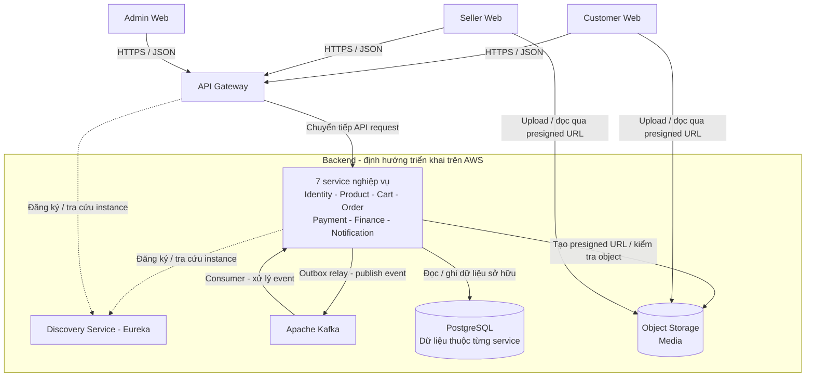

Trong sơ đồ, đường liền biểu diễn luồng API, sự kiện hoặc dữ liệu; đường nét đứt biểu diễn đăng ký và tra cứu service. Khối PostgreSQL gom các kho dữ liệu để sơ đồ dễ đọc, không có nghĩa mọi service được đọc/ghi chung các bảng. Tương tự, kết nối Kafka và object storage biểu diễn khả năng tích hợp của nhóm service, không có nghĩa mọi service đều phát event hoặc quản lý media.

### 3.1.1. C4 Level 2 - Container Diagram

Sơ đồ dưới đây chi tiết các container trong hệ thống: ứng dụng frontend, Gateway, từng service nghiệp vụ, Discovery, Kafka và các kho dữ liệu. Trong mô hình C4, **container** là ứng dụng hoặc kho dữ liệu có trách nhiệm riêng, không nhất thiết tương ứng với một Docker container hay một máy chủ.

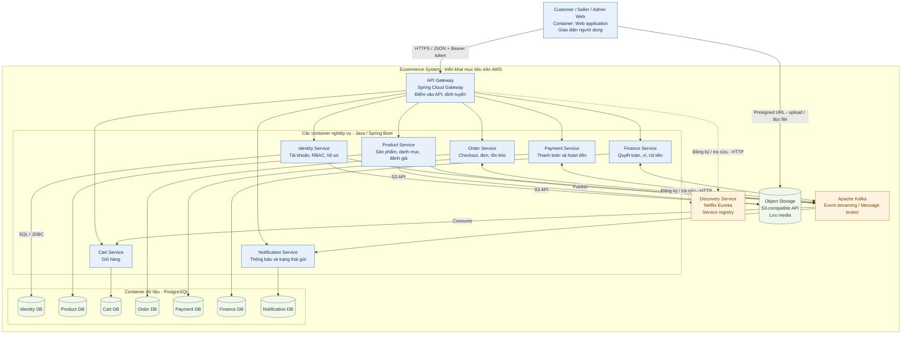

**Cách đọc các kết nối:**

- Gateway chuyển tiếp request tới service bằng HTTP/JSON trên mạng nội bộ; các đường Gateway–service trong sơ đồ dùng chung giao thức này.
- Các service gọi API nội bộ bằng OpenFeign theo thiết kế; danh sách kết nối cụ thể nằm ở mục 3.5 để tránh chồng nhiều đường trong sơ đồ tổng thể. Ví dụ: Cart → Product lấy sản phẩm, Payment → Order xác minh checkout, service bảo vệ → Identity kiểm tra quyền.
- Mũi tên `Publish` đi từ producer tới Kafka, `Consume` đi từ Kafka tới consumer. Một mũi tên hai chiều biểu diễn hai vai trò publish/consume, không phải request/response đồng bộ. Producer ghi Outbox trong database của mình; consumer ghi Inbox cùng tác động nghiệp vụ trong database của mình.
- Đường nét đứt từ nhóm nghiệp vụ tới Discovery biểu diễn việc các service đăng ký/tra cứu instance; không phải request nghiệp vụ đi qua Eureka.
- Các kết nối service–database sử dụng SQL qua JDBC; nhãn giao thức được ghi trên kết nối Identity làm đại diện để giảm số nhãn chồng nhau. Mỗi service chỉ kết nối trực tiếp với database do mình sở hữu. Gateway, Discovery và Kafka không sử dụng các database nghiệp vụ này để truy vấn chéo.
- Identity và Product quản lý media qua S3 API; frontend upload/đọc trực tiếp bằng presigned URL. SeaweedFS đang phục vụ dev; lựa chọn object storage trên AWS được chốt trong phần triển khai.

## 3.2. Các lớp thành phần

| Lớp | Thành phần | Vai trò |
|---|---|---|
| Client | Customer Web, Seller Web, Admin Web | Cung cấp giao diện cho từng nhóm người dùng và gọi API. Việc tách giao diện không thay thế phân quyền backend. |
| Truy cập API | Gateway | Cung cấp điểm vào chung, định tuyến và áp dụng chính sách tại biên. |
| Nghiệp vụ | 7 service nghiệp vụ | Kiểm tra quyền, thực hiện quy tắc nghiệp vụ và cập nhật dữ liệu sở hữu. |
| Tích hợp | OpenFeign, Kafka, Outbox/Inbox | Gọi API đồng bộ và truyền event bất đồng bộ giữa các service. OpenFeign là thư viện bên trong service, không phải một server riêng. |
| Dữ liệu | PostgreSQL, object storage | Lưu dữ liệu quan hệ và nội dung media. |
| Hỗ trợ vận hành | Discovery, health endpoint, log | Hỗ trợ tìm instance và theo dõi tình trạng ứng dụng. |

Gateway và Discovery không quản lý trạng thái đơn hàng, thanh toán hoặc dữ liệu ví. Các quyết định nghiệp vụ được thực hiện tại service chịu trách nhiệm.

## 3.3. Phân chia trách nhiệm và dữ liệu

| Service | Trách nhiệm chính | Dữ liệu sở hữu | Tích hợp tiêu biểu |
|---|---|---|---|
| Identity | Đăng ký, xác thực, phiên đăng nhập, RBAC, hồ sơ Customer/Seller, địa chỉ và xét duyệt Seller. | User, Customer, Seller, CustomerAddress, Role, Permission, UserRole, RolePermission; dữ liệu phiên và audit của Identity. | Cung cấp authorization context; hỏi Order về đơn đã thanh toán khi cấm Customer; phát event vòng đời tài khoản và Seller. |
| Product | Danh mục, sản phẩm, tìm kiếm và đánh giá; xử lý API media thuộc sản phẩm. | Category, Product, Review. | Kiểm tra Seller qua Identity; lấy và cập nhật tồn kho qua Order; kiểm tra điều kiện đánh giá từ Order. |
| Cart | Thêm, sửa, xóa và cung cấp nội dung giỏ hàng. | Cart, CartItem. | Lấy sản phẩm từ Product, tồn khả dụng từ Order; nhận `checkout.paid` để cập nhật các mục đã mua. |
| Order | Checkout nhiều cửa hàng, tách đơn, giữ tồn, chuyển trạng thái đơn và xử lý các mốc hết hạn. | CheckoutSession, Order, OrderItem, Inventory, Reservation, StockMovement. | Lấy thông tin từ Identity, Product và Finance; nhận kết quả từ Payment; phát event đơn hàng và checkout. |
| Payment | Thanh toán và hoàn tiền qua bộ giả lập; theo dõi kết quả và các trường hợp cần kiểm tra lại. | Payment, Refund. | Kiểm tra checkout tại Order; phát `payment.succeeded`, `payment.failed`, `refund.succeeded`; nhận yêu cầu hoàn từ event hủy đơn phù hợp. |
| Finance | Quyết toán, số dư ví, bút toán và rút tiền giả lập. | Settlement, Wallet, WalletTransaction, Withdrawal. | Nhận event Seller, checkout, đơn hàng và hoàn tiền; cung cấp tỷ lệ hoa hồng cho Order; phát thông báo tiền khả dụng và rút tiền. |
| Notification | Tạo thông báo, quản lý trạng thái đọc/xóa và xử lý gửi theo kênh. | Notification và dữ liệu phục vụ chống gửi trùng. | Nhận event nghiệp vụ hoặc API nội bộ theo contract; lấy thông tin liên hệ từ Identity khi cần. |

Các bảng Outbox/Inbox được triển khai tại service có nhu cầu phát/nhận event. Việc một service nhận bản sao dữ liệu từ event không làm thay đổi quyền sở hữu dữ liệu gốc.

Một số ranh giới cần giữ rõ:

- **Product và Order:** Product sở hữu thông tin mô tả, giá và danh mục; Order sở hữu tồn thực, tồn giữ và reservation. Product không tự ghi bảng Inventory.
- **Cart và Order:** giỏ hàng là lựa chọn mua sắm có thể thay đổi; Order lưu dữ liệu và snapshot của giao dịch. Thay đổi giỏ hoặc sản phẩm sau checkout không được sửa ngược đơn đã tạo.
- **Payment và Finance:** Payment xác định kết quả thu/hoàn tiền; Finance ghi nhận tác động lên quyết toán và ví. Payment không trực tiếp sửa số dư Wallet.
- **Identity và các service còn lại:** Identity cung cấp danh tính, quyền và trạng thái hồ sơ; service sở hữu tài nguyên vẫn phải kiểm tra quyền sở hữu và điều kiện thao tác.
- **Notification và nghiệp vụ nguồn:** thông báo phản ánh kết quả xử lý; không được dùng thông báo làm căn cứ xác định đơn đã thanh toán hoặc ví đã được ghi có.

MVP không tách Search, Inventory, Seller hoặc Reporting thành service triển khai riêng. Search nằm trong Product, Inventory nằm trong Order, hồ sơ Seller nằm trong Identity; Reporting đang tạm hoãn.

## 3.4. Vai trò của Gateway và Discovery

### 3.4.1. API Gateway

Gateway là điểm vào API của frontend, giúp client không cần biết địa chỉ của từng service. Gateway chuyển tiếp public path đến service phù hợp, chẳng hạn `/api/v1/identity/**` đến Identity, `/api/v1/cart/**` đến Cart và `/api/v1/orders/**` đến Order. Các path Product như `/api/v1/products/**` và `/api/v1/categories/**` không cần mang tên service trong URL.

Theo thiết kế, Gateway kiểm tra JWT cho API yêu cầu xác thực, loại bỏ header danh tính không đáng tin từ client, chuyển tiếp Bearer token và request ID, đồng thời áp dụng CORS và rate limit. API công khai được cấu hình theo danh sách cho phép; API `/internal/v1/**` không được công khai qua Gateway.

Service đích vẫn xác minh token và kiểm tra quyền hiện hành. Gateway không thay thế kiểm tra permission, ownership và trạng thái nghiệp vụ tại service. Lời gọi nội bộ đi trực tiếp đến service đích, không vòng lại public Gateway, và phải có xác thực service gọi.

### 3.4.2. Discovery Service

Discovery sử dụng Eureka để lưu thông tin các instance đã đăng ký. Gateway và service có thể tra cứu instance theo tên thay vì gắn địa chỉ máy cụ thể trong logic nghiệp vụ. Discovery hỗ trợ tìm địa chỉ; API request vẫn được gửi trực tiếp từ bên gọi đến instance đích, không truyền qua Eureka.

Tích hợp Eureka với OpenFeign và cơ chế chọn instance phải được cấu hình, kiểm thử riêng. Discovery không tự triển khai thêm container, không thay thế health check và không tự bảo đảm high availability. Các base URL cố định đang dùng trong dev cần được đối chiếu khi hoàn thiện cơ chế discovery.

## 3.5. Giao tiếp đồng bộ qua API

Các bước cần kết quả ngay sử dụng HTTP/JSON. Theo lựa chọn công nghệ, client liên service được khai báo bằng OpenFeign; public API dùng prefix `/api/v1`, internal API dùng `/internal/v1` theo đặc tả.

| Bên gọi | Bên cung cấp | Mục đích |
|---|---|---|
| Gateway và service bảo vệ | Identity | Kiểm tra phiên, quyền và trạng thái hiện hành. |
| Cart, Order | Product | Lấy thông tin sản phẩm phục vụ hiển thị hoặc checkout. |
| Product, Cart | Order | Lấy tồn kho; Product chuyển tiếp các thao tác quản lý tồn theo quyền. |
| Order | Identity | Kiểm tra điều kiện checkout, Seller và lấy snapshot địa chỉ. |
| Order | Finance | Lấy tỷ lệ hoa hồng để snapshot khi tạo đơn. |
| Payment | Order | Xác minh chủ checkout, số tiền và điều kiện thanh toán. |
| Identity | Order | Kiểm tra khách có đơn đã thanh toán khi áp dụng chính sách cấm. |
| Notification | Identity | Lấy thông tin liên hệ phục vụ gửi thông báo. |

Ví dụ sau minh họa một request đã có token, cần xác thực và kiểm tra quyền:

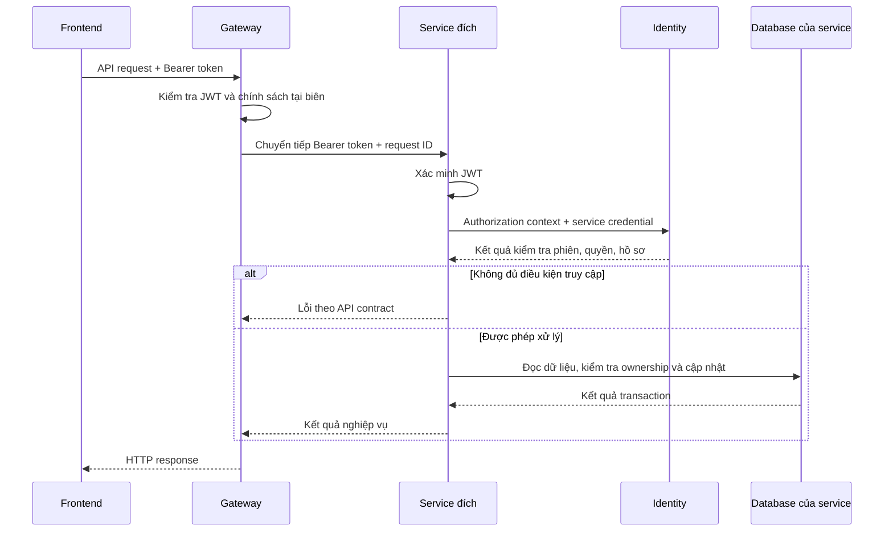

Sơ đồ lược bỏ bước lấy JWKS và các kiểm tra bổ sung tại Gateway. Nếu Identity không sẵn sàng, service không được bỏ qua kiểm tra quyền; trả lỗi theo contract. Mỗi lời gọi nội bộ cần timeout, ánh xạ lỗi và chính sách retry phù hợp. Các phụ thuộc hai chiều, chẳng hạn Identity và Order, chỉ được sử dụng cho từng use case xác định, tránh tạo chuỗi gọi đệ quy.

## 3.6. Giao tiếp bất đồng bộ qua Kafka

Kafka được sử dụng để truyền kết quả nghiệp vụ đến các service cần xử lý tiếp. Producer không phải gọi lần lượt mọi consumer. Ví dụ, `checkout.paid` do Order phát có thể được Cart, Finance và Notification xử lý theo trách nhiệm riêng.

| Event tiêu biểu | Producer | Consumer | Mục đích |
|---|---|---|---|
| `payment.succeeded`, `payment.failed` | Payment | Order | Áp dụng kết quả thanh toán vào checkout và các đơn liên quan. |
| `checkout.paid` | Order | Cart, Finance, Notification | Cập nhật giỏ đã mua, ghi nhận khoản chờ quyết toán và tạo thông báo. |
| `order.cancelled` | Order | Payment, Finance, Notification | Xử lý hoàn tiền khi cần và cập nhật nghiệp vụ liên quan. |
| `order.confirmed` | Order | Finance, Notification | Thực hiện quyết toán và thông báo. |
| `refund.succeeded` | Payment | Finance, Order, Notification | Ghi nhận hoàn tiền thành công và đồng bộ trạng thái. |
| `seller.approved` | Identity | Finance, Notification | Khởi tạo ví theo nghiệp vụ và thông báo kết quả duyệt. |
| `withdrawal.completed` | Finance | Notification | Thông báo kết quả rút tiền giả lập. |

Tên trên là **event type**, không mặc định mỗi event tương ứng một Kafka topic. Việc chia topic, partition, key và consumer group sẽ được xác định trong hợp đồng tích hợp. Danh sách đầy đủ tham chiếu [API — mục 7.2](api.md).

Luồng phát và nhận event được thiết kế như sau:

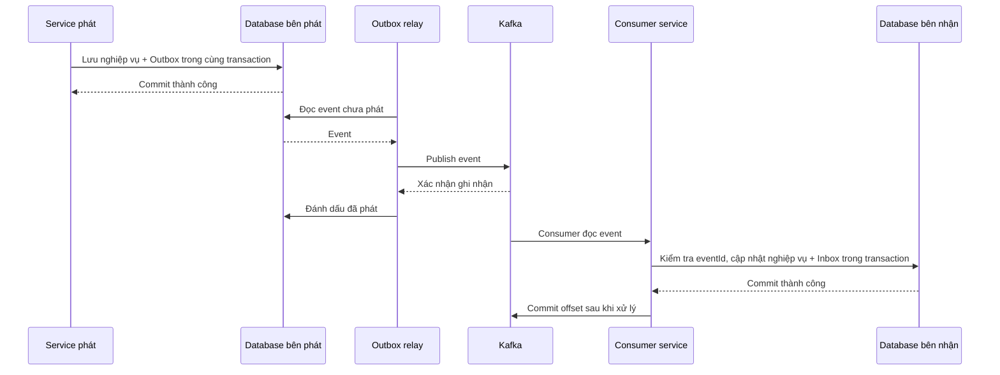

Relay có thể phát lại nếu đã gửi Kafka nhưng chưa đánh dấu Outbox. Consumer cũng có thể nhận lại nếu đã commit database nhưng chưa commit offset. Do đó, bên nhận cần chống xử lý trùng theo `eventId` và kiểm tra trạng thái/version trước khi cập nhật. Event còn thiếu dữ liệu phụ thuộc phải được giữ để thử lại, không đánh dấu xử lý thành công khi nghiệp vụ chưa được áp dụng.

Đối với Notification, luồng event là cách tích hợp chính trong sơ đồ. API tạo thông báo nội bộ vẫn tồn tại theo contract khi cần; producer chỉ chọn một đường phát cho một sự kiện, còn bên nhận dùng cùng cơ chế deduplication để tránh thông báo trùng.

## 3.7. Tổ chức dữ liệu và media

**Quyền sở hữu dữ liệu:** service chỉ đọc/ghi trực tiếp vào dữ liệu mình quản lý. Khi cần thông tin của miền khác, service sử dụng API hoặc bản sao được cập nhật từ event. Không join bảng liên service để xử lý nghiệp vụ. Mục tiêu tách database theo service và cách bố trí instance PostgreSQL cụ thể được làm rõ ở phần kiến trúc dữ liệu và triển khai.

**Object storage:** database lưu `objectKey` và metadata cần thiết; nội dung ảnh/video nằm trong object storage. Frontend xin presigned URL từ service phụ trách, upload trực tiếp và gửi lại `objectKey`. Service kiểm tra quyền sở hữu cùng điều kiện file trước khi gắn vào tài nguyên. Identity phụ trách media hồ sơ Seller; Product phụ trách media sản phẩm.

Trong môi trường dev hiện tại, các service được cấu hình cùng database `ecommerce`; Identity dùng schema `identity`. SeaweedFS cung cấp API tương thích S3. Trên AWS, việc giữ SeaweedFS hay chuyển sang Amazon S3 chưa được chốt; việc đã chọn AWS không tự thay đổi backend lưu trữ hiện có.

## 3.8. C4 Level 3 - Component Diagram

C4 Level 3 phân rã **bên trong một service/container** thành các component có trách nhiệm rõ ràng. Component có thể gồm nhiều class phối hợp, không nhất thiết là một class, một microservice mới hoặc một container Docker. Các service bên ngoài, Kafka, database và object storage được đặt ngoài khung service đang phân tích.

Các sơ đồ dùng Mermaid flowchart để thể hiện nội dung Component Diagram. Mũi tên trong service biểu diễn lời gọi hoặc phụ thuộc; mũi tên nối Kafka biểu diễn publish/consume; đường tới database biểu diễn truy cập dữ liệu. Đây không phải sequence diagram và không mô tả thứ tự đầy đủ của mỗi request.

**Trạng thái thiết kế:** Identity được đối chiếu với package/class hiện có, có ghi riêng những phần tích hợp chưa hoàn thành. Product, Cart, Order, Payment, Finance, Notification và các chính sách Gateway là **component đề xuất**, chưa phải xác nhận đã có implementation. Discovery chủ yếu sử dụng component của Eureka, không phải các class nghiệp vụ tự viết. Tên component đề xuất mô tả vai trò, không bắt buộc đặt tên class giống hệt sơ đồ.

Với các service nghiệp vụ ngoài Identity, lớp API bao gồm validation và kiểm tra quyền; authorization context lấy từ Identity qua internal API. Repository chỉ truy cập database của chính service. Các chi tiết dùng chung như serialization, logging, health endpoint và exception handler được lược khỏi sơ đồ để tập trung vào nghiệp vụ.

### 3.8.1. Identity Service

Identity chia thành các nhóm xác thực/phiên, hồ sơ, quản trị, phân quyền và tích hợp. Sơ đồ gom các class có trách nhiệm gần nhau thành component, giữ lại tên class chính để đối chiếu mã nguồn.

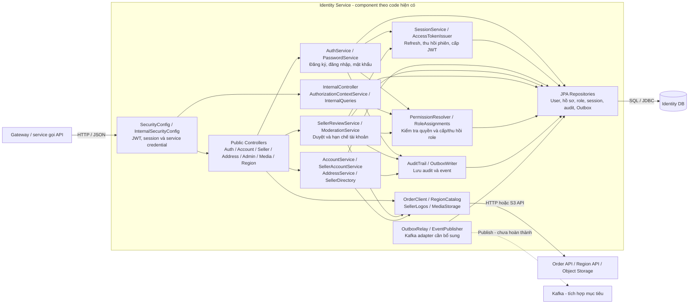

- `SessionService` quản lý refresh token và thu hồi phiên; `AccessTokenIssuer` cấp access token. Việc công bố khóa công khai do `JwksController` đảm nhiệm, không thể hiện riêng trong sơ đồ.
- `PermissionResolver` đọc quyền hiệu lực; `RoleAssignments` quản lý thay đổi role. `AuthorizationContextService` kết hợp token, phiên, quyền và hồ sơ để trả ngữ cảnh cho service gọi.
- `SellerReviewService` và `ModerationService` cập nhật nghiệp vụ, audit và Outbox theo transaction của từng thao tác. Không phải mọi cập nhật hồ sơ đều phát event; sơ đồ thể hiện khả năng phụ thuộc của nhóm component.
- `OrderClient` hiện được thực hiện bằng `HttpOrderClient` dùng RestClient; chuyển sang OpenFeign là thiết kế đã chọn nhưng chưa sửa code. Region và S3 sử dụng adapter riêng theo giao thức tương ứng.
- `OutboxRelay` đã có; `EventPublisher` hiện là `UnconfiguredEventPublisher`, chưa phát Kafka. Region API, Order API và object storage được gom thành một khối bên ngoài để giản lược các đường kết nối.

### 3.8.2. Product Service

Thiết kế đề xuất tách quản lý sản phẩm/danh mục, tìm kiếm, đánh giá và media. Tồn kho vẫn thuộc Order; Product chỉ gọi API, không tự ghi Inventory.

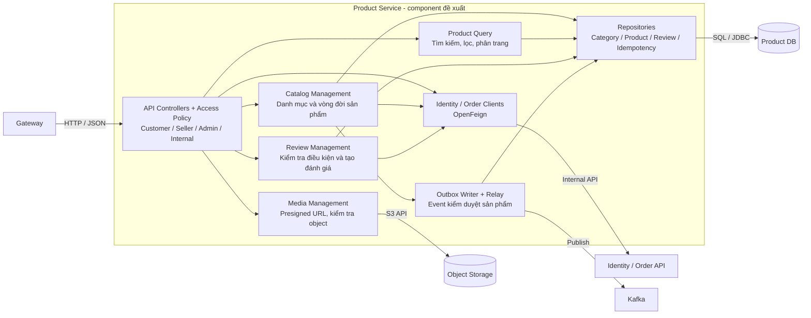

Catalog Management phối hợp Order để tạo tồn ban đầu và giữ `productId` ổn định khi retry. Review Management hỏi Order về điều kiện đánh giá. Search dùng truy vấn database của Product trong MVP; không có search engine hoặc Search Service riêng. Việc kiểm tra Seller hiện hành và bổ sung tồn khả dụng được thực hiện khi use case cần, không mặc định một kết quả tìm kiếm là cam kết giữ hàng.

### 3.8.3. Cart Service

Cart quản lý giỏ hiện tại và phản ứng với `checkout.paid`. Không cần tạo một workflow thanh toán hoặc tồn kho riêng trong Cart.

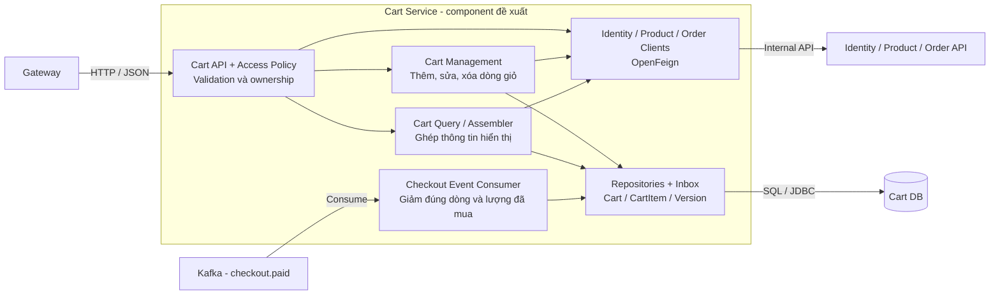

Checkout Event Consumer sử dụng snapshot của checkout và trạng thái/version dòng giỏ để không trừ nhầm dòng khách đã xóa rồi tạo lại. Ghi nhận Inbox cùng cập nhật giỏ trong một transaction. Event từ `BUY_NOW` không làm thay đổi giỏ.

### 3.8.4. Order Service

Order giữ các component checkout, đơn hàng và inventory trong cùng service để có thể cập nhật nguyên tử khi tạo checkout hoặc áp dụng kết quả thanh toán.

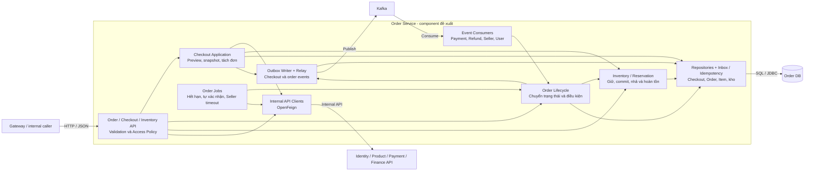

Checkout Application điều phối local transaction tạo checkout, đơn và reservation. Order Lifecycle áp dụng kết quả thanh toán hoặc thao tác chuyển trạng thái; Inventory bảo vệ lượng tồn và chống tác động lặp. Các component này dùng chung database Order, không phải ba service độc lập. Consumer và job phải gọi cùng quy tắc trạng thái với API, tránh tạo đường cập nhật bỏ qua bất biến. Những lời gọi mạng cần thiết được thực hiện ngoài các đoạn giữ khóa kéo dài theo transaction boundary đã mô tả ở Phần 4.

### 3.8.5. Payment Service

Payment tách thao tác yêu cầu thanh toán/hoàn tiền, lưu kết quả và adapter bộ giả lập. Interface `PaymentGateway` là cổng tích hợp logic bên trong Payment, không phải API Gateway của hệ thống.

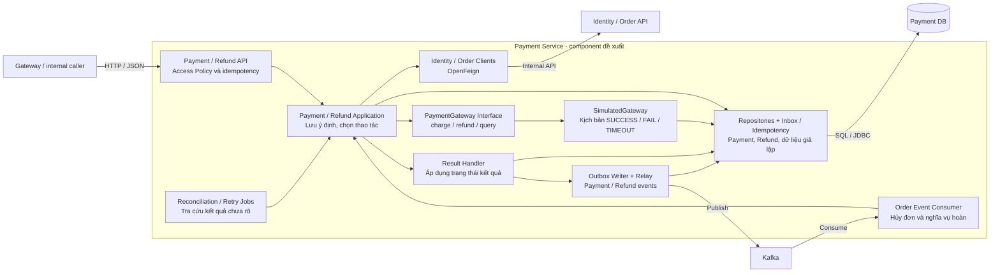

Application lưu ý định và khóa chống lặp trước khi gọi `PaymentGateway`; Result Handler cập nhật kết quả cùng Outbox trong transaction riêng. Simulator nằm trong cùng service, không phải nhà cung cấp bên ngoài; dữ liệu kết quả đến trễ được lưu theo giai đoạn giả lập. Khi timeout, job tra cứu trước khi retry. Không dùng một transaction bao trùm việc gọi adapter và cập nhật các service khác, cũng không triển khai callback public cho bộ giả lập theo contract hiện hành.

### 3.8.6. Finance Service

Finance tập trung logic tiền vào các component quyết toán, ví và rút tiền. Mọi component có thể tác động số dư phải sử dụng cùng quy tắc ghi bút toán.

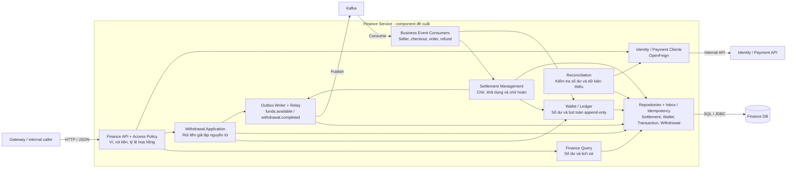

Settlement Management quyết định khoản tiền ở trạng thái nào; Wallet/Ledger thực hiện cập nhật số dư và bút toán tương ứng trong cùng transaction do application điều phối. Withdrawal không gọi cổng chi trả bên ngoài trong MVP. Consumer phải ghi Inbox cùng tác động nghiệp vụ; nếu thiếu ví hoặc Settlement thì giữ để xử lý tiếp, không đánh dấu thành công hoặc tự tạo bút toán sai thứ tự. Reconciliation phát hiện và hỗ trợ xử lý sai lệch, không tự sửa số dư khi chưa có căn cứ.

### 3.8.7. Notification Service

Notification dùng chung luồng tạo thông báo cho event và internal API. Việc ghi nhận thông báo được tách khỏi gửi email để một lỗi gửi không làm mất thông báo hoặc rollback nghiệp vụ nguồn.

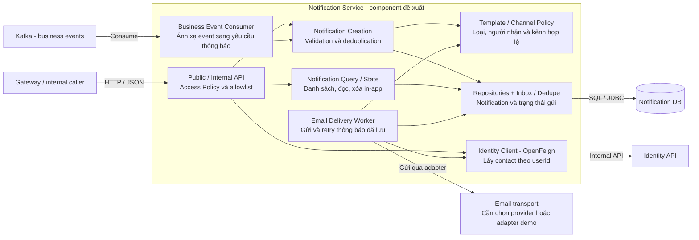

Notification Creation commit thông báo và dấu chống lặp trước khi worker gửi email. Query/State chỉ quản lý thông báo của chính người dùng; xóa in-app không xóa bản ghi chống lặp hoặc hủy email tương ứng. Email transport là phụ thuộc chưa chọn, không được hiểu là đã tích hợp Amazon SES. Nếu gửi thành công nhưng mất xác nhận, retry vẫn có nguy cơ gửi email lặp tùy khả năng của transport; Inbox không tự bảo đảm một email chỉ được nhận đúng một lần.

### 3.8.8. Gateway Service

Sơ đồ Gateway mô tả các vai trò cần cấu hình bằng Spring Cloud Gateway/Spring Security và filter khi cần. Đây là phân rã trách nhiệm mục tiêu, không khẳng định đã có các class tương ứng trong module.

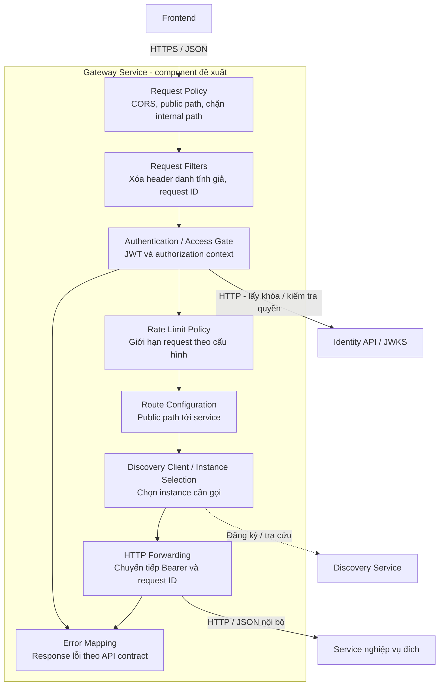

Các mũi tên thể hiện sự phối hợp logic, không ấn định thứ tự filter thực tế của framework. Public endpoint không bắt buộc qua kiểm tra JWT; request phải được phân loại theo route/policy. Gateway không lưu dữ liệu nghiệp vụ, không gọi Kafka và không thay kiểm tra quyền/ownership của service đích. Backend lưu trạng thái rate limit khi chạy nhiều instance chưa được chọn trong sơ đồ.

### 3.8.9. Discovery Service

Discovery dùng `@EnableEurekaServer`; các component dưới đây thuộc chức năng Eureka được bật trong Spring Boot. Không cần xây thêm controller, repository hoặc database nghiệp vụ để quản lý đăng ký service.

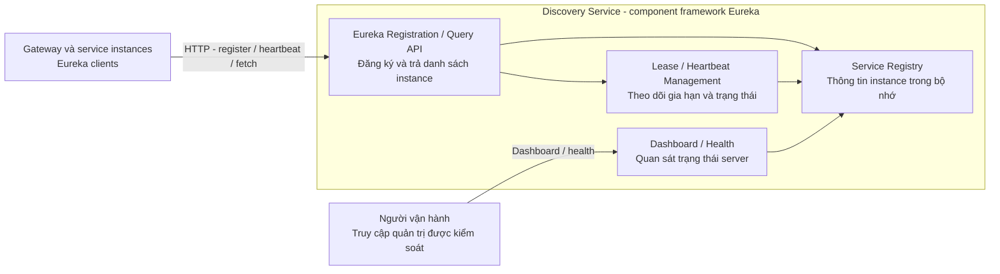

Registry phục vụ tìm instance, không nhận request mua hàng để chuyển tiếp. Việc lease hết hạn hoặc thông tin registry thay đổi không bảo đảm client đã cập nhật ngay; bên gọi vẫn phải xử lý lỗi kết nối. Cấu hình peer replication hoặc nhiều Discovery instance chưa được thể hiện vì chưa chốt topology high availability. Dashboard và registry API cần được giới hạn truy cập khi triển khai Cloud.

### 3.8.10. Nguyên tắc triển khai từ Component Diagram

- Controller kiểm tra dữ liệu đầu vào và chuyển sang application component; quy tắc nghiệp vụ không được viết lại riêng cho API, consumer và job.
- Application component điều phối local transaction; repository và Outbox/Inbox tham gia cùng transaction khi bảo vệ một thay đổi nghiệp vụ.
- API client, Kafka adapter, S3 adapter và email adapter là các điểm tích hợp. Không giữ transaction hoặc khóa database qua một chuỗi gọi mạng dài.
- Các ô trong sơ đồ là trách nhiệm logic, không phải yêu cầu tạo một interface/class cho mỗi ô. Khi triển khai, giữ cấu trúc đơn giản và chỉ tách khi trách nhiệm cần được quản lý riêng.
- Tên component đề xuất không phải bằng chứng implementation. Cần kiểm thử các luồng API, event lặp, job chạy đồng thời và lỗi phụ thuộc trước khi xác nhận đáp ứng kiến trúc.

# 4. Kiến trúc dữ liệu và tính nhất quán

## 4.1. Nguyên tắc tổ chức dữ liệu

Dữ liệu được tổ chức theo nguyên tắc **data ownership**: mỗi nhóm dữ liệu có một service chịu trách nhiệm quản lý và là nguồn thông tin chính thức — **source of truth**. Service khác truy cập qua API hoặc nhận dữ liệu từ event, không đọc/ghi trực tiếp vào bảng của nhau.

| Service | Dữ liệu nghiệp vụ chính thức |
|---|---|
| Identity | Danh tính, hồ sơ Customer/Seller, địa chỉ, vai trò, quyền và phiên đăng nhập. |
| Product | Danh mục, thông tin sản phẩm, giá niêm yết và đánh giá. |
| Cart | Giỏ hàng và các dòng sản phẩm được chọn mua. |
| Order | Checkout, đơn hàng, snapshot giao dịch, tồn kho và giữ hàng. |
| Payment | Giao dịch thanh toán, hoàn tiền và kết quả bộ giả lập. |
| Finance | Quyết toán, số dư ví, bút toán và giao dịch rút tiền. |
| Notification | Thông báo, trạng thái đọc/xóa và trạng thái gửi. |

Ví dụ, Finance nhận thông tin đơn đã thanh toán để tạo Settlement, nhưng Order vẫn là nguồn chính thức về trạng thái đơn. Notification nhận kết quả rút tiền để tạo biên nhận, nhưng không quyết định giao dịch rút đã thành công hay chưa.

- Trong cùng database, sử dụng primary key, foreign key, unique constraint và check constraint để bảo vệ dữ liệu.
- Giữa các service, lưu ID tham chiếu như `customerId`, `sellerId`, `productId`, `paymentId`; không tạo foreign key xuyên database.
- Service kiểm tra điều kiện sử dụng dữ liệu qua API hoặc event theo từng use case. Kiểm tra tồn tại một lần không bảo đảm trạng thái bên ngoài sẽ không thay đổi sau đó.
- Không dùng truy vấn join xuyên service để tạo transaction nghiệp vụ. Dữ liệu tổng hợp được lấy qua API hoặc read model nếu triển khai về sau.

## 4.2. Mô hình dữ liệu tổng quan

Sơ đồ sau tập trung vào các quan hệ phục vụ mua hàng và dòng tiền, không liệt kê toàn bộ bảng hoặc field:

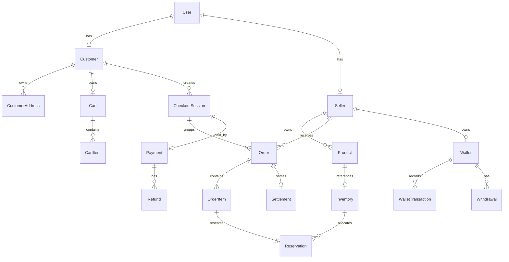

Các quan hệ liên service trong sơ đồ là quan hệ nghiệp vụ, không phải tất cả đều là foreign key vật lý. Ví dụ, `CheckoutSession` thuộc Order còn `Payment` thuộc Payment; `Order` thuộc Order còn `Settlement` thuộc Finance. Quan hệ ví của Seller là mô hình mục tiêu sau khi xử lý sự kiện duyệt, nên có thể chưa tồn tại tại một thời điểm.

Các ràng buộc chính gồm:

- Một checkout tạo một hoặc nhiều Order, mỗi Seller có tối đa một Order trong checkout.
- Một checkout có tối đa một Payment; một Payment có thể có nhiều Refund theo quy tắc hoàn tiền.
- Mỗi Order có tối đa một Settlement. Finance cũng có ví nền tảng, không thể hiện trong sơ đồ rút gọn.
- Mỗi OrderItem có một Reservation khi checkout được tạo thành công.
- Customer và Seller dùng ID chung với User; quan hệ hồ sơ không tự cấp vai trò hoặc quyền.

Chi tiết Category, Review, RBAC, Notification và các field được dẫn chiếu trong [thiết kế dữ liệu](database.md).

## 4.3. Snapshot và quy ước lưu trữ

### 4.3.1. Snapshot giao dịch

Đơn hàng cần phản ánh thông tin tại thời điểm mua. Vì vậy, Order lưu **snapshot** — bản chụp dữ liệu phục vụ giao dịch — thay vì luôn lấy giá trị mới nhất từ service khác.

| Dữ liệu snapshot | Mục đích |
|---|---|
| Tên sản phẩm, ảnh bìa, đơn giá, số lượng và thành tiền | Giữ lịch sử mua hàng đúng khi Product đổi tên, media hoặc giá. |
| Người nhận, số điện thoại, mã/tên địa giới và địa chỉ chi tiết | Giữ thông tin giao hàng khi khách sửa hoặc xóa địa chỉ gốc. |
| Tỷ lệ hoa hồng theo Order | Finance tính khoản quyết toán theo tỷ lệ đã chốt, không áp dụng ngược tỷ lệ mới. |
| Dòng giỏ, số lượng và version tại checkout | Cart chỉ giảm phần đã mua trên đúng dòng sau thanh toán, tránh tác động vào dòng khách tạo lại sau đó. |

Snapshot được tạo từ dữ liệu đã kiểm tra tại checkout và không sửa theo thay đổi danh mục về sau. Tuy nhiên, snapshot không thay thế kiểm tra quyền hoặc điều kiện thanh toán hiện hành. Luồng `BUY_NOW` không đọc hoặc cập nhật giỏ hàng.

### 4.3.2. Kiểu dữ liệu và media

- Định danh nghiệp vụ sử dụng UUID theo hợp đồng API và dữ liệu.
- Tiền được lưu bằng số nguyên VND, không dùng số thực; tỷ lệ hoa hồng dùng số nguyên basis points (`bps`). Tổng tiền phải được tính và kiểm tra tại backend.
- Các mốc thời gian được quản lý theo UTC; API trả định dạng ISO 8601, frontend chuyển sang múi giờ hiển thị.
- Enum được kiểm soát bằng tập giá trị hợp lệ; chuyển trạng thái phải đi qua logic nghiệp vụ.
- PostgreSQL lưu `objectKey` và metadata media; file nằm trong object storage. Không lưu presigned URL có thời hạn như định danh bền vững của file.

## 4.4. Transaction và cập nhật đồng thời

### 4.4.1. Transaction trong từng service

**Local transaction** bảo đảm các thay đổi liên quan trong cùng database thành công toàn bộ hoặc rollback toàn bộ. Những phạm vi quan trọng gồm:

| Service | Các thay đổi phải nguyên tử |
|---|---|
| Identity | Duyệt Seller, cấp vai trò, tăng `authzVersion`, ghi audit và Outbox. |
| Order | Tạo CheckoutSession, các Order/OrderItem và Reservation, cập nhật lượng giữ cùng Outbox cần thiết. |
| Order | Áp dụng thanh toán hợp lệ: cập nhật checkout và các đơn, commit Reservation, ghi biến động kho và event trong cùng transaction. |
| Payment | Lưu kết quả thanh toán/hoàn tiền và event tương ứng; không gộp transaction này với database Order hoặc Finance. |
| Finance | Chuyển trạng thái Settlement, cập nhật số dư và ghi WalletTransaction cùng Outbox cần thiết. |
| Finance | Rút tiền: kiểm tra số dư, trừ khả dụng, tăng tổng đã rút, tạo Withdrawal và bút toán. |

Các bước lấy thông tin bên ngoài phải có timeout; tránh giữ khóa database trong thời gian gọi mạng kéo dài. Đặc biệt, việc gọi bộ giả lập thanh toán phải tách khỏi transaction cập nhật kết quả, có ý định giao dịch được lưu bền vững và khóa chống lặp ổn định.

### 4.4.2. Kiểm soát thao tác đồng thời

Chỉ đọc giá trị rồi ghi lại là chưa đủ khi có nhiều request cùng thao tác. Thiết kế kết hợp các cơ chế sau:

- **Optimistic locking:** client gửi `version` khi cập nhật tài nguyên theo contract. Nếu version cũ, trả `409 VERSION_CONFLICT` thay vì ghi đè dữ liệu mới hơn.
- **Conditional update:** chỉ chuyển trạng thái hoặc trừ số dư nếu trạng thái/số dư hiện tại thỏa điều kiện. Kết quả cập nhật phải được kiểm tra trước khi tiếp tục.
- **Row locking:** dùng khi cần phối hợp nhiều thay đổi trên cùng đối tượng, chẳng hạn chuyển trạng thái đơn; các đường xử lý liên quan phải dùng cách khóa nhất quán.
- **Database constraints:** unique constraint và check constraint là lớp bảo vệ khi nhiều request cùng vượt qua kiểm tra tại ứng dụng.

Ví dụ, hai yêu cầu cùng rút toàn bộ số dư không được cùng thành công: cập nhật có điều kiện `available >= amount` và việc ghi giao dịch nằm trong cùng transaction. Tương tự, chuyển đơn sang `CONFIRMED` và `CANCELLED` phải kiểm tra trạng thái hiện tại để chỉ một chuyển đổi hợp lệ được áp dụng.

## 4.5. Tính nhất quán của tồn kho

Order là nơi duy nhất cập nhật Inventory. Tồn khả dụng được xác định bằng:

```text
availableQuantity = onHandQuantity - reservedQuantity
onHandQuantity >= reservedQuantity >= 0
```

| Tình huống | Cập nhật cần thực hiện |
|---|---|
| Checkout giữ q sản phẩm | Chỉ thực hiện khi còn đủ khả dụng; tăng lượng giữ thêm q, Reservation ở `HELD`. |
| Thanh toán thành công hợp lệ | Giảm tồn thực và lượng giữ cùng q; chuyển Reservation sang `COMMITTED`, ghi `SOLD` đúng một lần. |
| Checkout hết hạn, thất bại hoặc hủy trước thanh toán | Giảm lượng giữ q, chuyển Reservation từ `HELD` sang `RELEASED`; tồn thực không đổi. |
| Hủy hợp lệ một đơn đã thanh toán | Hoàn tồn thực của chính đơn đó một lần và ghi `RESTOCK`; không thay đổi đơn của Seller khác. |

Nếu một sản phẩm không đủ tồn khi tạo checkout, transaction phải rollback toàn bộ các đơn và reservation của checkout. Việc Product hoặc Cart vừa hiển thị còn hàng không bảo đảm checkout sẽ thành công; Order kiểm tra và giữ tồn tại thời điểm xử lý.

Reservation và StockMovement phải có khóa hoặc ràng buộc nghiệp vụ chống áp dụng lại. Job hết hạn và event thanh toán cũng kiểm tra cùng trạng thái checkout, tránh một bên nhả tồn trong khi bên kia commit tồn. Kết quả thanh toán đến sau khi checkout đã đóng không được mở lại phiên; xử lý theo nhánh hoàn toàn bộ checkout trong đặc tả.

## 4.6. Tính nhất quán của thanh toán và ví

Các bất biến tiền phải được kiểm tra trong phạm vi dữ liệu sở hữu và đối chiếu giữa các service:

```text
CheckoutSession.totalAmountVnd = tổng Order.totalAmountVnd
Payment.amountVnd = CheckoutSession.totalAmountVnd
Order.totalAmountVnd = tổng OrderItem.lineTotalVnd
Settlement.grossAmountVnd = commissionAmountVnd + sellerAmountVnd
```

Finance xử lý dòng tiền theo các bước:

1. Khi nhận `checkout.paid` hợp lệ, tạo Settlement và ghi khoản chờ quyết toán.
2. Khi Order được xác nhận nhận hàng, chuyển khoản tương ứng từ chờ sang khả dụng và ghi bút toán quyết toán.
3. Khi đơn đã trả tiền bị hủy, chuyển Settlement sang chờ hoàn; **chưa trừ số dư chờ chỉ vì đơn bị hủy**.
4. Chỉ sau `refund.succeeded`, ghi bút toán trừ khoản chờ tương ứng. Không trừ lại số dư khả dụng hoặc tổng đã rút để hoàn đơn trong phạm vi MVP.
5. Rút tiền chỉ sử dụng khoản khả dụng và hoàn tất trong local transaction của Finance.

Các số dư không được âm. Với ví Seller trong phạm vi MVP:

```text
pendingBalanceVnd = tổng sellerAmountVnd của Settlement PENDING và PENDING_REFUND
availableBalanceVnd + totalWithdrawnVnd = tổng sellerAmountVnd của Settlement SETTLED
totalWithdrawnVnd = tổng Withdrawal.amountVnd
```

WalletTransaction là dữ liệu **append-only**: chỉ thêm bút toán, không sửa/xóa để che sai lệch. Mọi thay đổi số dư phải có bút toán cùng transaction và `businessEventKey` duy nhất. Tổng nghĩa vụ hoàn, kể cả khoản thất bại còn chờ retry, không vượt số đã thu; hoàn toàn bộ checkout và hoàn từng Order phải loại trừ chồng lặp.

## 4.7. Nhất quán giữa các service

Trong từng service, transaction bảo vệ dữ liệu cục bộ. Giữa các service, áp dụng **eventual consistency**: các bản ghi liên quan có thể cập nhật ở thời điểm khác nhau, nhưng phải hội tụ qua xử lý event, retry và đối soát.

Ví dụ, Payment đã ghi nhận thành công nhưng Order chưa đọc được event thì checkout có thể còn hiển thị chờ cập nhật. Điều đó không có nghĩa được phép tạo thêm khoản thu. API và giao diện phải phân biệt trạng thái đang xử lý với thất bại xác định.

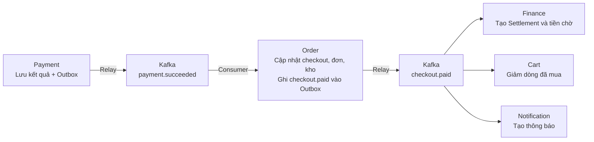

Hai khối Kafka trong sơ đồ biểu diễn hai chặng event trong cùng hạ tầng Kafka, không phải hai cluster. Mỗi khối xử lý nghiệp vụ có local transaction riêng; không có commit chung xuyên sơ đồ. Nhánh thanh toán thất bại hoặc thành công muộn được xử lý theo trạng thái, không áp dụng trực tiếp nhánh thành công trên.

### 4.7.1. Outbox, Inbox và idempotency

- Producer lưu thay đổi nghiệp vụ và Outbox cùng transaction; relay chỉ đánh dấu đã phát sau khi Kafka xác nhận.
- Consumer lưu tác động nghiệp vụ và dấu xử lý Inbox cùng transaction. Khóa duy nhất theo `(eventId, consumerName)` chặn áp dụng event lần hai.
- API cần chống gửi lặp sử dụng IdempotencyRecord theo actor, ngữ cảnh, endpoint và key. Cùng key và payload trả lại kết quả cũ; khác payload trả lỗi `409` theo contract. Luôn kiểm tra quyền trước khi trả kết quả đã lưu.
- Chống lặp bằng `eventId` chưa đủ nếu hai event khác ID cùng mô tả một thao tác. Cần thêm unique constraint hoặc cập nhật có điều kiện theo khóa nghiệp vụ, như Payment theo checkout, Settlement theo Order, StockMovement và WalletTransaction theo business event.

### 4.7.2. Event sai thứ tự và thiếu dữ liệu phụ thuộc

Không giả định event ở mọi topic hoặc mọi đối tượng đến theo đúng thứ tự nghiệp vụ. Ví dụ, Finance có thể nhận `order.confirmed` trước khi tạo được Settlement từ `checkout.paid`, hoặc nhận checkout trước khi ví Seller được khởi tạo.

Trong trường hợp đó, consumer giữ trạng thái chờ phụ thuộc để retry; chưa đánh dấu nghiệp vụ đã hoàn tất và không tạo số dư âm. Consumer kiểm tra trạng thái, version theo đúng đối tượng và dữ liệu đã áp dụng. Không bỏ qua mọi event có version thấp hơn chỉ vì đã thấy version lớn hơn: có event vẫn chứa tác động tiền/kho bắt buộc chưa được ghi nhận. Version không phải bộ đếm chung cho toàn hệ thống.

### 4.7.3. Retry, xử lý bù và đối soát

Retry phải giữ nguyên khóa chống lặp. Với kết quả thanh toán/hoàn tiền chưa rõ do timeout, Payment cần tra cứu bộ giả lập trước khi quyết định gửi lại. Không rollback database của một service để coi như đã hoàn tác giao dịch ở service khác.

Các bước bù là thao tác nghiệp vụ riêng: nhả reservation khi checkout đóng, tạo Refund khi cần hoàn, hoặc tiếp tục xử lý event còn thiếu. Job đối soát so sánh dữ liệu với service sở hữu và bút toán để phát hiện lệch. Nếu chưa đủ căn cứ tự sửa, giữ trạng thái cần xử lý và chuyển quản trị viên; không suy đoán từ nội dung thông báo.

## 4.8. Vòng đời dữ liệu và thay đổi cấu trúc

- **Lịch sử giao dịch:** không xóa vật lý dữ liệu đang được giao dịch tham chiếu nếu làm mất khả năng truy vết; snapshot bảo vệ thông tin lịch sử trước thay đổi dữ liệu gốc.
- **Địa chỉ:** theo thiết kế dữ liệu hiện hành, CustomerAddress có thể xóa vật lý vì đơn lưu snapshot. Cần đối chiếu triển khai Identity, hiện còn phân biệt địa chỉ đã dùng và chưa dùng, trước khi khẳng định đã đồng bộ quy tắc này.
- **Dữ liệu kỹ thuật:** Outbox, Inbox và IdempotencyRecord chỉ được dọn sau khi xác định thời hạn retry/replay tương ứng. Dọn dấu chống lặp quá sớm có thể làm event cũ tạo lại tác động; không ấn định thời hạn khi chưa chốt retention và hợp đồng.
- **Dữ liệu nhạy cảm:** chỉ lưu thông tin cần thiết; không ghi token, mật khẩu hoặc presigned URL nhạy cảm vào log. Event chứa reset URL cần chính sách bảo vệ và lưu giữ riêng.
- **Thay đổi schema:** dùng SQL có phiên bản và kiểm tra tương thích giữa phiên bản ứng dụng đang chạy với cấu trúc mới. Ưu tiên thêm cấu trúc, chuyển dữ liệu, cập nhật bên dùng rồi mới bỏ phần cũ khi đã xác nhận an toàn.
- **Backup/restore:** database và object storage cần chính sách riêng. Khôi phục từng service phải xét trạng thái event và dữ liệu đã được service khác áp dụng; replay không thay thế backup và không tự giải quyết mọi dữ liệu lệch sau phục hồi.


