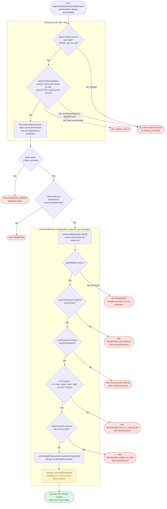

# identity-service — change password flow

How `PUT /api/v1/identity/users/me/password` changes the caller's password: `AccountController.changePassword` → `PasswordService.change` (`src/main/java/com/example/identity_service/auth/PasswordService.java`). Spec: API §6.1 "Đổi mật khẩu", UC-A04.

Request body: `{ currentPassword, newPassword, confirmPassword }`. Success is `204 No Content`, and the client must log in again because every session of the user, including the current one, is revoked.

## Outcomes

| Situation | Response | Side effect |
|---|---|---|
| Missing, invalid or expired access token | 401 `UNAUTHENTICATED` / `TOKEN_EXPIRED` | None |
| Token issued before a role or status change | 401 `TOKEN_STALE` | None; the client refreshes and retries |
| Blank field | 400 `VALIDATION_ERROR` | None |
| Google account | 403 `FORBIDDEN` | None |
| Wrong current password | 400 `PASSWORD_INCORRECT` | None; the session stays valid |
| `confirmPassword` differs | 400 `VALIDATION_ERROR` (`confirmPassword`) | None |
| New password fails G-07 | 400 `PASSWORD_POLICY_VIOLATION` | None |
| New password equals the current one | 400 `PASSWORD_SAME_AS_OLD` | None |
| Everything valid | 204 | Password hash replaced; every session of the user revoked, so all its access and refresh tokens stop working |

## Notes

- The user is always the token's `sub` (`Caller.of(jwt)`); the body has no user id, so a caller can only change their own password.
- Body validation runs before `@PreAuthorize`: Spring MVC resolves and validates the arguments, then calls the method-security proxy. Every ACTIVE user has `account:update:own` through the baseline policy, so the permission check only fails for unusual states.
- Checks inside the service run in the order drawn. The first failure throws `ApiException`, the transaction rolls back, and nothing changes.
- Changing the password does not bump `authzVersion`: revoking the sessions is what invalidates the old tokens, because `SessionTokenValidator` rejects any token whose session is revoked.
- Tests: `auth/PasswordEndpointsTests.java` (`changePasswordEndsEverySessionIncludingTheCurrentOne`, `changePasswordReportsEachProblemAndKeepsTheSession`, `googleAccountCannotChangePassword`, `changePasswordNeedsAnAccessToken`).
