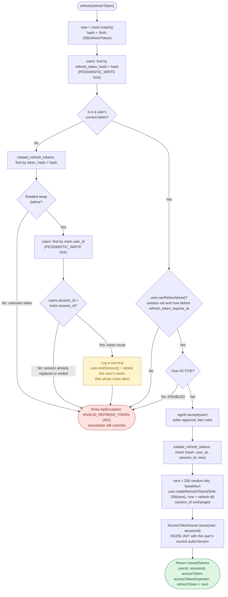

# identity-service — `SessionService.refresh` flow

How `SessionService.refresh(refreshToken)` (`src/main/java/com/example/identity_service/service/SessionService.java`) exchanges a refresh token for a new token pair. Spec: API §3.2 and §6.1 `POST /identity/auth/refresh`, [decision 0003](../docs/decisions/0003-mot-phien-refresh-tren-user.md) (one session per User, on `users`), DB §6 `RotatedRefreshToken`.

The whole method runs in one transaction with `noRollbackFor = ApiException.class`, so ending a session on token reuse is committed even though the call then fails with `INVALID_REFRESH_TOKEN`.

## Outcomes

| Situation | Result | Side effect |
|---|---|---|
| Current token, session not expired, user ACTIVE | New `IssuedTokens` | Old hash saved in `rotated_refresh_tokens`; `users` gets the new hash and `refresh_token_expires_at` = now + TTL; `session_id` kept |
| Unknown token | `INVALID_REFRESH_TOKEN` | None |
| Rotated token of the current session (reuse) | `INVALID_REFRESH_TOKEN` | Session ended (three `users` fields null), so the newest refresh token and every access token of that session stop working |
| Token of a session replaced by a newer login | `INVALID_REFRESH_TOKEN` | None: it cannot end the new session |
| Current token, but expired | `INVALID_REFRESH_TOKEN` | None |
| Current token, but user DISABLED | `INVALID_REFRESH_TOKEN` | None (disabling the user ends its session separately) |

## Notes

- Only hashes are stored or looked up; the raw refresh token never touches the database.
- Login (`start`) locks the user row, sets a new `session_id` and deletes the marks of older sessions; the previous session's access tokens fail the validator (`users.session_id` no longer matches) on their next request.
- The lock on the user row serializes two refreshes with the same token. The second one no longer finds the token as current, finds its mark for the current session, and ends the session: a client racing itself must log in again (decision 0003, no grace period).
- Tests: `service/SessionServiceTests.java` (rotation, expiry move, reuse, replaced session, logout with a rotated token, expired, disabled, unknown, current `authzVersion`), `controller/AuthEndpointsTests.java` (a new login replaces the previous session).
