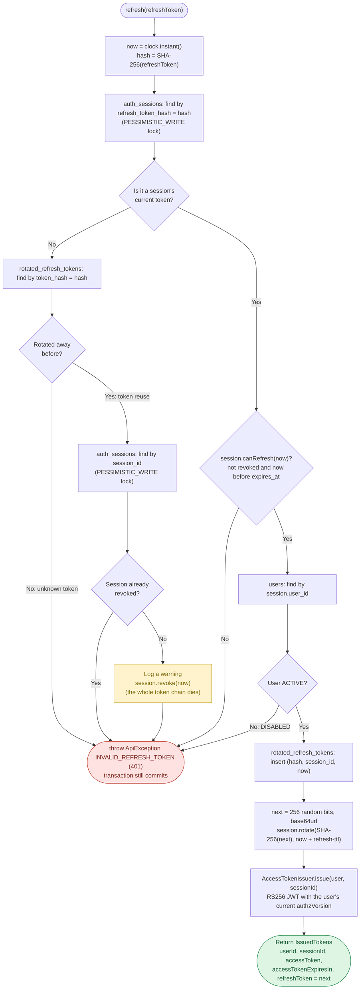

# identity-service — `SessionService.refresh` flow

How `SessionService.refresh(refreshToken)` (`src/main/java/com/example/identity_service/session/SessionService.java`) exchanges a refresh token for a new token pair. Spec: API §3.2 and §6.1 `POST /identity/auth/refresh`, DB §6 `AuthSession`.

The whole method runs in one transaction with `noRollbackFor = ApiException.class`, so revoking a session on token reuse is committed even though the call then fails with `INVALID_REFRESH_TOKEN`.

## Outcomes

| Situation | Result | Side effect |
|---|---|---|
| Current token, session active, user ACTIVE | New `IssuedTokens` | Old hash saved in `rotated_refresh_tokens`; session gets the new hash and a new `expires_at` (sliding) |
| Unknown token | `INVALID_REFRESH_TOKEN` | None |
| Rotated token presented again (reuse) | `INVALID_REFRESH_TOKEN` | Session revoked, so the newest refresh token and every access token of that session stop working |
| Current token, but session revoked or expired | `INVALID_REFRESH_TOKEN` | None |
| Current token, but user DISABLED | `INVALID_REFRESH_TOKEN` | None (disabling the user revokes its sessions separately) |

## Notes

- Only hashes are stored or looked up; the raw refresh token never touches the database.
- The lock on the session row serializes two refreshes with the same token. The second one no longer finds the token as current, finds it in `rotated_refresh_tokens`, and revokes the session: a client racing itself must log in again (strict on purpose, see `identity-service.md`).
- Roles and permissions are not in the token. The new access token carries the user's `authzVersion` read from the database at refresh time, and the step 3 refresh endpoint builds the profile from the current roles.
- Tests: `session/SessionServiceTests.java` (rotation, reuse, expired, revoked, disabled, unknown, current `authzVersion`).
